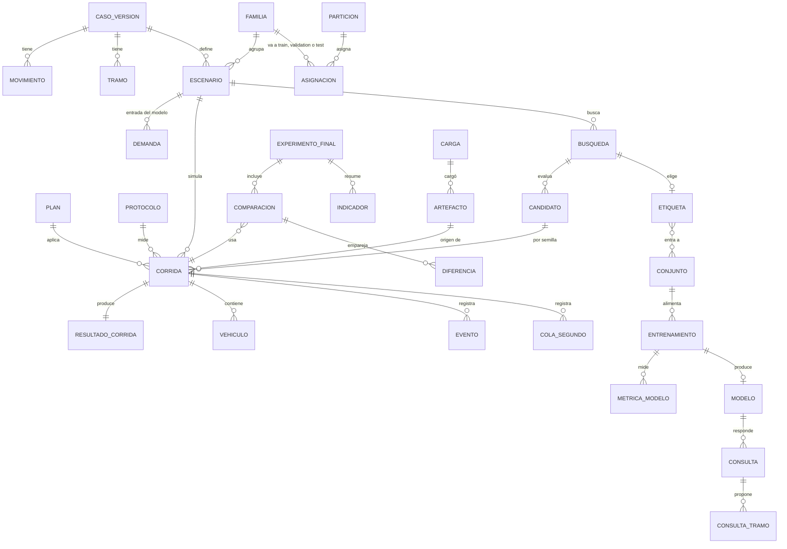

Escrito para: el Product Owner (aprobación del diseño), el asesor (qué evidencia respaldará la tesis y cómo se protege) y el equipo técnico (lo que se construye de F1 a F8).

# DEV31 F0: planificación y diseño de la base de datos y de los cambios de arquitectura

- **Fecha:** 2026-11-05
- **Tarea:** DEV31 (historia propuesta HU15). Plan vigente: sección 12 de `docs/actas/2026-11-05-plan-base-de-datos.md`.
- **Estado:** **propuesto, para aprobación del PO.** Esta fase no cambia `documentacion/`, el código ni `datos/`. Solo se leyeron la tesis v2.5, los documentos 01 a 03, los contratos (`schemas/`), el código y los artefactos publicados.
- **Modelo:** Opus. Complejidad media-alta, riesgo medio.
- **Qué entrega:** (1) qué evidencia tendrá que mostrar la tesis al jurado; (2) los cambios de arquitectura; (3) el diseño de la base; (4) el panel; (5) la lista exacta de cambios por documento para F1 y F2; (6) los hallazgos y las decisiones que se piden al PO.

## 1. Resumen

1. El jurado no solo pregunta **qué números salieron**. También pregunta **cómo se sabe que el procedimiento fue honesto**: que la prueba final no se miró antes de tiempo, que todas las alternativas se compararon en las mismas condiciones, que no se borraron los casos malos y que nada se cambió después. Por eso la base guarda tres tipos de datos: **entradas**, **resultados** y **evidencia del procedimiento**.
2. Los archivos con huella siguen siendo el respaldo físico; la base es el consolidado. **Ningún proceso de cálculo lee la base**: búsqueda, entrenamiento y evaluación siguen trabajando con archivos, así que no cambia nada de lo ya probado.
3. **PostgreSQL 17**, una base `semaforo` guardada en D:, cuatro usuarios con permisos distintos y una regla que la propia base aplica: **las filas de prueba quedan ocultas hasta que se registre su apertura**.
4. **Unas 40 tablas** en seis zonas: control, caso, experimento, simulación, aprendizaje y evaluación final.
5. **Las métricas se calculan una sola vez, con el código oficial del proyecto (DEV19)**, y se publican como archivo con huella. La base las copia; nunca las recalcula a su manera.
6. **Cada tabla y figura de resultados de la tesis sale de una consulta guardada en el repositorio.** Así se puede seguir cualquier número hasta el archivo original.
7. **El panel** es HTML estático, generado desde la base con el usuario de solo lectura.
8. **Cambios de documentación:** se piden en los documentos 01 a 03, las matrices, el validador, los ADR y unos 12 pasajes de la tesis (v2.6 borrador).

## 2. Qué tendrá que mostrar la tesis al jurado

### 2.1 Lo que la tesis promete

La tesis v2.5 fija el objetivo general, cuatro objetivos específicos (OE1 a OE4) y ocho indicadores (Tabla 2, I1 a I8). Además distingue **tres resultados posibles**, y advierte que alcanzar uno no demuestra los otros (párrafo «2.2.7 Síntesis crítica»):

- un modelo que **reproduce las etiquetas** (error pequeño frente al mejor plan encontrado);
- un modelo que entrega **planes factibles** (que respetan las reglas del cruce);
- un modelo cuyos planes tienen **utilidad vehicular y computacional** (menos demora, colas y detenciones, y menos tiempo de cálculo que la búsqueda).

La tesis también dice que el resultado puede ser **desfavorable**, y que en ese caso se informa igual. La base debe permitir mostrar un resultado malo con el mismo detalle que uno bueno.

### 2.2 De cada indicador a la evidencia y a la base

| Indicador (Tabla 2 de la tesis) | Evidencia que se presentará | Preguntas típicas del jurado | De dónde sale en la base |
|---|---|---|---|
| **I1 Calidad de datos** (OE1) | Error de conteo por movimiento, periodo y clase; cobertura; origen y revisión manual | «¿Cómo validó los aforos del video?» «¿Qué periodos faltan?» | `aforos`, `aforos_control`, `calidad_aforos` (DEV22) |
| **I2 Correspondencia de la simulación** (OE2) | Diferencias observado–simulado en volúmenes y colas o recorridos, con datos separados de ajuste y comprobación | «¿Se parece SUMO a Javier Prado?» «¿Usó los mismos datos para calibrar y para validar?» | `calibracion_intentos`, `calibracion_contraste` (DEV23) |
| **I3 Conjunto de entrenamiento** (OE3) | Escenarios y etiquetas con origen, restricciones, presupuesto, semillas, versión de SUMO y partición | «¿Cuántos ejemplos?» «¿Cómo sabe que no entrenó con la prueba?» «¿Por qué este plan es la etiqueta?» | `escenarios`, `demanda`, `particiones`, `busquedas`, `candidatos`, `etiquetas` |
| **I4 Factibilidad y cobertura** (OE4) | Planes factibles antes y después de la corrección; solicitudes resueltas; motivos de rechazo | «¿Propuso planes imposibles?» «¿Cuántas veces no respondió?» | `consultas`, `consulta_tramos`, `consulta_reglas` |
| **I5 Precisión de tiempos** (OE4) | Error absoluto medio del ciclo y de cada verde frente a la referencia, y su distribución; comparación con la mediana | «¿Cuánto se equivoca en segundos?» «¿XGBoost es mejor que la mediana?» | `metricas_modelo`, `errores_por_escenario` |
| **I6 Desempeño vehicular** (OE4) | Diferencias de demora, colas y detenciones frente a cada referencia, global y por acceso, con intervalos de confianza | «¿Cuánto bajó la demora?» «¿A qué acceso perjudica?» «¿Con qué incertidumbre?» | `comparaciones`, `diferencias`, `indicadores` |
| **I7 Tiempo de cálculo** (OE4) | Tiempo de estimación y verificación, tiempo de búsqueda, costo inicial de etiquetas y entrenamiento | «¿Cuánto más rápido es que buscar con SUMO?» | `costos` (de corridas, búsquedas, entrenamientos y consultas) |
| **I8 Reproducibilidad** (OE2 a OE4) | Versiones, semillas, parámetros y bitácora; repetición idéntica dentro de la tolerancia | «Si lo corro yo, ¿me da lo mismo?» «¿Cómo sabe que no cambió los datos?» | `artefactos`, `entornos`, `replicas`, `hitos` y la huella de la base |

### 2.3 La evidencia del procedimiento

Estas son las preguntas que pueden tumbar una tesis aunque los números sean buenos. Por eso cada una tiene su lugar en la base.

| Lo que hay que demostrar | Cómo lo demuestra la base |
|---|---|
| **La prueba final no se usó para entrenar ni para elegir** (ADR07; Cawley y Talbot, citado en la tesis) | Tabla `hitos` con fecha, huella y acta: protocolo congelado → partición congelada → modelo congelado → **apertura de la prueba**. La base rechaza registrar una apertura si antes no hay un modelo congelado. Hasta la apertura, el usuario de lectura no ve ninguna fila de prueba |
| **Las alternativas se compararon en las mismas condiciones** | Cada comparación guarda la huella de la demanda materializada, las rutas, la red y la semilla de cada alternativa. Una consulta guardada comprueba que coinciden |
| **Las semillas de búsqueda, de finalistas y finales no se mezclan** | Las semillas se registran con su etapa; una regla de la base rechaza una semilla final usada en la búsqueda |
| **No se borraron los casos malos** (viajes sin terminar, no insertados, rechazos, Webster no aplicable) | Nada se borra. Cada indicador guarda sus denominadores, y los rechazos y fallos tienen filas propias |
| **Sintético no se presenta como de campo** | Cada fila lleva `origen_evidencia` (campo o sintético), calculado con la regla única del proyecto (auditoría A03) |
| **Los datos no cambiaron después** | Cada fila apunta a su archivo y a su huella. La base se puede regenerar y da la misma huella de contenido. Las huellas de lo publicado se guardan en git, con fecha externa al subirse a GitHub |
| **Las reglas se fijaron antes de mirar los resultados** | Los protocolos tienen fecha de congelamiento y huella; cada corrida dice con qué versión del protocolo se midió |

### 2.4 El recorrido de un número, como se mostraría al jurado

Supongamos que una figura de la tesis dice: «en la familia ALTA, el modelo redujo la demora 12,3 s por vehículo frente al plan vigente (IC 95 %: 8,1 a 16,4)». Con la base, ese número se sigue así:

1. La figura sale de la consulta guardada `resultados/i6_demora_por_familia.sql`, que está en el repositorio con su commit.
2. La consulta lee `indicadores`, que guarda el valor, el intervalo, el número de escenarios y de semillas, y la versión del cálculo.
3. `indicadores` remite a sus filas de `diferencias`: la diferencia emparejada por escenario y semilla.
4. Cada diferencia remite a dos filas de `comparaciones` (modelo y plan vigente) y, por ellas, a dos `corridas`.
5. Cada corrida tiene sus `vehiculos` (las 1 780 filas de ese viaje simulado) y sus `eventos` (choques y teletransportes).
6. Cada fila remite a su `artefacto`, con la ruta del archivo y su huella SHA-256. Si se vuelve a calcular la huella y coincide, el dato no cambió.

## 3. Situación actual

| Dato | Estado hoy |
|---|---|
| Corridas de SUMO | 133 en `datos/ejecuciones/` (2,95 GB; 22,2 MB de media; 92 % es FCD) |
| Búsquedas y etiquetas | 1 (piloto de DEV14, `no_reference`). `traza.json` enlaza cada candidato con sus corridas y semillas |
| Comparadores | 1 publicación (ESC-SINT-001) |
| Protocolos | 3 borradores (`datos/derivados/protocolos/caso-001/`) |
| Escenarios | ESC-SINT-001 (`datos/escenarios/caso-001/`) |
| Particiones | Código listo (DEV12), **ninguna publicada en `datos/`** |
| Modelos, consultas y evaluación final | Aún no existen (DEV16 a DEV26) |
| Métricas por corrida (demora, cola, detenciones) | **Se calculan al vuelo** (`evaluate_run`, DEV19) y no se guardan como archivo propio. Solo quedan las medias por semilla dentro de `traza.json` |
| Cola por acceso segundo a segundo | **No existe como dato.** El código la recorre para sacar la media y el máximo, pero no la guarda |
| Versión del código de cada corrida | **No se registra** (el manifiesto guarda SUMO, Python y el sistema operativo) |
| El caso | 23 movimientos, 4 tipos de vehículo (auto, moto, bus, camión), 9 tramos (t1, t3, t5 y t7 variables), 7 accesos medidos, ciclo de 120 a 240 s |

## 4. Cambios de arquitectura

### 4.1 Qué se agrega

```
Procesos actuales (sin cambios)                 Nuevo (DEV31)
─────────────────────────────────               ──────────────────────────────────────────
simulación, búsqueda, entrenamiento,            semaforo bd cargar
consulta, evaluación                             ├─ verifica huellas de cada carpeta
        │                                        ├─ copia a PostgreSQL (todo o nada)
        ▼                                        └─ registra la carga y los rechazos
  datos/  (archivos con huella)  ─────────────►  PostgreSQL «semaforo» (en D:)
  = respaldo físico                                        │
                                                           ▼
                                                 semaforo panel generar
                                                 (usuario de solo lectura)
                                                           │
                                                           ▼
                                                 datos/reportes/panel/<fecha>/  (HTML estático)
```

| Componente | Qué hace | Dónde |
|---|---|---|
| Paquete `bd` | Esquema (migraciones SQL numeradas), conexión, cargadores por tipo de artefacto, conciliación, exportación y huella del contenido | `src/semaforo/bd/` |
| Consultas guardadas | Una consulta SQL por tabla o figura de la tesis y del panel | `src/semaforo/bd/consultas/` |
| Panel | Genera las páginas HTML con las funciones de escape que ya usan los reportes (`app/html_page.py`) | `src/semaforo/app/panel_*.py` |
| Métricas publicadas | Archivo `metricas.json` por corrida, calculado con `evaluate_run`, incluida la serie de cola | `datos/derivados/metricas/<caso>/<run_id>/` (solo lectura, con manifiesto) |
| Comandos nuevos | `bd iniciar`, `bd cargar`, `bd verificar`, `bd exportar`, `bd hito`, `panel generar` | `src/semaforo/cli/` |

### 4.2 Reglas de dependencia

1. **La base depende del proyecto, nunca al revés.** `bd` lee artefactos con las funciones de lectura y verificación existentes (`trazabilidad/`, `dominio/`, `referencias/`). Ningún módulo de cálculo importa `bd`.
2. **El cargador no calcula métricas propias.** Copia las publicadas por el código oficial; si una corrida no tiene métricas publicadas, las pide a `evaluate_run`. Así hay una sola definición de demora, cola y detención en todo el proyecto.
3. **Si la base falla, no se pierde nada.** Los archivos ya están publicados; se corrige y se vuelve a cargar.

### 4.3 Despliegue y seguridad

| Tema | Diseño |
|---|---|
| Servicio | PostgreSQL 17.9 (`postgresql-x64-17`), el que ya está instalado. Se registra la versión exacta en cada carga |
| Ubicación | Espacio de tablas en `D:\pgdata\semaforo` (los datos del servicio están en C:, con 131 GB libres) |
| Conexión | Solo dentro de la laptop (`listen_addresses = 'localhost'`). La red del PO es cerrada, pero la laptop sale a otras redes |
| Usuarios | `semaforo_admin` (dueño; crea el esquema y registra hitos), `semaforo_carga` (solo agrega filas), `semaforo_lectura` (panel y consultas; no ve la prueba hasta la apertura), `postgres` (administrador del servicio, solo el PO) |
| Contraseñas | En el archivo estándar `%APPDATA%\postgresql\pgpass.conf` del usuario de Windows, con los datos de conexión en `pg_service.conf`. El código pide el servicio por nombre, y nada de esto va al repositorio público |
| Controlador | psycopg 3, con la versión exacta fijada en `uv.lock` tras una prueba de instalación |
| Pruebas | Base temporal `semaforo_pruebas_<n>`, que se crea y se borra en cada ejecución. Sin PostgreSQL, la puerta **falla**, no se salta |
| Respaldo | `pg_dump` en formato propio a `D:\respaldos\semaforo\<fecha>.dump`, con su huella; restauración probada (QA36) |
| Amenazas nuevas | Alterar filas (lo impiden los permisos y la regla de no modificar); espiar la prueba (lo impide la seguridad por filas); filtrar contraseñas (fuera del repositorio, QA34); inyectar texto en el panel (escape, QA30 y QA34) |

**Límite honesto:** el administrador siempre puede saltarse los permisos dentro de su propia laptop, igual que hoy puede abrir los archivos. ADR07 ya lo acepta («aunque el investigador tenga acceso local»). Lo que protege la tesis es que **cualquier cambio deja rastro**: la base regenerada desde los archivos no daría la misma huella, y las huellas están en git.

## 5. Diseño de la base

### 5.1 Decisiones de diseño

| # | Decisión | Motivo |
|---|---|---|
| B1 | **Los archivos son la fuente; la base se regenera desde ellos** | Si alguien duda, se borra y se regenera, y da la misma huella de contenido (QA36) |
| B2 | **Solo se agregan filas.** La base rechaza modificar o borrar la evidencia; una corrección es una fila nueva que dice a cuál reemplaza | Nada se pierde y todo cambio queda a la vista |
| B3 | **Cada fila de evidencia lleva** el artefacto de origen (con su huella), la carga, la zona (desarrollo o prueba) y el origen de la evidencia (campo o sintético) | Trazabilidad fila por fila (sección 2.4) |
| B4 | **Cegado con seguridad por filas** (*row level security* de PostgreSQL): cada fila tiene `zona`, y el usuario de lectura solo ve `prueba` si existe el hito de apertura | Una sola tabla por tema, sin copias, y la regla la aplica la base, no el código del panel |
| B5 | **La zona se decide al cargar**, por la partición congelada del escenario y por la etapa de la semilla. Una corrida con semilla final, o de un escenario de prueba, es `prueba`. Una etiqueta del experimento principal sin partición congelada **no se carga** | Evita que un dato de prueba quede visible por error |
| B6 | **Unidades en el nombre de la columna** (`_s`, `_vph`, `_m`, `_veh`, `_mps`), como en el código | Sin ambigüedad para el jurado |
| B7 | **Cero no es faltante.** Un valor no disponible es NULL y lleva una columna de motivo. Ejemplo: la demora media es NULL si la cohorte no terminó, y se guarda la cota inferior | Regla del proyecto (QA05 y QA26) |
| B8 | **Todo lleva `caso_id`.** Nada nombra a Frutales | Herramienta para cualquier cruce de Lima |
| B9 | **Claves naturales únicas** (`run_id`, `label_id`, `model_id`, etc.). Cargar dos veces el mismo artefacto no duplica. La misma clave con otra huella se rechaza y queda registrada como conflicto | Cargas repetibles y sin sorpresas |
| B10 | **Las métricas se copian, no se recalculan** (sección 4.2). Se guarda la versión del cálculo | Una sola definición de cada métrica |
| B11 | **Fuera de la base:** el FCD crudo (se enlaza), los videos, los logs completos de SUMO (se enlazan; sus avisos se cargan como eventos) | Volumen y privacidad (RNF10) |
| B12 | **Las consultas del panel y de la tesis usan siempre vistas**, nunca las tablas directamente | Se puede cambiar cómo se guarda algo sin tocar las consultas |

### 5.2 Las zonas de la base (esquemas)

| Esquema | Qué contiene | Quién escribe |
|---|---|---|
| `control` | Cargas, artefactos y huellas, entornos, hitos del procedimiento, conflictos y versión del esquema | Carga (hitos: admin) |
| `caso` | El cruce: versiones, movimientos, tipos de vehículo, tramos, grupos de verde, plan observado, aforos y calibración | Carga |
| `experimento` | Familias, escenarios, demanda, particiones y protocolos | Carga |
| `simulacion` | Planes, corridas, resultados, vehículos, eventos, cola; búsquedas, candidatos, etiquetas y comparadores | Carga |
| `aprendizaje` | Conjuntos, entrenamientos, curva de aprendizaje, métricas, modelos, selección y consultas | Carga |
| `evaluacion` | Experimentos finales, comparaciones, diferencias, indicadores e intervalos | Carga |
| `vistas` | Vistas para el panel y las consultas guardadas | Admin (solo lectura para los demás) |

### 5.3 Modelo conceptual



Todas las tablas de evidencia tienen además la relación con `ARTEFACTO` y `CARGA`; el diagrama la muestra solo para `CORRIDA`.

### 5.4 Catálogo de tablas

Las columnas que se indican son las principales. F3 fija cada columna con su tipo, unidad, regla y significado (diccionario de datos). «Filas DEV16» es una estimación para las 4 692 corridas de DEV16.

**`control` (evidencia del procedimiento)**

| Tabla | Columnas principales | Origen | Filas DEV16 |
|---|---|---|---|
| `cargas` | id, inicio, fin, versión del cargador, commit, versión de PostgreSQL, resultado, filas por tabla | El propio cargador | Decenas |
| `artefactos` | id, ruta relativa, tipo, tamaño, sha256, manifiesto de origen, estado (íntegro, alterado, desconocido) | Manifiestos | ~60 000 |
| `entornos` | id, SUMO, Python, sistema operativo, commit (o «no registrado»), librerías | Manifiestos | Pocas |
| `hitos` | tipo (protocolo congelado, partición congelada, modelo congelado, apertura de prueba, réplica), fecha, huella, acta, responsable | Comando `bd hito`, con acta | Decenas |
| `conflictos` | clave, huella cargada, huella nueva, fecha, decisión | Cargador | 0 si todo está bien |
| `replicas` | corrida original, réplica, iguales o diferentes, tolerancia | `replica.json` (DEV14 A06) | Pocas |

**`caso`**

| Tabla | Columnas principales | Origen |
|---|---|---|
| `casos` | caso_id, versión, origen, estado de la representación, huella de la red, tick_s, ciclo mínimo y máximo | `case.json` |
| `movimientos` | caso, movimiento_id (M01 a M23), acceso, carriles de entrada, aristas de salida, dominio de flujo | `case.json` |
| `tipos_vehiculo` | caso, clase (auto, moto, bus, camión) | `case.json` |
| `tramos` | caso, t1 a t9, fijo o variable, mínimo_s, máximo_s, orden | `case.json` |
| `grupos_verde` y `grupo_tramo` | Qué tramos dan verde a cada grupo | `case.json` |
| `planes_observados` | Plan vigente (82/45/45/10), fuente, fecha, cumple reglas | Comparadores (DEV15) |
| `aforos`, `aforos_control`, `calidad_aforos` | Conteos por observación, movimiento y clase; control manual; error y cobertura (I1) | DEV04, DEV05, DEV22 |
| `calibracion_intentos`, `calibracion_contraste` | Parámetros probados; observado frente a simulado, separado en ajuste y validación (I2) | DEV23 |

**`experimento`**

| Tabla | Columnas principales | Origen | Filas DEV16 |
|---|---|---|---|
| `familias` | familia_id (BAJA, MEDIA, ALTA…), origen, rango | Especificación de escenarios (DEV11) | ~20 |
| `escenarios` | escenario_id, caso, familia, variante, semilla de demanda, origen, calentamiento, medición y vaciado (s), huella | Escenario JSON | ~46 |
| `demanda` | escenario, movimiento, flujo_vph, proporción por clase. **Es la entrada del modelo** | Escenario JSON | ~4 200 |
| `particiones` y `asignaciones` | partición, política, semilla, congelada; familia → entrenamiento, validación o prueba | Split (DEV12) | ~20 |
| `protocolos` y `protocolo_semillas` | Protocolo, estado, definición de la demora, política de censura, presupuesto, epsilon, umbrales; semillas por etapa | Protocolo JSON | Pocas |

**`simulacion`**

| Tabla | Columnas principales | Origen | Filas DEV16 |
|---|---|---|---|
| `planes` | huella del vector, caso, duraciones por tramo, ciclo_s, origen (búsqueda, vigente, Webster, modelo, corregido) | Trazas, comparadores, consultas | ~1 000 |
| `corridas` | run_id, escenario, plan, semilla, etapa (búsqueda, finalistas, final), estado, código de salida, duración_s, memoria pico, entorno, protocolo, retry_of | `manifest.json`, `tiempos.json` | 4 692 |
| `resultados_corrida` | Insertados, terminados, sin terminar, no insertados; teletransportes (atasco, cruce, carril); choques; avisos; demora media (y cota inferior); cola media y máxima; detenciones; **clase según la regla C** (limpia, incidente aislado, colapso) | `summary.json` y métricas publicadas | 4 692 |
| `resultados_acceso` y `resultados_movimiento` | Lo mismo por acceso (7) y por movimiento (23) | Métricas publicadas | ~140 000 |
| `vehiculos` | Corrida, vehículo, movimiento, clase, acceso, de la cohorte o no, salida programada y real, llegada, duración, pérdida de tiempo, espera de salida, espera, detenciones, recorrido_m, estado (terminado, sin terminar, no insertado), teletransportado | `tripinfo.xml`, `cohorte_conciliada.csv` y métricas | ~8,4 millones |
| `eventos` | Corrida, tiempo_s, tipo (teletransporte, choque, aviso), vehículo, carril, detalle | `sumo.log` y `summary.json` | Miles |
| `cola_segundo` | Corrida, acceso, tiempo_s, vehículos en cola; marca de ventana de medición | Métricas publicadas | ~69 millones (sección 5.6) |
| `busquedas` | búsqueda_id, escenario, protocolo, identidad, método, presupuesto y su uso, intentos, duplicados, inviables por regla, tamaño del espacio, duración | `traza.json`, `cobertura.json` | ~46 |
| `candidatos` | Búsqueda, candidato, plan, origen, consume presupuesto, etapa alcanzada, elegible, puntaje_s, cola y detenciones medias, problemas, posición en el ranking | `traza.json` | ~1 000 |
| `candidato_semillas` | Candidato, semilla, etapa, corrida, demora, problemas | `traza.json` | 4 692 |
| `etiquetas` | label_id, escenario, búsqueda, estado (con referencia o `no_reference`), plan ganador, motivo, regla de selección, estado de la evidencia | `label.json` | ~46 |
| `comparadores` | Escenario, plan vigente, Webster (aplica o no y por qué), ciclo de la fórmula, recorrido crítico, parámetros, saturación | `comparadores.json` | ~46 a 140 |

**`aprendizaje`**

| Tabla | Columnas principales | Origen |
|---|---|---|
| `conjuntos` y `conjunto_etiquetas` | dataset_id, partición, huella; qué etiquetas entran y en qué partición | DEV16 |
| `entrenamientos` | training_run_id, algoritmo (mediana o XGBoost), configuración, semilla, librería y versión, duración, costo inicial | DEV16 |
| `curva_aprendizaje` | Entrenamiento, salida (t1, t3, t5, t7), vuelta, error en entrenamiento y en validación | DEV16 (XGBoost) |
| `metricas_modelo` | Entrenamiento, partición, salida, error absoluto medio, factibilidad antes y después, cobertura | DEV16, DEV25 |
| `errores_por_escenario` | Modelo, escenario, salida, predicho, referencia, error | DEV16, DEV20 |
| `modelos` | model_id, estado (candidato, elegido, congelado), algoritmo, orden de entradas, dominio, huella, artefactos | `model_manifest.json` (DEV17) |
| `seleccion` | Decisión, orden de criterios, candidatos comparados, ganador, motivo, fecha | DEV16 F4 |
| `consultas` | request_id, caso, modelo, entrada normalizada, estado (aceptado, corregido, rechazado), códigos de error, tiempo por etapa (ms) | Respuestas (DEV18) |
| `consulta_tramos` y `consulta_reglas` | Duración original y final por tramo; reglas cumplidas e incumplidas | Respuestas (DEV18) |

**`evaluacion` (lo que respalda la tesis)**

| Tabla | Columnas principales | Origen |
|---|---|---|
| `experimentos` | Experimento, protocolo congelado, modelo congelado, semillas finales, hito de apertura | DEV20, DEV26 |
| `comparaciones` | Experimento, escenario, alternativa (modelo, mediana, vigente, Webster, búsqueda), semilla, corrida, aplicable o no y motivo, huellas de la demanda y de las rutas | DEV20, DEV26 |
| `diferencias` | Par de alternativas, escenario, semilla, métrica (demora, cola, detenciones), total o acceso, diferencia, censura | DEV20, DEV26 |
| `indicadores` | Experimento, indicador (I4 a I7), alcance (global, familia, acceso), valor, unidad, numerador, denominador, IC (nivel, inferior, superior, remuestreos, semilla), versión del cálculo | DEV20, DEV26 |
| `costos` | Proceso (corrida, búsqueda, entrenamiento, consulta fría o caliente), duración, equipo, entorno | Todos (I7) |

### 5.5 Reglas que aplica la propia base

1. **Claves y relaciones:** no se puede cargar un resultado sin su corrida, ni una corrida sin su escenario y su plan.
2. **Rangos:** flujos y conteos ≥ 0; proporciones entre 0 y 1 que suman 1 (con tolerancia) cuando hay flujo; composición NULL cuando el flujo es 0; duraciones de tramo dentro de sus límites.
3. **Semillas:** una semilla final no puede aparecer en búsqueda ni en finalistas del mismo protocolo.
4. **Orden de los hitos:** no hay apertura de prueba sin modelo congelado antes, ni modelo congelado sin protocolo y partición congelados.
5. **Solo agregar:** se bloquean la modificación y el borrado de las tablas de evidencia. La regeneración completa es una base nueva, no un borrado.
6. **Zona coherente:** una fila `prueba` debe venir de un escenario de prueba o de una semilla final, y al revés.

### 5.6 La cola segundo a segundo

- **Propuesta:** una fila por corrida, acceso y segundo (`cola_segundo`). Es la forma más clara para el jurado y la más simple de consultar. Cuesta unos 5 GB en DEV16, y el disco lo soporta.
- **Garantía:** el panel y las consultas guardadas leen la vista `vistas.cola_por_segundo`, nunca la tabla. Si al medir resulta pesada, se cambia a un arreglo por acceso y la vista lo sigue mostrando igual. Ninguna consulta cambia.
- **Confirmación:** en F6, con las 133 corridas reales, se mide el peso, el tiempo de carga y el tiempo de las consultas típicas en las dos formas. Se decide con ese dato.
- **Prerrequisito:** hoy la serie no se guarda (sección 3). F4 hace que DEV19 la publique dentro de `metricas.json`, con la misma regla de cola que ya usa.

### 5.7 La carga

1. **Orden:** caso → protocolos → escenarios → particiones → corridas → métricas → búsquedas y etiquetas → comparadores → modelos → consultas → evaluación.
2. **Por artefacto:** leer el manifiesto, verificar las huellas con las funciones existentes (`trazabilidad/verify.py`) y validar el contrato. Luego, en **una sola transacción**, insertar todo; ante cualquier error no queda nada.
3. **Si el artefacto ya está cargado con la misma huella, se salta.** Si la misma clave viene con otra huella, se rechaza y se registra en `conflictos`.
4. **Formatos viejos:** etiquetas con identidad 1.0.0, FCD con y sin compresión. Las 3 carpetas antiguas sin formato reconocido se registran como «no cargable», con su motivo.
5. **Corridas existentes:** se cargan como están, con commit «no registrado» y origen sintético según su escenario.
6. **Al terminar:** `bd verificar` compara la base con los archivos (QA33) y calcula la huella de contenido (QA36).

### 5.8 Volumen

| Tabla o grupo | DEV16 (4 692 corridas) | Proyecto completo (hipótesis de 15 400 corridas) |
|---|---|---|
| `vehiculos` | ~8,4 M filas, ~1,5 GB | ~27 M filas, ~5 GB |
| `cola_segundo` (una fila por segundo) | ~69 M filas, ~5 GB | ~226 M filas, ~16 GB |
| Resultados por acceso y movimiento | ~0,14 M filas, < 0,1 GB | ~0,46 M filas, ~0,1 GB |
| Resto (búsquedas, etiquetas, modelos, control) | < 0,2 GB | < 0,5 GB |
| **Total** | **~7 GB** (~2 GB si la cola va como arreglo) | **~22 GB** (~6 GB si la cola va como arreglo) |

La hipótesis del proyecto completo supone un corpus principal de 100 escenarios (DEC07 aún no lo fija) más la prueba final.

### 5.9 Paquete de evidencia para el asesor y el jurado

`bd exportar` produce, en una carpeta nueva y de solo lectura:

- el respaldo completo de la base (`pg_dump`);
- un CSV por tabla, con los datos sensibles a fórmulas neutralizados para Excel, como ya hacen los reportes;
- el diccionario de datos;
- las consultas guardadas;
- un manifiesto con la huella de cada archivo y la huella de contenido de la base.

Con ese paquete, el jurado puede abrir las tablas en Excel o rehacer cualquier figura sin instalar el proyecto. La prueba final se incluye solo después de su apertura.

## 6. El panel (versión 1)

| Página | Qué muestra | Indicadores |
|---|---|---|
| Inicio | Estado del proyecto: hitos, cargas, totales por zona y origen; avisos (conflictos, cargas fallidas) | I8 |
| Caso | Cruce, versión, movimientos, tramos y límites, plan vigente, origen | — |
| Datos de campo | Aforos, calidad y cobertura; calibración (cuando existan) | I1, I2 |
| Escenarios | Familias, demanda por movimiento y clase, partición de cada una | I3 |
| Simulaciones | Corridas por estado, regla C, problemas; detalle de una corrida con su cola segundo a segundo | I3, I8 |
| Búsqueda | Por escenario: candidatos, puntajes, ganador o `no_reference` con motivo; comparadores | I3 |
| Entrenamiento | Versiones del modelo, error por salida en validación, mediana frente a XGBoost, curva de aprendizaje | I5 |
| Consultas | Aceptadas, corregidas y rechazadas, con motivos | I4, I7 |
| Evaluación final | **Bloqueada hasta la apertura.** Después: diferencias e intervalos, global y por acceso | I4 a I7 |

Reglas: cada cifra muestra la corrida y la huella de donde sale; todo el texto se escapa; el color nunca es la única señal; sin recursos externos (gráficos en SVG dentro de la página); siempre se ve si el dato es de campo o sintético.

## 7. Cambios en la documentación (para F1 y F2)

### 7.1 F1: documentación en Markdown

Antes de tocar nada se copia la v1.0 de `documentacion/` con sus huellas a `documentacion/historial/v1.0/`, porque la carpeta no está en git.

| Documento | Sección | Cambio |
|---|---|---|
| `CONTEXTO.md` | Línea 71 (fuera de alcance) | Quitar «bases de datos»; enmienda 12 en la sección 1.3 |
| `01_Diseno_tecnico.md` | Alcance (línea 18) | Base relacional local de consulta, derivada de los archivos |
| | ADR01, ADR02, ADR03 (líneas 25 a 29) | PostgreSQL como servicio local; panel estático desde la base; la base como consolidado y los archivos como respaldo |
| | ADR12 nuevo | Decisiones B1 a B12 y el cegado |
| | Componentes (tabla de la línea 47) | Paquete `bd`: `load(artifact_dir, connection) → LoadReport` |
| | Estructura del repositorio (línea 61) | `src/semaforo/bd/` y sus migraciones; `datos/derivados/metricas/` |
| | Integración y transacciones (línea 66) | Carga transaccional después de verificar huellas |
| | Artefactos y relaciones (línea 115) | Las relaciones también se materializan en la base |
| | Vistas (línea 165) | Panel |
| | Despliegue (líneas 169 a 171) | PostgreSQL solo dentro de la laptop |
| | Seguridad y amenazas (líneas 178 a 181) | Contraseñas locales fuera del repositorio; amenazas nuevas |
| | Línea 242 y diagramas D02, D03, D06 y D07 | Archivos más consolidado relacional |
| `02_Requisitos_y_plan.md` | Entregables, RNF, hoja de ruta, historias y tareas | RF15 y HU15; DEV31 (Transversal; depende de DEV08 y DEV19); entregable «base de evidencia y panel» |
| `03_Pruebas_y_operacion.md` | Capas, pipeline, backup, observabilidad, catálogo | La puerta necesita PostgreSQL; respaldo y restauración; QA32 a QA37 |
| `matrices/trazabilidad.csv`, `tareas.csv`, `pruebas.csv` | — | Filas HU15, DEV31 y QA32 a QA37 |
| `tools/contracts/validar_paquete.py` | Comprobación de trazabilidad | Aceptar HU01 a HU15 |
| `LEEME.md`, `VALIDACION_PAQUETE.md`, `INVENTARIO_SHA256.json` | — | Nuevas cantidades, validación repetida y huellas nuevas |
| `docs/adr/` | — | Enmiendas a ADR01, ADR02, ADR03, ADR05 y ADR08 (precisiones de DEC09); ADR12 nuevo; tabla de estados |

**Texto propuesto para HU15** (en F1 se ajusta al estilo del documento 02): *«Como analista del experimento necesito consultar en un solo lugar las entradas, los resultados y la evidencia del procedimiento, con su origen verificado, para responder al asesor y al jurado.»* Criterios: carga verificada y sin duplicados; coincidencia con los archivos; prueba cegada hasta su apertura; regeneración idéntica; panel legible. Trazabilidad: RF15; OE2, OE3 y OE4; I8; ENT1 a ENT4; pruebas QA32 a QA37.

### 7.2 F2: los Word, los diagramas y la tesis

- Los tres Word (01, 02 y 03) se regeneran con pandoc portátil, usando cada Word actual como plantilla de estilos. Los diagramas se regeneran con Graphviz portátil desde sus `.dot`. Las dos herramientas se usan desde una carpeta temporal fuera del proyecto y se borran al terminar.
- **Tesis:** la v2.5 queda intacta y los cambios van en una copia v2.6 borrador. Junto a ella, un `.md` con cada cambio: sección, párrafo, texto antes, texto después y motivo. Los pasajes identificados son estos:

| Sección de la tesis | Párrafo | Qué cambia |
|---|---|---|
| 3.1.2 Entradas y salidas | «El intercambio de datos utilizará archivos CSV o JSON…» | Agregar el consolidado relacional para consulta |
| 3.2.5 y 3.2.6 Historias y backlog | Tablas de historias, criterios y backlog | Agregar HU15 (decisión del PO y del asesor) |
| 3.2.7 Mapa de historias y roadmap | Tablas de entregas | Ubicar HU15 en ENT1 a ENT4 |
| 3.3 Arquitectura | «…con almacenamiento de archivos y ejecución de SUMO…» | Archivos con huella más base de consulta |
| 3.3.1.1 Contexto y límites | «El usuario… examina los archivos resultantes» y nota de la Figura 8 | Base y panel; la Figura 8 suma la base |
| 3.3.1.2 Organización modular | Tabla 14 | Módulo `bd` |
| 3.3.2.1 Tecnologías | Párrafos de tecnologías e interacción | PostgreSQL, psycopg y panel HTML |
| 3.3.2.3 Vistas | «La vista de unidades distinguirá aplicación, repositorio de archivos y SUMO…» | Sumar la base de datos |
| 3.3.2.6 Almacenamiento | Los tres párrafos, incluido «sin requerir una base de datos empresarial» | Archivos = respaldo físico, base = consolidado, cegado, regeneración |
| 3.3.2.7 Despliegue | Instalación | PostgreSQL local, solo dentro de la laptop |
| Capítulo 4 (Sprint 1) | — | **No se toca:** es historia ya ocurrida |

La lista final de cada cambio se hace en F2, con el texto exacto, y se revisa con el PO antes de entregarla al asesor.

## 8. Hallazgos de la inspección (F0)

1. **Las métricas de cada corrida no se guardan como archivo propio:** se calculan al vuelo y solo quedan las medias dentro de `traza.json`. Para no recalcular 4 692 FCD en cada carga, y para que haya una sola fuente, conviene publicarlas una vez como `metricas.json` (sección 4.1). **Esto suma trabajo a F4**, que ya toca DEV19 por la compresión del FCD (decisión 2).
2. **La cola segundo a segundo no existe como dato.** F4 la agrega a las métricas publicadas, con la misma regla de DEV19.
3. **No hay partición publicada en `datos/`.** Por la regla B5, las etiquetas del experimento principal no se podrán cargar sin una partición congelada. Para DEV16, F1 de DEV16 debe publicar la partición antes de las etiquetas.
4. **La versión del código no se registra en las corridas** (ya conocido; F4).
5. **PostgreSQL escucha en toda la red** (ya conocido; F5, con pasos para el PO).
6. **La tesis tiene la misma prohibición** que el documento 01: «sin requerir una base de datos empresarial» (3.3.2.6). Va en la lista de F2.
7. **La tesis tiene sus propias tablas de historias (HU01 a HU14).** Agregar HU15 en la tesis es decisión del PO y del asesor (decisión 3).
8. **La fecha de un hito guardada en la base no es prueba externa**, porque el administrador podría cambiarla. La fecha externa la da el commit con las huellas subido a GitHub. Conviene subir un commit en cada hito (decisión 4).

## 9. Decisiones que se piden al PO

1. **¿Apruebas este diseño** (secciones 4 a 6) para pasar a F1?
2. **¿Sumas a F4 la publicación de `metricas.json` por corrida**, incluida la serie de cola (hallazgos 1 y 2)? Sin esto, la carga tendría que recalcular cada FCD.
3. **¿Agrego HU15 también a las tablas de historias de la tesis v2.6** (hallazgo 7), o la tesis solo menciona la base en la arquitectura?
4. **¿Un push a GitHub en cada hito** (protocolo, partición y modelo congelados; apertura de la prueba), para tener una fecha externa (hallazgo 8)? Sería un push a pedido tuyo en cada hito, no automático.
5. **¿Ejecuto F1?**
