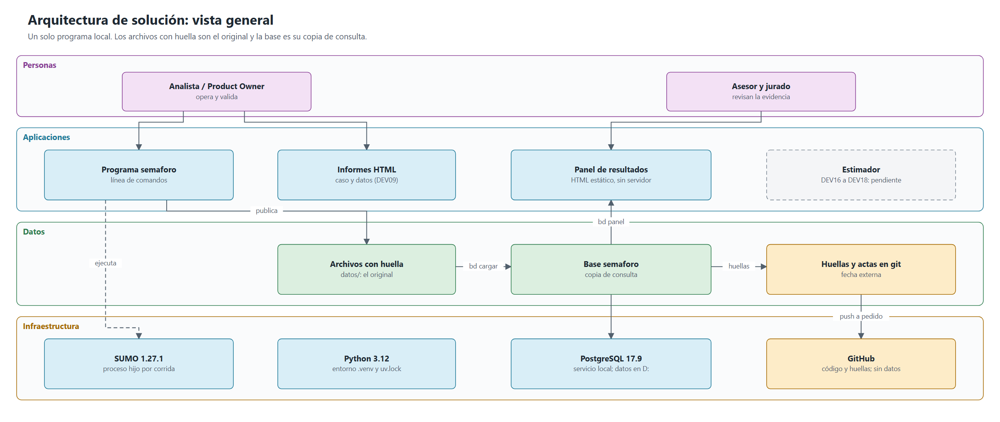
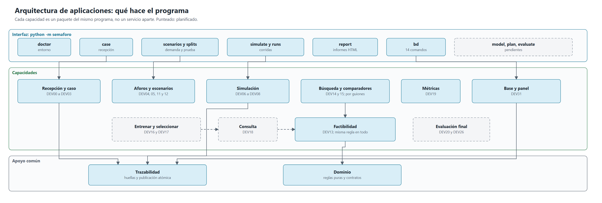
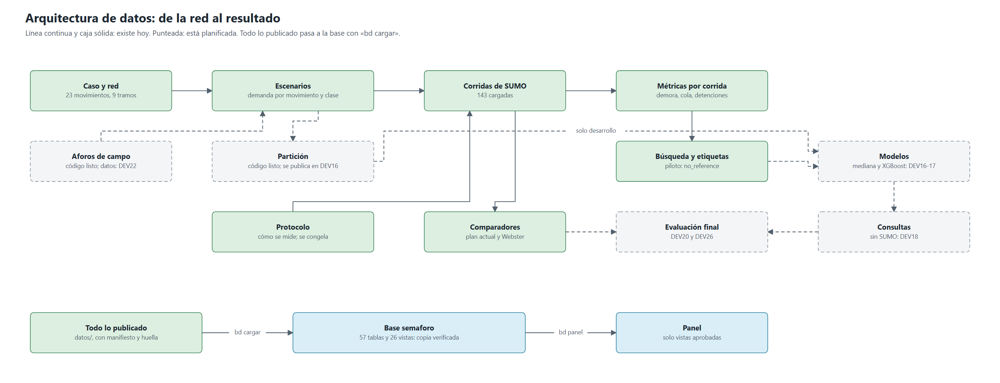
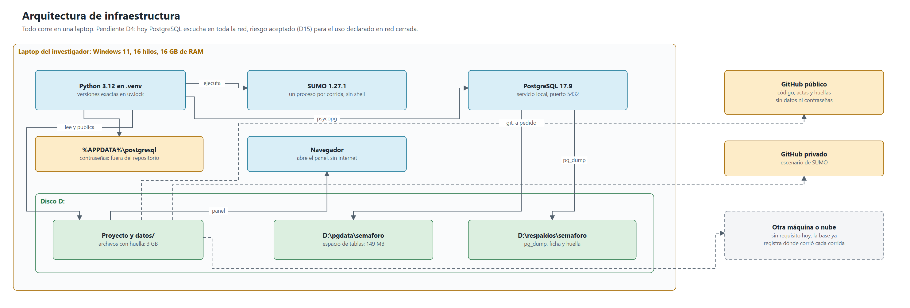

# Arquitectura de solución

Qué partes tiene la solución y cómo encajan: aplicaciones, datos e infraestructura. Estado al 2026-11-08. El detalle de construcción está en [arquitectura-tecnica.md](arquitectura-tecnica.md); las tablas, en [modelo-de-datos.md](modelo-de-datos.md).

## 1. Qué problema resuelve

Un estimador supervisado que, a partir de la demanda de una intersección, propone el ciclo y los verdes de su semáforo, y se compara en simulación con el plan actual, con Webster y con una búsqueda de referencia. Es un prototipo de investigación, fuera de línea: **no controla semáforos reales ni se conecta a sistemas municipales**.

Además de los resultados, la solución debe demostrar cómo se obtuvieron: que la prueba final no se miró antes, que las alternativas se compararon en iguales condiciones y que nada se borró ni se cambió después.

## 2. Vista general

| Decisión | Qué significa | Registro |
|---|---|---|
| Un solo programa local | Sin servicios separados ni despliegues | ADR01 |
| Línea de comandos y HTML estático | Sin servidor: el panel se abre con doble clic | ADR02 |
| Archivos con huella como original | Cada ejecución escribe una carpeta nueva; nada se sobrescribe | ADR03 |
| SUMO como proceso externo | Sin shell, una carpeta por corrida | ADR04 |
| XGBoost y mediana | Se comparan bajo las mismas reglas; gana quien lo demuestre | ADR05 |
| Corrección determinista | El plan entregado siempre cumple las reglas, o se rechaza con motivo | ADR06 |
| Prueba final separada | Por grupos, con protocolo congelado y semillas propias | ADR07 |
| Modelos sin código ejecutable | JSON o UBJ, nunca `pickle` de origen desconocido | ADR08 |
| Base de consulta en PostgreSQL | Copia que se regenera desde los archivos | ADR12 |

## 3. Aplicaciones

| Capacidad | Estado | Tareas |
|---|---|---|
| Recepción de la simulación y modelo del caso | Hecho | DEV00 a DEV03 |
| Aforos y calidad | Hecho, con datos sintéticos | DEV04, DEV05 |
| Corrida aislada, ejecución y trazabilidad | Hecho | DEV06 a DEV08 |
| Informes del caso y de los datos | Hecho | DEV09 |
| Escenarios y particiones | Hecho | DEV11, DEV12 |
| Reglas de factibilidad y corrección | Hecho | DEV13 |
| Búsqueda y comparadores | Hecho; Webster es provisional hasta la revisión de un especialista (DEC08) | DEV14, DEV15 |
| Métricas y cohorte | Hecho | DEV19 |
| Base de evidencia y panel | Construido; F8 pendiente | DEV31 |
| Entrenar, empaquetar y consultar | **Pendiente** | DEV16 a DEV18 |
| Comparar y vistas finales | **Pendiente** | DEV20, DEV21 |
| Datos de campo y calibración | **Pendiente** | DEV22, DEV23 |
| Corpus principal, selección y prueba final | **Pendiente** | DEV24 a DEV26 |
| Reproducir, proteger y documentar la operación | **Pendiente** | DEV27 a DEV30 |

**El panel** tiene diez páginas: Inicio, Caso, Escenarios y protocolo, Simulaciones, Comparación con el plan actual, Búsqueda, Entrenamiento, Consultas, Evaluación final (bloqueada hasta la apertura) y Evidencia. Entrenamiento y Consultas están vacías y lo dicen; se llenan cuando las tareas carguen sus datos.

## 4. Datos

**Los archivos son el original y la base es la copia de consulta.** Si alguien duda de un número, se sigue hasta su archivo y se recalcula su huella.

| Dónde | Qué guarda | Estado real |
|---|---|---|
| `datos/` | Caso, escenarios, entradas, corridas, métricas, búsquedas, comparadores y reportes | 3 GB. Git no los versiona |
| Base `semaforo` | Copia verificada de lo anterior | 149 MB: 143 corridas, 254 540 vehículos, 21 planes |
| `docs/bd/huellas.json` | Huellas de lo publicado y de la base | En git: da una fecha externa |
| `D:\respaldos\semaforo` | Respaldos con ficha | Fuera del proyecto |

**Corridas:** hay 146 carpetas en `datos/ejecuciones/`. En la base hay 143: las 130 originales más 13 del plan actual con las semillas de los finalistas. Las otras 3 son de DEV00, excluidas con una decisión verificable. Las «133» de los planes antiguos son esas 130 más las 3.

**Todo lo actual es de demanda sintética.** No hay aforos de campo cargados ni calibración de SUMO, ni modelo entrenado. Cada fila lleva su origen para que lo sintético no se presente como medido.

### De cada indicador de la tesis a la evidencia

| Indicador | Evidencia | Tablas | Hoy |
|---|---|---|---|
| I1 Calidad de datos | Error de conteo, cobertura y origen | `aforos`, `aforos_control`, `calidad_aforos`, `reportes_calidad` | Vacías (DEV22) |
| I2 Correspondencia de la simulación | Observado frente a simulado | `calibracion_intentos`, `calibracion_contraste` | Vacías (DEV23) |
| I3 Conjunto de entrenamiento | Escenarios, etiquetas, presupuesto y semillas | `escenarios`, `demanda`, `particiones`, `busquedas`, `candidatos`, `etiquetas` | Piloto: 1 escenario, `no_reference` |
| I4 Factibilidad y cobertura | Planes factibles y motivos de rechazo | `consultas`, `consulta_tramos`, `consulta_reglas` | Vacías (DEV18) |
| I5 Precisión de tiempos | Error del ciclo y de cada verde | `metricas_modelo`, `errores_por_escenario` | Vacías (DEV16) |
| I6 Desempeño vehicular | Diferencias de demora, cola y detenciones | `comparaciones`, `diferencias`, `indicadores` | Vacías (DEV20, DEV26) |
| I7 Tiempo de cálculo | Costo de consulta y de búsqueda | `costos`, duración en `corridas` | Solo duración de corridas |
| I8 Reproducibilidad | Versiones, semillas y réplicas | `artefactos`, `entornos`, `replicas`, `hitos` | Con datos, sin hitos todavía |

## 5. Infraestructura

- **Una laptop con Windows.** No hay contenedores ni servidores. La RAM y el disco se miden antes de las tareas pesadas.
- **Espacio:** la base y sus respaldos van en D:, con unos 420 GB libres.
- **Red:** el programa no necesita internet para funcionar; solo se usa al instalar y al subir a GitHub, a pedido del PO.
- **Repositorios:** uno público, con código, actas y huellas, sin datos ni contraseñas. Otro privado con el escenario de SUMO.
- **Pendiente D4:** PostgreSQL escucha en toda la red, aunque sus reglas solo admiten a la propia laptop. El PO aceptó el riesgo para el uso declarado (una persona, red cerrada) y dejó el cambio para el final del desarrollo. Si cambian la red o el uso, se aplica antes.
- **En otra laptop:** los pasos están en `docs/manuales/instalacion-en-otra-laptop.md`. No se han probado desde cero.

## 6. Cómo puede crecer

| Necesidad posible | Qué permite ya | Qué faltaría |
|---|---|---|
| **Más corridas** (DEV16: unas 4 700) | FCD comprimido, cola como arreglo, corridas en paralelo midiendo recursos | Medir a esa escala: carga, conciliación y cegado (con DEV16) |
| **Otros cruces de Lima** | El caso es un dato; `caso_id` en todo el esquema; un modelo por caso; el orden de ajuste por caso | Recibir y validar cada cruce |
| **Correr en otra máquina o en la nube** | Cada corrida lleva su manifiesto; `control.entornos` registra dónde corrió; la base se carga después verificando huellas | Decidirlo con datos si la laptop no alcanza. Un ADR |
| **Otras herramientas de consulta** | Un rol de solo vistas | Revisar el cegado de esa conexión |
| **Panel con servidor o API** | El panel solo lee vistas; `app` separa la lógica de la interfaz | Un ADR, su modelo de amenazas y pruebas de seguridad |

Nada de esto está construido por adelantado: solo se evitó cerrarle el camino. Las condiciones que activarían cada cambio están en `docs/actas/2026-11-08-dev31-f7-dec09.md`, sección 4.

## 7. Fuera de alcance

Siguen fuera, según el documento 01: control en vía, conexión municipal, predicción de tráfico futuro, optimización de varias intersecciones a la vez, aprendizaje por refuerzo, agentes LLM, RAG y aplicación pública. «Otros cruces» significa un modelo por cruce, no coordinar varios.

## 8. Cómo se cotejó este documento

Se contrastó el 2026-11-08 con el código, con `datos/` y con la base vigente, en solo lectura. Las cifras de filas y tamaños salen de consultas a la base en esa fecha, y cambiarán con cada carga. Los volúmenes futuros son estimaciones de `docs/actas/2026-11-05-dev31-f0-planificacion-y-diseno.md`, no mediciones.
