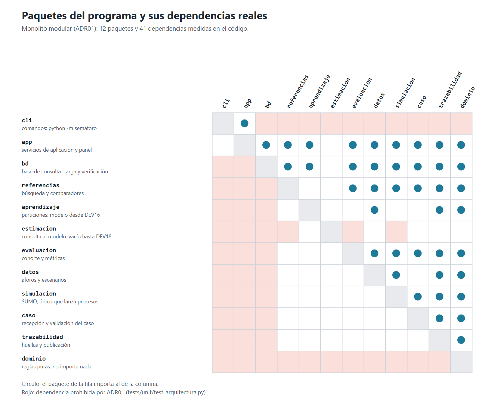
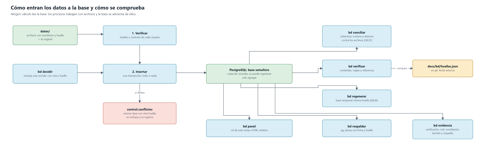
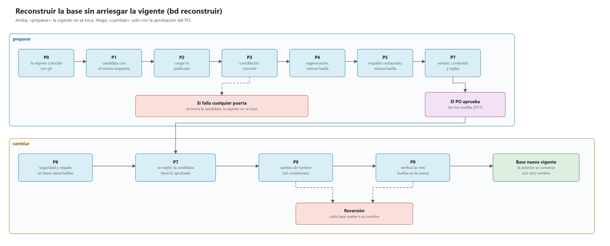
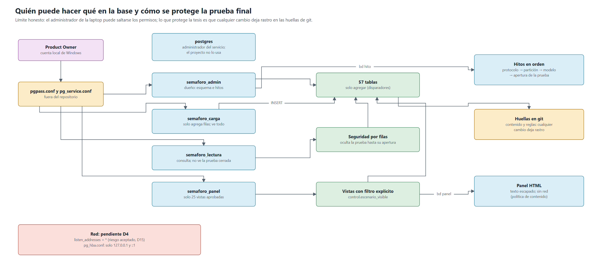

# Arquitectura técnica

Cómo está construido el programa. Estado al 2026-11-08, esquema `sql-afadf606c1a2065b`. La visión por datos, aplicaciones e infraestructura está en [arquitectura-de-solucion.md](arquitectura-de-solucion.md); las tablas, en [modelo-de-datos.md](modelo-de-datos.md).

**Qué está construido:** recepción y caso, aforos y escenarios, simulación, métricas, búsqueda, comparadores, reglas de factibilidad, base y panel. **Qué no:** entrenamiento, consulta al modelo y evaluación final (DEV16 a DEV18, DEV20, DEV26). Esos paquetes o tablas existen vacíos.

## 1. Tecnología

| Pieza | Versión | Dónde queda fijada |
|---|---|---|
| Python | 3.12.3 | `pyproject.toml` admite solo 3.12; el manifiesto de cada corrida guarda la versión |
| uv | 0.13 o posterior | `uv.lock` guarda las versiones exactas y sus huellas |
| pydantic | 2.14.1 | `uv.lock` |
| defusedxml | 0.7.1 | `uv.lock` |
| psycopg | 3.3.8 | `pyproject.toml` y `uv.lock` |
| SUMO | 1.27.1 | Lo revisa `doctor`; cada manifiesto guarda la versión |
| PostgreSQL | 17.9 | Cada carga guarda la versión (`control.cargas`) |
| XGBoost | Sin instalar | Se fija en DEV16 con una prueba de instalación (ADR05, ADR08) |
| Pruebas y calidad | pytest 9.1.1, hypothesis 6.170.3, ruff 0.17.1, pyright 1.1.414 | `uv.lock` |

## 2. Paquetes y dependencias

Un solo programa con 12 paquetes (ADR01). No son servicios: se comunican importándose, y los datos que deben perdurar pasan por archivos con huella.

**Cotejo:** el gráfico se calcula leyendo los `import` de `src/semaforo/`. Lo rojo sale de `tests/unit/test_arquitectura.py`, la prueba que falla si alguien importa algo prohibido. Si el código cambia y el gráfico no, `scripts/graficos.py --comprobar` lo avisa y una prueba de la puerta falla.

| Paquete | Qué hace | Regla que lo limita |
|---|---|---|
| `cli` | Traduce comandos y códigos de salida | Solo importa `app` |
| `app` | Servicios que combinan paquetes; genera informes y panel | No lo importa nadie, salvo `cli` |
| `bd` | Esquema, carga verificada, conciliación, huellas, respaldos y lectura del panel | Ningún módulo de cálculo lo importa |
| `referencias` | Búsqueda de planes y comparadores (plan actual, Webster) | No importa `app`, `cli` ni `bd` |
| `aprendizaje` | Hoy, particiones. Desde DEV16, entrenamiento | Igual; no puede leer la prueba para ajustar |
| `estimacion` | Vacío hasta DEV18 | No puede importar `simulacion`, `referencias` ni `evaluacion`: la consulta no ejecuta SUMO |
| `evaluacion` | Cohorte y métricas desde las salidas de SUMO | Igual que `referencias` |
| `datos` | Aforos, calidad y escenarios | Igual |
| `simulacion` | Prepara y ejecuta SUMO; lanza las herramientas del sistema | **Único que lanza procesos** (`tests/unit/test_estructura.py`) |
| `caso` | Recepción y validación del caso contra la red | Igual |
| `trazabilidad` | Huellas, manifiestos y publicación atómica | Igual |
| `dominio` | Reglas puras y contratos | **No importa nada** del proyecto |

## 3. Comandos

`python -m semaforo <grupo>`. Por la salida estándar va un JSON con el resultado; por la de error, el registro.

| Grupo | Para qué | Tarea |
|---|---|---|
| `doctor` | Revisa entorno, versiones, permisos y espacio | DEV01 |
| `case` | Recibir, publicar y comparar recepciones | DEV00 |
| `simulate` | Ejecutar una corrida preparada | DEV07 |
| `runs` | Verificar y comparar corridas | DEV08 |
| `report` | Informes HTML del caso y de los datos | DEV09 |
| `scenarios` | Generar escenarios controlados | DEV11 |
| `splits` | Crear y comprobar particiones | DEV12 |
| `bd` | Base y panel: 14 comandos (sección 4) | DEV31 |

La búsqueda y los comparadores aún no tienen comando: corren con guiones de `scripts/`. **Códigos de salida de `bd`:** 0 correcto; 2 entrada inválida; 3 falta una dependencia; 4 fallo de proceso; 5 difiere o está incompleta; 6 no concluyente o protocolo violado.

## 4. Cómo entran los datos a la base

**Regla central:** ningún cálculo lee la base. Búsqueda, métricas y comparadores trabajan con archivos. Si la base falla, no se pierde nada: se corrige y se vuelve a cargar.

| Paso | Qué garantiza |
|---|---|
| `bd cargar` | Antes de insertar, verifica huellas y contrato de cada carpeta. Una carpeta entra completa o no entra. Cargar dos veces no duplica. La misma clave con otra huella se rechaza y queda en `control.conflictos` |
| `bd metricas` | Publica las métricas que falten, en carpetas nuevas de solo lectura, con el cálculo oficial (DEV19). La base las copia, nunca las recalcula a su manera |
| `bd decidir` | Excluir un archivo exige una decisión publicada, con ruta y huella. Sobrevive a una reconstrucción |
| `bd conciliar` | Compara la base con los archivos: cobertura, conteos y demora recalculada (QA33) |
| `bd verificar` | Solo lectura: huella de contenido, reglas instaladas y referencia de git. Con `--red`, informa la configuración de red |
| `bd regenerar` | Crea la base desde cero en una temporal y compara la huella (QA36) |
| `bd respaldar`, `ficha`, `probar-respaldo` | Respaldo con ficha, por versión del esquema; se restaura en una temporal y se compara |
| `bd hito` | Registra un hito del procedimiento, con su acta confirmada en git |
| `bd evidencia` | Reúne verificación, red, conciliación, barrido de cegado y respaldo en una carpeta nueva |
| `bd panel` | Publica el panel en una carpeta nueva |

**Lectura estable:** verificar y conciliar toman un candado compartido y leen en una sola foto de la base. Si hay una carga en curso, o la base cambia durante la lectura, el resultado es *no concluyente*, nunca un falso «coincide».

## 5. Reconstruir la base

`bd reconstruir` tiene dos fases, y la base vigente no se toca hasta la segunda. El detalle de cada paso está en `src/semaforo/app/bd_reconstruir.py`.

- **Preparar:** crea la candidata con otro nombre y la valida. Si falla una puerta, se borra la candidata.
- **Aprobación:** el PO aprueba tres huellas: versión del esquema, contenido y reglas.
- **Cambiar:** intercambia los nombres (P8) y verifica (P9). Si algo falla, cada base vuelve a su nombre. La anterior nunca se borra sola.
- **P6** corre en bases desechables, porque inserta datos de prueba y la base real es de solo agregar.

**Pendiente:** dos pruebas de esta parte fallan a veces (3 de 20 corridas, acta de F6). Las tres veces la operación se detuvo en P8, antes de cambiar nada. La causa no se encontró. El PO lo aceptó como pendiente; se resuelve antes del próximo cambio real de base.

## 6. Seguridad

| Rol | Puede | No puede |
|---|---|---|
| `postgres` | Administrar el servicio. Solo el PO; el proyecto no lo usa | |
| `semaforo_admin` | Es dueño del esquema; registra hitos | Lo usa solo el PO |
| `semaforo_carga` | Agregar filas y leerlas todas | Modificar o borrar evidencia |
| `semaforo_lectura` | Consultar tablas y vistas | Ver la prueba cerrada ni modificar nada |
| `semaforo_panel` | Leer 25 vistas | Leer tablas ni modificar nada |

| Amenaza | Control | Prueba |
|---|---|---|
| Alterar o borrar evidencia | Permisos, disparadores de «solo agregar», huellas en git | QA34, QA36 |
| Espiar la prueba final | Seguridad por filas; vistas con filtro explícito; barrido de todas las relaciones con el lector y con el panel | QA35 |
| Abrir la prueba antes de tiempo | Hitos en orden, validados por la base | QA35 |
| Filtrar contraseñas | Solo en `%APPDATA%\postgresql`; nunca en el repositorio, que es público | QA34 |
| Inyectar texto en el panel | Todo el dato se escapa; política de contenido sin red | QA30, QA34 |
| Cargar datos alterados | Verificación de huellas antes de insertar | QA32 |
| Tocar otras bases del servidor | El programa solo acepta nombres del proyecto | QA34 |
| Conexión desde otro equipo | `pg_hba.conf` solo admite 127.0.0.1 y ::1. **Pendiente D4:** el servicio escucha en toda la red | QA34, parcial |

**Límites que deben decirse:**

- Quien administra la laptop puede saltarse los permisos. Lo que protege la tesis es que el cambio deja rastro.
- El cegado se comprobó en bases desechables, porque la base real aún no tiene una prueba cerrada.
- D15: los roles conservan el permiso público de conectarse a otras bases del servidor. El PO lo aceptó; no autoriza leerlas ni modificarlas.

## 7. Cómo se comprueba la calidad

| Control | Qué hace | Resultado registrado |
|---|---|---|
| `scripts/check.ps1` | Estilo, tipos, esquema al día, pruebas, contratos y archivos ocultos | 5509 pruebas pasaron y 1 omitida; 43 de 43 contratos (F6) |
| `scripts/mutaciones/dev31_*.py` | Rompe el código a propósito y comprueba que una prueba lo note | 145 de 145 detectados (F6) |
| `bd evidencia` | Comprobación de la base real | Última carpeta en `datos/reportes/bd/` |
| Revisión manual | Una persona no técnica entiende el panel | QA37, hecha por el PO en F5 |

## 8. Cómo se cotejó este documento

Se contrastó el 2026-11-08 con el código y con la base vigente, en solo lectura: paquetes y dependencias (calculados), comandos (`--help`), versiones (`uv.lock`, `python --version`, consulta a la base), roles y vistas (`docs/bd/esquema.toml`, `bd/ddl.py`) y pasos de reconstrucción (`app/bd_reconstruir.py`). No se probó en otra laptop.
