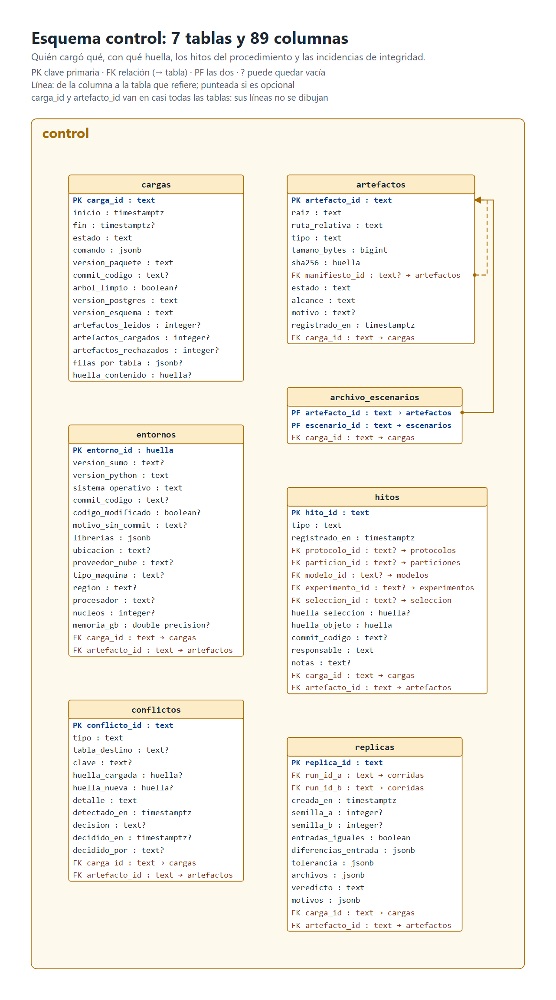
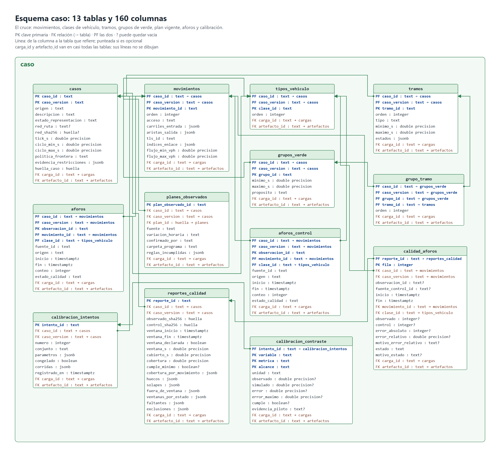
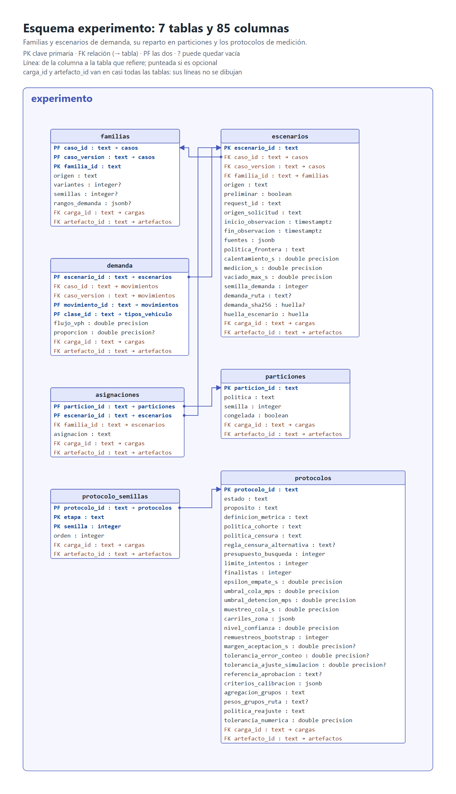
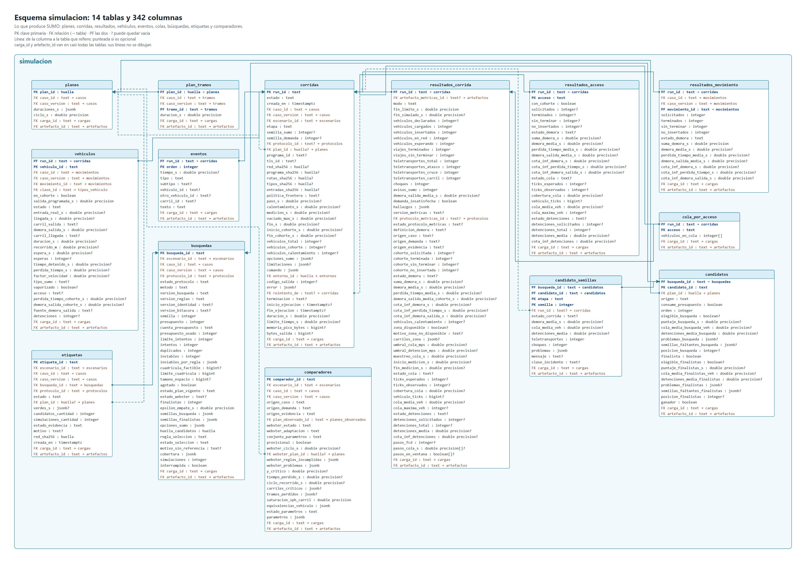
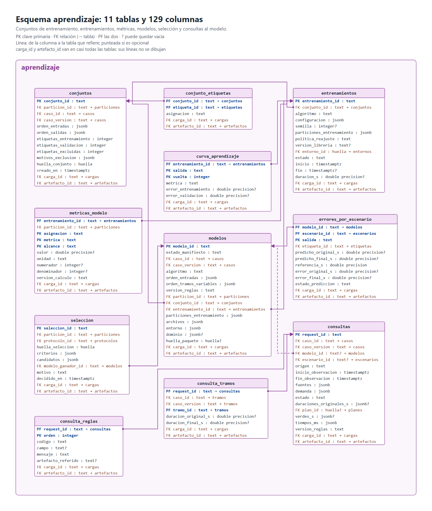
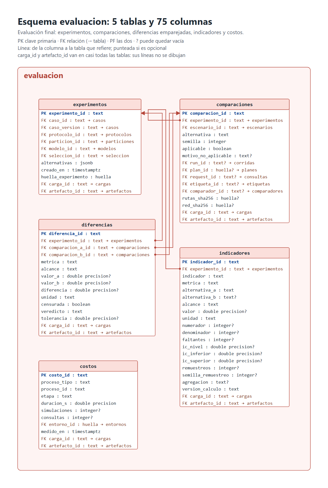
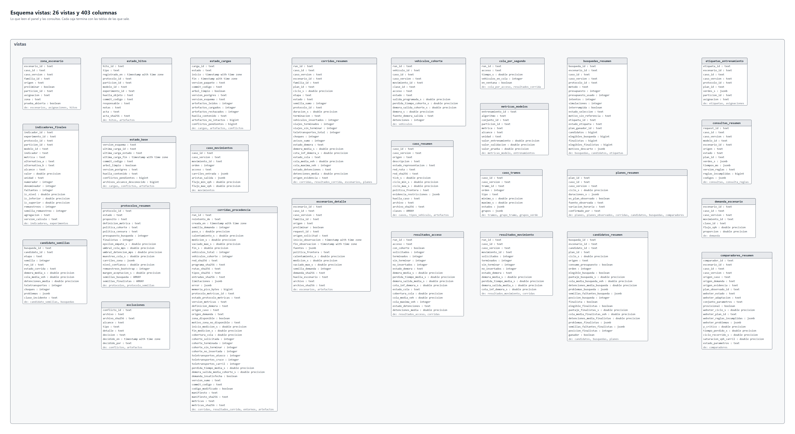

# Modelo de datos

La base `semaforo` tiene **57 tablas, 880 columnas, 117 relaciones** y **26 vistas**, en siete esquemas. Motor: PostgreSQL 17.9. Esquema `sql-afadf606c1a2065b`.

**Todos los gráficos muestran todas las columnas.** Salen de `docs/bd/esquema.toml` con `scripts/graficos.py`: no se dibujan a mano. El significado, la unidad y el origen de cada columna están en el [diccionario de datos](../bd/diccionario.md).

## Gráfico completo

Las 57 tablas con todas sus columnas en una sola imagen. Por su tamaño, se abre aparte y se usa el zoom.

| Para | Archivo |
|---|---|
| Ver | [BD00_modelo_completo.png](diagramas/BD00_modelo_completo.png) |
| Editar en draw.io | [BD00_modelo_completo.drawio](diagramas/BD00_modelo_completo.drawio) (en draw.io: Archivo → Abrir) |

El archivo editable se comprobó por su estructura, no abriéndolo en draw.io. Cada tabla se mueve con sus columnas y sus líneas. Si se edita a mano y luego se regenera con `scripts/graficos.py`, se sobrescribe: guarde su versión con otro nombre.

## Cómo leer los gráficos

- **PK:** clave primaria. **FK:** relación con otra tabla; la flecha `→` dice con cuál. **PF:** las dos cosas.
- **`?`** después del tipo: la columna puede quedar vacía. Vacío nunca significa cero.
- **Líneas:** van de la columna a la tabla que refiere; punteadas si la relación es opcional.
- **`carga_id` y `artefacto_id`** están en casi todas las tablas y dicen de qué carga y de qué archivo viene cada fila. Aparecen como columnas, pero sus líneas no se dibujan: taparían todo lo demás.
- En los gráficos por esquema, una relación con otro esquema se ve en el texto de la columna y no como línea.

## Gráficos por esquema

| Esquema | Qué guarda | Tablas | Columnas |
|---|---|---|---|
| [`control`](#esquema-control) | Quién cargó qué, con qué huella, los hitos del procedimiento y las incidencias de integridad. | 7 | 89 |
| [`caso`](#esquema-caso) | El cruce: movimientos, clases de vehículo, tramos, grupos de verde, plan vigente, aforos y calibración. | 13 | 160 |
| [`experimento`](#esquema-experimento) | Familias y escenarios de demanda, su reparto en particiones y los protocolos de medición. | 7 | 85 |
| [`simulacion`](#esquema-simulacion) | Lo que produce SUMO: planes, corridas, resultados, vehículos, eventos, colas, búsquedas, etiquetas y comparadores. | 14 | 342 |
| [`aprendizaje`](#esquema-aprendizaje) | Conjuntos de entrenamiento, entrenamientos, métricas, modelos, selección y consultas al modelo. | 11 | 129 |
| [`evaluacion`](#esquema-evaluacion) | Evaluación final: experimentos, comparaciones, diferencias emparejadas, indicadores y costos. | 5 | 75 |
| [`vistas`](#esquema-vistas) | Lo que leen el panel y las consultas. | 26 vistas | 403 |

### Esquema control

Quién cargó qué, con qué huella, los hitos del procedimiento y las incidencias de integridad.

| Tabla | Una fila es | Qué guarda |
|---|---|---|
| `cargas` | Una fila por carga | Cada vez que el cargador escribe en la base. |
| `artefactos` | Una fila por archivo | Cada archivo que la base conoce, con su huella. Es el enlace de cada fila con su original. |
| `archivo_escenarios` | Una fila por archivo y escenario vinculado | Escenarios a los que corresponde un archivo. Todos deben ser visibles para mostrar el archivo. |
| `entornos` | Una fila por combinación distinta de versiones | Versiones y equipo con que se produjo un resultado. |
| `hitos` | Una fila por hito | Pasos fechados del procedimiento que el jurado puede pedir: congelar el protocolo, la partición y el modelo, y abrir la prueba. |
| `conflictos` | Una fila por incidencia | Incidencias de integridad: una clave que llega con otro contenido, una huella que dejó de coincidir, un archivo que no se pudo cargar o un escenario preliminar que después aparece en prueba. |
| `replicas` | Una fila por réplica comparada | Comparación de una corrida con su réplica (QA09, I8). |

### Esquema caso

El cruce: movimientos, clases de vehículo, tramos, grupos de verde, plan vigente, aforos y calibración.

| Tabla | Una fila es | Qué guarda |
|---|---|---|
| `casos` | Una fila por versión de caso | Versión del cruce tal como se representa. |
| `movimientos` | Una fila por caso y movimiento | Cada movimiento del cruce, con su acceso, carriles y dominio de demanda. |
| `tipos_vehiculo` | Una fila por caso y clase | Clases de vehículo del caso. |
| `tramos` | Una fila por caso y tramo | Tramos de la secuencia fija de fases, con sus límites. |
| `grupos_verde` | Una fila por caso y grupo | Grupos de verde: lo que debe recibir verde junto, con su mínimo y máximo. |
| `grupo_tramo` | Una fila por grupo y tramo | Qué tramos dan verde a cada grupo. |
| `planes_observados` | Una fila por plan observado y caso | Plan vigente del semáforo real, con su fuente. |
| `aforos` | Una fila por observación, movimiento y clase | Conteos de vehículos por movimiento, periodo y clase (I1). |
| `aforos_control` | Una fila por observación de control, movimiento y clase | Conteos manuales de control, para medir el error de los aforos (I1). |
| `calidad_aforos` | Una fila por fila de calidad.csv | Comparación de cada aforo con su control: error absoluto y relativo, y estado (I1). |
| `reportes_calidad` | Una fila por reporte de calidad | Resumen de cada reporte de calidad: ventana, cobertura por movimiento, huecos, faltantes y exclusiones (I1). |
| `calibracion_intentos` | Una fila por intento | Cada intento de ajustar los parámetros de SUMO, separado entre ajuste y validación (I2). |
| `calibracion_contraste` | Una fila por intento, variable, métrica y alcance | Observado frente a simulado por variable, con el criterio fijado antes (I2). |

### Esquema experimento

Familias y escenarios de demanda, su reparto en particiones y los protocolos de medición.

| Tabla | Una fila es | Qué guarda |
|---|---|---|
| `familias` | Una fila por caso y familia | Familias (grupos) de escenarios: un patrón de demanda con sus variantes. |
| `escenarios` | Una fila por escenario | Un escenario de demanda: familia, semilla, ventana de medición y origen. |
| `demanda` | Una fila por escenario, movimiento y clase | Demanda de cada movimiento y clase en un escenario. Es la entrada del modelo. |
| `particiones` | Una fila por partición | Particiones congeladas del conjunto de escenarios. |
| `asignaciones` | Una fila por partición y escenario | A qué parte de la partición va cada escenario (entrenamiento, validación o prueba). Es la base del cegado. |
| `protocolos` | Una fila por protocolo | Reglas de medición, búsqueda y decisión fijadas antes del experimento. |
| `protocolo_semillas` | Una fila por protocolo, etapa y semilla | Semillas de cada etapa del protocolo. La base impide que una semilla esté en dos etapas. |

### Esquema simulacion

Lo que produce SUMO: planes, corridas, resultados, vehículos, eventos, colas, búsquedas, etiquetas y comparadores.

| Tabla | Una fila es | Qué guarda |
|---|---|---|
| `planes` | Una fila por plan distinto (vector de duraciones) | Un plan de tiempos: la duración de cada tramo y el ciclo. |
| `plan_tramos` | Una fila por plan y tramo | Duración de cada tramo de un plan, en filas. Permite consultar «el t5 de todos los planes» y exige que el tramo exista en el caso. |
| `corridas` | Una fila por corrida | Una simulación de SUMO: escenario, plan, semilla, etapa, estado, versiones y huellas de sus entradas. |
| `resultados_corrida` | Una fila por corrida | Resultados de una corrida: lo que reporta SUMO y las métricas de la cohorte y la zona calculadas por el código oficial (DEV19). |
| `resultados_acceso` | Una fila por corrida y acceso | Demora, cola y detenciones por acceso del cruce (I6 por acceso). |
| `resultados_movimiento` | Una fila por corrida y movimiento | Demora por movimiento del cruce. |
| `vehiculos` | Una fila por corrida y vehículo (unas 1 780 por corrida) | Cada vehículo de una corrida: qué pidió, qué le pasó y cuánto tiempo perdió. |
| `eventos` | Una fila por línea relevante del registro | Teletransportes, choques, avisos y errores del registro de SUMO. |
| `cola_por_acceso` | Una fila por corrida y acceso; cada arreglo tiene un valor por paso de la FCD | Cola de cada acceso de la zona, paso a paso, como un arreglo por acceso. Los momentos de los pasos y cuáles cuentan para la cola del resumen están una sola vez por corrida, en resultados_corrida (pasos_cola_s y pasos_en_ventana). La vista vistas.cola_por_segundo muestra una fila por corrida, acceso y paso, como antes. |
| `busquedas` | Una fila por búsqueda | Búsqueda del mejor plan para un escenario: presupuesto, semillas, identidad y resultado de la selección. |
| `candidatos` | Una fila por búsqueda y candidato | Cada plan que evaluó una búsqueda, con su resultado en la etapa de búsqueda y, si llegó, en la de finalistas. |
| `candidato_semillas` | Una fila por candidato, etapa y semilla | Resultado de un candidato con cada semilla, con su clasificación según la regla C. |
| `etiquetas` | Una fila por etiqueta | El mejor plan encontrado para un escenario, o «sin referencia» con su motivo. Son los ejemplos de entrenamiento. |
| `comparadores` | Una fila por publicación de comparadores (escenario y conjunto de parámetros) | Referencias de comparación de un escenario: el plan vigente y Webster, con su aplicabilidad y sus parámetros. |

### Esquema aprendizaje

Conjuntos de entrenamiento, entrenamientos, métricas, modelos, selección y consultas al modelo.

| Tabla | Una fila es | Qué guarda |
|---|---|---|
| `conjuntos` | Una fila por conjunto | Conjunto de datos de entrenamiento: qué etiquetas, de qué partición y en qué orden de variables. |
| `conjunto_etiquetas` | Una fila por conjunto y etiqueta | Qué etiquetas entran a cada conjunto. La base impide meter una etiqueta de prueba. |
| `entrenamientos` | Una fila por entrenamiento | Cada entrenamiento: algoritmo, configuración, semilla, versiones y costo inicial (I7). |
| `curva_aprendizaje` | Una fila por entrenamiento, salida y vuelta | Error por vuelta de entrenamiento, con datos de entrenamiento y de validación. Muestra si el modelo aprende o se sobreajusta. |
| `metricas_modelo` | Una fila por entrenamiento, asignación, métrica y alcance | Métricas de cada entrenamiento por partición: error (I5), factibilidad y cobertura (I4), con numerador y denominador. |
| `errores_por_escenario` | Una fila por modelo, escenario y salida | Error de cada modelo en cada escenario y salida, antes y después de la corrección. |
| `modelos` | Una fila por modelo | Paquete del modelo entrenado. Su congelamiento es un hito; el paquete no cambia. |
| `seleccion` | Una fila por decisión | Decisión de elegir un modelo, con el orden de criterios fijado antes y los candidatos comparados (QA19). |
| `consultas` | Una fila por consulta | Cada consulta al modelo: entrada, propuesta original, plan final o rechazo, y tiempo por etapa (I4, I7). |
| `consulta_tramos` | Una fila por consulta y tramo | Duración propuesta y final de cada tramo en una consulta. |
| `consulta_reglas` | Una fila por error de la respuesta | Reglas incumplidas y errores de cada consulta. |

### Esquema evaluacion

Evaluación final: experimentos, comparaciones, diferencias emparejadas, indicadores y costos.

| Tabla | Una fila es | Qué guarda |
|---|---|---|
| `experimentos` | Una fila por experimento | Experimento de evaluación: protocolo, partición y modelo congelados. Su apertura es un hito. |
| `comparaciones` | Una fila por experimento, escenario, alternativa y semilla | Una alternativa aplicada a un escenario de prueba con una semilla final, con las huellas que prueban que todas usaron la misma demanda. |
| `diferencias` | Una fila por par de comparaciones, métrica y alcance | Diferencia emparejada entre dos alternativas en un escenario y una semilla (I6). |
| `indicadores` | Una fila por experimento, indicador, métrica, alternativas y alcance | Indicadores finales I4 a I7: valor, numerador, denominador, faltantes e intervalo de confianza. |
| `costos` | Una fila por proceso medido | Costo computacional de cada proceso, separado en inicial, por consulta y de evaluación (I7). |

### Esquema vistas

El panel solo lee **25 de estas 26 vistas**, con el rol `semaforo_panel`. Cada caja termina con las tablas de las que sale. Las columnas se leen de la base (`diagramas/vistas_columnas.json`) y una prueba comprueba que coincidan.

| Vista | Panel | Qué muestra |
|---|---|---|
| `zona_escenario` | Sí | Cada escenario con su partición, su asignación, su zona (desarrollo o prueba) y si su prueba ya se abrió. |
| `estado_hitos` | Sí | Línea de tiempo de los hitos del procedimiento, con su acta y su commit. |
| `estado_cargas` | No | Cargas, artefactos cargados y rechazados, y conflictos pendientes. |
| `corridas_resumen` | Sí | Una fila por corrida con su escenario, familia, plan, etapa, estado y resultados principales. |
| `vehiculos_cohorte` | Sí | Vehículos de la cohorte con su demora (pérdida de tiempo más espera de salida, según la definición del protocolo). |
| `cola_por_segundo` | Sí | Cola por corrida, acceso y paso (una fila por paso, como antes del cambio a arreglo por acceso). El panel y las consultas leen esta vista, nunca la tabla, para poder cambiar cómo se guarda. |
| `busquedas_resumen` | Sí | Una fila por búsqueda con su etiqueta, sus candidatos elegibles y sus motivos de descarte. |
| `etiquetas_entrenamiento` | Sí | Etiquetas con referencia y la asignación de su escenario (solo train y validation). |
| `metricas_modelos` | Sí | Métricas de cada entrenamiento por partición, en columnas, para comparar la mediana con XGBoost. |
| `consultas_resumen` | Sí | Consultas con su estado, sus tiempos y sus reglas incumplidas. |
| `indicadores_finales` | Sí | Indicadores I4 a I7 del experimento final con sus intervalos. Vacía hasta la apertura. |
| `estado_base` | Sí | Versión del esquema, última carga completa con su huella, conflictos pendientes y archivos de alcance desconocido. Solo conteos globales: no dice cuántos archivos o filas tiene la prueba. |
| `caso_resumen` | Sí | El caso: identidad, origen, límites del ciclo, clases de vehículo y su archivo con huella. |
| `caso_movimientos` | Sí | Los movimientos del caso: de qué acceso salen, por qué carriles y qué flujo admiten. |
| `caso_tramos` | Sí | Los tramos del programa del semáforo, una fila por tramo, con sus límites y sus grupos de verde. |
| `planes_resumen` | Sí | Los planes con sus duraciones, solo si los usa algo visible; marca el plan observado del caso. |
| `escenarios_detalle` | Sí | Los datos de entrada de cada escenario visible: ventana, tiempos, semilla de demanda y su archivo con huella. |
| `demanda_escenario` | Sí | La demanda de cada escenario visible, por movimiento y clase de vehículo. |
| `protocolos_resumen` | Sí | Las reglas de cada protocolo y sus semillas de búsqueda y de finalistas; las de la etapa final quedan fuera. |
| `corridas_procedencia` | Sí | De dónde sale cada corrida visible: entradas con su huella, versión de SUMO, commit, protocolo de sus métricas, manifiesto y archivo de métricas. |
| `resultados_acceso` | Sí | Demora, cola y detenciones de cada acceso en cada corrida visible; con_cohorte dice si la demora puede existir. |
| `resultados_movimiento` | Sí | Demora de cada movimiento en cada corrida visible. |
| `candidatos_resumen` | Sí | Cada plan probado en una búsqueda visible: su origen, si fue elegible, su puntaje y sus motivos de descarte. |
| `candidato_semillas` | Sí | El resultado de cada plan en cada semilla de una búsqueda visible, con su corrida. |
| `comparadores_resumen` | Sí | Los comparadores de cada escenario visible: el plan observado y el estado de Webster con sus motivos. |
| `exclusiones` | Sí | Los archivos excluidos con una decisión registrada: qué archivo, por qué, qué se decidió y quién. |

## Estado de los datos

Muchas tablas están **vacías a propósito**: esperan a las tareas que las llenan (aforos en DEV22, calibración en DEV23, modelos en DEV16 y DEV17, consultas en DEV18, evaluación en DEV20 y DEV26). Ver [arquitectura-de-solucion.md](arquitectura-de-solucion.md), sección 4.
