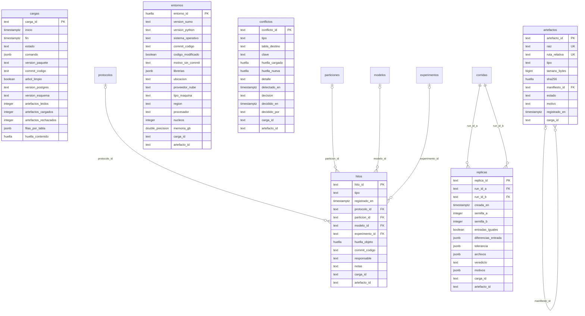
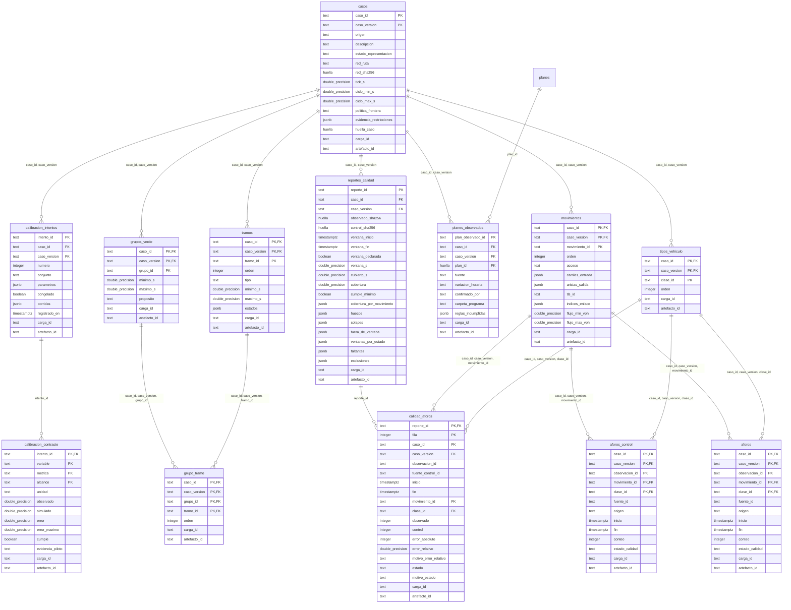
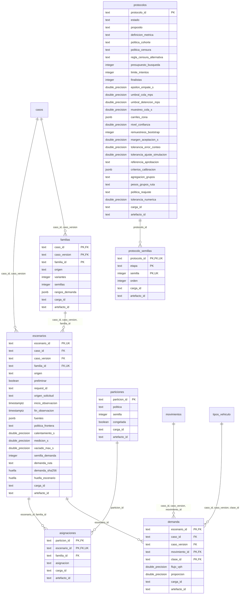
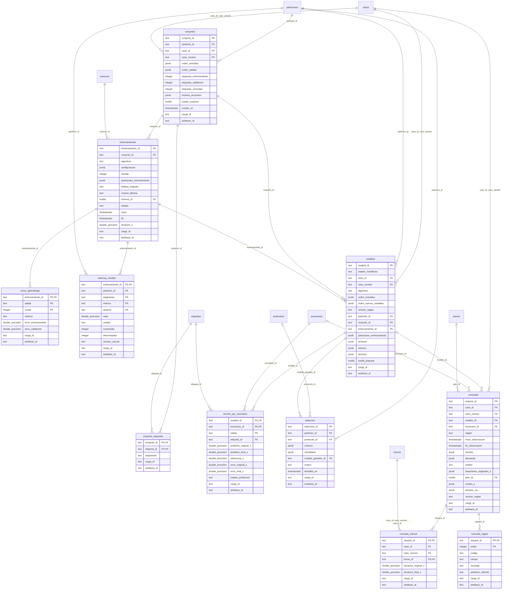
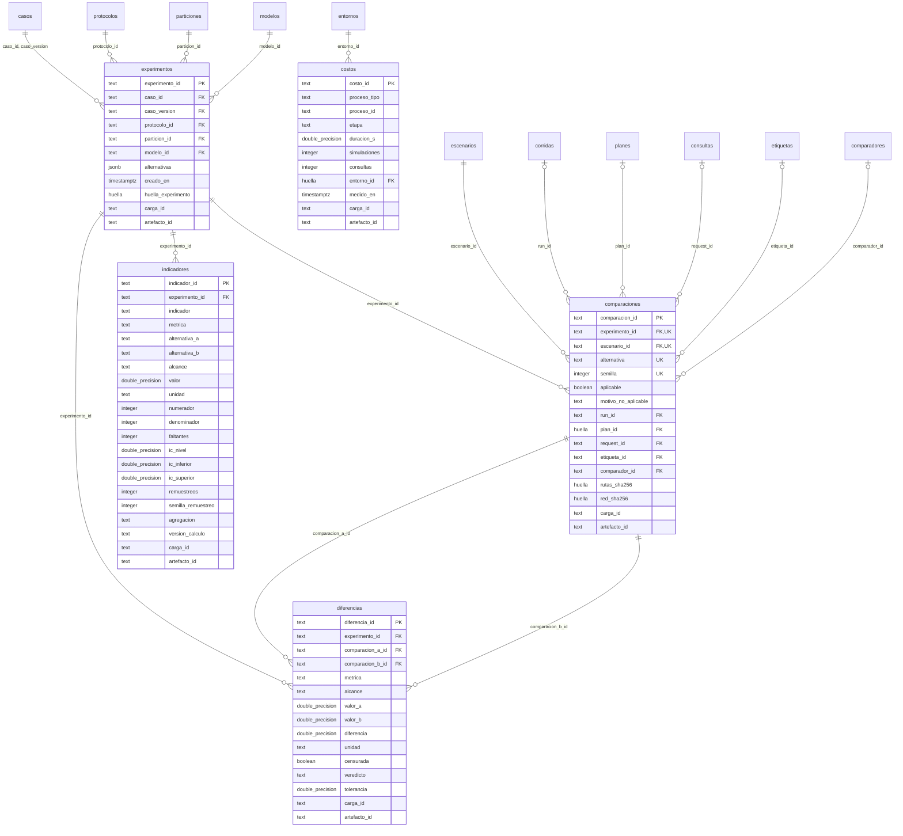

```mermaid
erDiagram
  planes {
    huella plan_id PK
    text caso_id FK
    text caso_version FK
    jsonb duraciones_s
    double_precision ciclo_s
    text carga_id
    text artefacto_id
  }
  plan_tramos {
    huella plan_id PK, FK
    text caso_id FK
    text caso_version FK
    text tramo_id PK, FK
    double_precision duracion_s
    text carga_id
    text artefacto_id
  }
  corridas {
    text run_id PK
    text estado
    timestamptz creada_en
    text caso_id FK
    text caso_version FK
    text escenario_id FK
    text etapa
    integer semilla_sumo
    integer semilla_demanda
    text protocolo_id FK
    huella plan_id FK
    text programa_id
    text tls_id
    huella red_sha256
    huella programa_sha256
    huella rutas_sha256
    huella tipos_sha256
    huella entradas_sha256
    text politica_frontera
    double_precision paso_s
    double_precision calentamiento_s
    double_precision medicion_s
    double_precision vaciado_max_s
    double_precision fin_s
    double_precision inicio_cohorte_s
    double_precision fin_cohorte_s
    integer vehiculos_total
    integer vehiculos_cohorte
    integer vehiculos_calentamiento
    jsonb opciones_sumo
    jsonb limitaciones
    jsonb comando
    huella entorno_id FK
    integer codigo_salida
    jsonb error
    text reintento_de FK
    text terminacion
    timestamptz inicio_ejecucion
    timestamptz fin_ejecucion
    double_precision duracion_s
    double_precision limite_tiempo_s
    bigint memoria_pico_bytes
    bigint bytes_salida
    text carga_id
    text artefacto_id
  }
  resultados_corrida {
    text run_id PK, FK
    text artefacto_metricas_id FK
    text modo
    double_precision fin_limite_s
    double_precision fin_simulado_s
    integer vehiculos_declarados
    integer vehiculos_cargados
    integer vehiculos_insertados
    integer vehiculos_en_red
    integer vehiculos_esperando
    integer viajes_terminados
    integer viajes_sin_terminar
    integer teletransportes_total
    integer teletransportes_atasco
    integer teletransportes_cruce
    integer teletransportes_carril
    integer choques
    integer avisos_sumo
    double_precision demora_salida_media_s
    boolean demanda_insatisfecha
    jsonb hallazgos
    text version_metricas
    text protocolo_metricas_id FK
    text estado_protocolo_metricas
    text definicion_demora
    text origen_caso
    text origen_demanda
    text origen_evidencia
    integer cohorte_solicitada
    integer cohorte_terminada
    integer cohorte_sin_terminar
    integer cohorte_no_insertada
    text estado_demora
    double_precision suma_demora_s
    double_precision demora_media_s
    double_precision perdida_tiempo_media_s
    double_precision demora_salida_media_cohorte_s
    double_precision cota_inf_demora_s
    double_precision cota_inf_perdida_tiempo_s
    double_precision cota_inf_demora_salida_s
    integer vehiculos_calentamiento
    boolean zona_disponible
    text motivo_zona_no_disponible
    jsonb carriles_zona
    double_precision umbral_cola_mps
    double_precision umbral_detencion_mps
    double_precision muestreo_cola_s
    double_precision inicio_medicion_s
    double_precision fin_medicion_s
    text estado_cola
    integer ticks_esperados
    integer ticks_observados
    double_precision cobertura_cola
    bigint vehiculo_ticks
    double_precision cola_media_veh
    integer cola_maxima_veh
    text estado_detenciones
    integer detenciones_solicitados
    integer detenciones_total
    double_precision detenciones_media
    double_precision cota_inf_detenciones
    integer pasos_fcd
    text carga_id
    text artefacto_id
  }
  resultados_acceso {
    text run_id PK, FK
    text acceso PK
    integer solicitados
    integer terminados
    integer sin_terminar
    integer no_insertados
    text estado_demora
    double_precision suma_demora_s
    double_precision demora_media_s
    double_precision perdida_tiempo_media_s
    double_precision demora_salida_media_s
    double_precision cota_inf_demora_s
    double_precision cota_inf_perdida_tiempo_s
    double_precision cota_inf_demora_salida_s
    text estado_cola
    integer ticks_esperados
    integer ticks_observados
    double_precision cobertura_cola
    bigint vehiculo_ticks
    double_precision cola_media_veh
    integer cola_maxima_veh
    text estado_detenciones
    integer detenciones_solicitados
    integer detenciones_total
    double_precision detenciones_media
    double_precision cota_inf_detenciones
    text carga_id
    text artefacto_id
  }
  resultados_movimiento {
    text run_id PK, FK
    text caso_id FK
    text caso_version FK
    text movimiento_id PK, FK
    integer solicitados
    integer terminados
    integer sin_terminar
    integer no_insertados
    text estado_demora
    double_precision suma_demora_s
    double_precision demora_media_s
    double_precision perdida_tiempo_media_s
    double_precision demora_salida_media_s
    double_precision cota_inf_demora_s
    double_precision cota_inf_perdida_tiempo_s
    double_precision cota_inf_demora_salida_s
    text carga_id
    text artefacto_id
  }
  vehiculos {
    text run_id PK, FK
    text vehiculo_id PK
    text caso_id FK
    text caso_version FK
    text movimiento_id FK
    text clase_id FK
    boolean en_cohorte
    double_precision salida_programada_s
    text estado
    double_precision entrada_real_s
    double_precision llegada_s
    text carril_salida
    double_precision demora_salida_s
    text carril_llegada
    double_precision duracion_s
    double_precision recorrido_m
    double_precision espera_s
    integer esperas
    double_precision tiempo_detenido_s
    double_precision perdida_tiempo_s
    double_precision factor_velocidad
    text tipo_sumo
    boolean vaporizado
    text acceso
    double_precision perdida_tiempo_cohorte_s
    double_precision demora_salida_cohorte_s
    text fuente_demora_salida
    integer detenciones
    text carga_id
    text artefacto_id
  }
  eventos {
    text run_id PK, FK
    integer orden PK
    double_precision tiempo_s
    text tipo
    text subtipo
    text vehiculo_id
    text otro_vehiculo_id
    text carril_id
    text texto
    text carga_id
    text artefacto_id
  }
  cola_segundo {
    text run_id PK, FK
    text acceso PK
    double_precision tiempo_s PK
    integer vehiculos_en_cola
    boolean en_ventana
    text carga_id
    text artefacto_id
  }
  busquedas {
    text busqueda_id PK
    text escenario_id FK
    text caso_id FK
    text caso_version FK
    text protocolo_id FK
    text estado_protocolo
    text metodo
    text version_busqueda
    text version_reglas
    text version_identidad
    text version_bitacora
    integer semilla
    integer presupuesto
    text cuenta_presupuesto
    integer presupuesto_usado
    integer limite_intentos
    integer intentos
    integer duplicados
    integer inviables
    jsonb inviables_por_regla
    bigint cuadricula_factible
    bigint limite_cuadricula
    bigint tamano_espacio
    boolean agotado
    text estado_plan_vigente
    text estado_webster
    integer finalistas
    double_precision epsilon_empate_s
    jsonb semillas_busqueda
    jsonb semillas_finalistas
    jsonb opciones_sumo
    huella huella_candidatos
    text regla_seleccion
    text estado_seleccion
    text motivo_sin_referencia
    jsonb cobertura
    integer simulaciones
    boolean interrumpida
    text carga_id
    text artefacto_id
  }
  candidatos {
    text busqueda_id PK, FK
    text candidato_id PK
    huella plan_id FK
    text origen
    boolean consume_presupuesto
    integer orden
    boolean elegible_busqueda
    double_precision puntaje_busqueda_s
    double_precision cola_media_busqueda_veh
    double_precision detenciones_media_busqueda
    jsonb problemas_busqueda
    jsonb semillas_faltantes_busqueda
    integer posicion_busqueda
    boolean finalista
    boolean elegible_finalistas
    double_precision puntaje_finalistas_s
    double_precision cola_media_finalistas_veh
    double_precision detenciones_media_finalistas
    jsonb problemas_finalistas
    jsonb semillas_faltantes_finalistas
    integer posicion_finalistas
    boolean ganador
    text carga_id
    text artefacto_id
  }
  candidato_semillas {
    text busqueda_id PK, FK
    text candidato_id PK, FK
    text etapa PK
    integer semilla PK
    text run_id FK
    text estado_corrida
    double_precision demora_media_s
    double_precision cola_media_veh
    double_precision detenciones_media
    integer teletransportes
    integer choques
    jsonb problemas
    text mensaje
    text clase_incidente
    text carga_id
    text artefacto_id
  }
  etiquetas {
    text etiqueta_id PK
    text escenario_id FK
    text caso_id FK
    text caso_version FK
    text busqueda_id FK
    text protocolo_id FK
    text estado
    huella plan_id FK
    jsonb verdes_s
    integer candidatos_cantidad
    integer simulaciones_cantidad
    text estado_evidencia
    text motivo
    huella red_sha256
    timestamptz creada_en
    text carga_id
    text artefacto_id
  }
  comparadores {
    text comparador_id PK
    text escenario_id FK
    text caso_id FK
    text caso_version FK
    text origen_caso
    text origen_demanda
    text origen_evidencia
    text plan_observado_id FK
    text webster_estado
    text webster_adaptacion
    text conjunto_parametros
    boolean provisional
    double_precision webster_ciclo_s
    huella webster_plan_id FK
    jsonb webster_reglas_incumplidas
    jsonb webster_problemas
    double_precision y_critico
    double_precision tiempo_perdido_s
    double_precision ciclo_recorrido_s
    jsonb carriles_criticos
    jsonb tramos_perdidos
    double_precision saturacion_vph_carril
    jsonb equivalencias_vehiculo
    text estado_parametros
    jsonb parametros
    text carga_id
    text artefacto_id
  }
  casos ||--o{ planes : "caso_id, caso_version"
  planes ||--o{ plan_tramos : "plan_id"
  tramos ||--o{ plan_tramos : "caso_id, caso_version, tramo_id"
  casos ||--o{ corridas : "caso_id, caso_version"
  escenarios ||--o{ corridas : "escenario_id"
  protocolos |o--o{ corridas : "protocolo_id"
  planes |o--o{ corridas : "plan_id"
  entornos ||--o{ corridas : "entorno_id"
  corridas |o--o{ corridas : "reintento_de"
  corridas ||--|| resultados_corrida : "run_id"
  artefactos |o--o{ resultados_corrida : "artefacto_metricas_id"
  protocolos |o--o{ resultados_corrida : "protocolo_metricas_id"
  corridas ||--o{ resultados_acceso : "run_id"
  corridas ||--o{ resultados_movimiento : "run_id"
  movimientos ||--o{ resultados_movimiento : "caso_id, caso_version, movimiento_id"
  corridas ||--o{ vehiculos : "run_id"
  movimientos ||--o{ vehiculos : "caso_id, caso_version, movimiento_id"
  tipos_vehiculo ||--o{ vehiculos : "caso_id, caso_version, clase_id"
  corridas ||--o{ eventos : "run_id"
  corridas ||--o{ cola_segundo : "run_id"
  escenarios ||--o{ busquedas : "escenario_id"
  casos ||--o{ busquedas : "caso_id, caso_version"
  protocolos ||--o{ busquedas : "protocolo_id"
  busquedas ||--o{ candidatos : "busqueda_id"
  planes ||--o{ candidatos : "plan_id"
  candidatos ||--o{ candidato_semillas : "busqueda_id, candidato_id"
  corridas |o--o{ candidato_semillas : "run_id"
  escenarios ||--o{ etiquetas : "escenario_id"
  casos ||--o{ etiquetas : "caso_id, caso_version"
  busquedas ||--o{ etiquetas : "busqueda_id"
  protocolos ||--o{ etiquetas : "protocolo_id"
  planes |o--o{ etiquetas : "plan_id"
  escenarios ||--o{ comparadores : "escenario_id"
  casos ||--o{ comparadores : "caso_id, caso_version"
  planes_observados ||--o{ comparadores : "plan_observado_id"
  planes |o--o{ comparadores : "webster_plan_id"
```

Escrito para: el Product Owner (revisión del diseño), el asesor y el jurado (qué datos respaldan la tesis) y el equipo técnico (F2 a F8 de DEV31).

# Diccionario de datos de la base «semaforo»

Versión 1.0.0-borrador del 2026-11-05. Motor: PostgreSQL 17.9. Estado: propuesto para revisión del PO (DEV31 F1).

**Archivo generado** por `scripts/bd_esquema.py` desde `docs/bd/esquema.toml`. No se edita a mano: se cambia el esquema y se vuelve a generar.

**56 tablas aprobadas en F0** y **0 propuestas** de F1, con **871 columnas** en total y **112 relaciones** entre tablas. Cada tabla lleva además `carga_id` y `artefacto_id`, que la unen con la carga que la escribió y con su archivo original.

## Resumen por esquema

| Esquema | Qué guarda | Tablas aprobadas | Propuestas | Columnas |
|---|---|---|---|---|
| `control` | Quién cargó qué, con qué huella, los hitos del procedimiento y las incidencias de integridad. | 6 | 0 | 83 |
| `caso` | El cruce: movimientos, clases de vehículo, tramos, grupos de verde, plan vigente, aforos y calibración. | 13 | 0 | 160 |
| `experimento` | Familias y escenarios de demanda, su reparto en particiones y los protocolos de medición. | 7 | 0 | 85 |
| `simulacion` | Lo que produce SUMO: planes, corridas, resultados, vehículos, eventos, colas, búsquedas, etiquetas y comparadores. | 14 | 0 | 341 |
| `aprendizaje` | Conjuntos de entrenamiento, entrenamientos, métricas, modelos, selección y consultas al modelo. | 11 | 0 | 128 |
| `evaluacion` | Evaluación final: experimentos, comparaciones, diferencias emparejadas, indicadores y costos. | 5 | 0 | 74 |

## Cómo leer este diccionario

- **Vacío**: «sí» quiere decir que la columna puede quedar vacía. Vacío nunca es cero.
- **Clave**: PK es la clave primaria; FK, una relación con otra tabla («opc.» si puede quedar vacía).
- **Origen**: el archivo y el campo de donde sale el dato. «Pendiente» marca tablas cuyo archivo de origen todavía no existe.
- **Valores codificados** (estados, orígenes, etapas): se guardan como vienen en los archivos, en inglés; la descripción los traduce.
- **Cegado**: cómo se oculta la prueba final al usuario de lectura hasta su apertura.

## Tipos de datos

| Tipo | Qué es |
|---|---|
| text | Texto. |
| integer | Número entero. |
| bigint | Número entero grande. |
| double precision | Número con decimales. |
| boolean | Verdadero o falso. |
| timestamptz | Fecha y hora con zona horaria. |
| date | Fecha. |
| jsonb | Lista u objeto con estructura propia, por ejemplo una lista de carriles. |
| huella | Huella SHA-256 en hexadecimal minúscula (64 caracteres). Se define sobre text con `CHECK (VALUE ~ '^[0-9a-f]{64}$')`. |

## Usuarios y permisos

| Usuario | Para qué | Permisos |
|---|---|---|
| semaforo_admin | Dueño de los esquemas. Aplica las migraciones y registra los hitos con «bd hito». Solo lo usa el PO. | Todo sobre los siete esquemas. |
| semaforo_carga | Lo usa el cargador («bd cargar»). | USAGE en los esquemas; SELECT e INSERT en todas las tablas; UPDATE solo en las dos excepciones de «solo agregar». Ve todas las filas, también las de prueba. |
| semaforo_lectura | Lo usan el panel, las consultas guardadas y el PO para consultar. | USAGE y SELECT en todas las tablas y vistas. La seguridad por filas le oculta lo que esté cegado. |
| postgres | Administrador del servicio PostgreSQL de la laptop. | Solo el PO. El proyecto no lo usa. |

## Cegado de la prueba final

La zona (desarrollo o prueba) no se guarda en cada fila: se deduce de la partición congelada. Un escenario asignado a «test» está cegado mientras su partición no tenga el hito de apertura. La seguridad por filas de PostgreSQL oculta al usuario de lectura las filas de esos escenarios y todo lo que cuelga de ellas. Al registrar la apertura, aparecen sin cambiar ningún dato.

## Funciones, disparadores y vistas

| Nombre | Clase | Qué hace |
|---|---|---|
| control.escenarios_cegados | vista | Escenarios asignados a «test» en una partición cuya prueba no tiene hito de apertura. Es la base del cegado. |
| control.prueba_abierta(particion_id) | función | Verdadero si existe un hito «test_opened» para esa partición. |
| control.bloquear_cambios() | disparador | Rechaza UPDATE y DELETE en todas las tablas, salvo las dos excepciones declaradas (cierre de una carga y decisión de un conflicto). |
| control.validar_hito() | disparador | Exige el orden de los hitos: protocolo y partición congelados antes que el modelo; modelo congelado antes de abrir la prueba. |
| experimento.validar_asignacion() | disparador | Una familia completa va a una sola partición y asignación; un escenario cargado como preliminar no puede pasar a «test». |
| simulacion.validar_corrida() | disparador | La etapa «final» solo en escenarios asignados a «test»; la semilla debe pertenecer a la etapa del protocolo. |
| aprendizaje.validar_conjunto_etiqueta() | disparador | Una etiqueta entra a un conjunto solo si su escenario está asignado a «train» o «validation» en la misma partición; nunca a «test». |

| Vista | Qué muestra | Lee de |
|---|---|---|
| `vistas.zona_escenario` | Cada escenario con su partición, su asignación, su zona (desarrollo o prueba) y si su prueba ya se abrió. | `experimento.escenarios`, `experimento.asignaciones`, `control.hitos` |
| `vistas.estado_hitos` | Línea de tiempo de los hitos del procedimiento, con su acta y su commit. | `control.hitos`, `control.artefactos` |
| `vistas.estado_cargas` | Cargas, artefactos cargados y rechazados, y conflictos pendientes. | `control.cargas`, `control.artefactos`, `control.conflictos` |
| `vistas.corridas_resumen` | Una fila por corrida con su escenario, familia, plan, etapa, estado y resultados principales. | `simulacion.corridas`, `simulacion.resultados_corrida`, `experimento.escenarios`, `simulacion.planes` |
| `vistas.vehiculos_cohorte` | Vehículos de la cohorte con su demora (pérdida de tiempo más espera de salida, según la definición del protocolo). | `simulacion.vehiculos` |
| `vistas.cola_por_segundo` | Cola por acceso y segundo. El panel y las consultas leen esta vista, nunca la tabla, para poder cambiar cómo se guarda. | `simulacion.cola_segundo` |
| `vistas.busquedas_resumen` | Una fila por búsqueda con su etiqueta, sus candidatos elegibles y sus motivos de descarte. | `simulacion.busquedas`, `simulacion.candidatos`, `simulacion.etiquetas` |
| `vistas.etiquetas_entrenamiento` | Etiquetas con referencia y la asignación de su escenario (solo train y validation). | `simulacion.etiquetas`, `experimento.asignaciones` |
| `vistas.metricas_modelos` | Métricas de cada entrenamiento por partición, en columnas, para comparar la mediana con XGBoost. | `aprendizaje.metricas_modelo`, `aprendizaje.entrenamientos` |
| `vistas.consultas_resumen` | Consultas con su estado, sus tiempos y sus reglas incumplidas. | `aprendizaje.consultas`, `aprendizaje.consulta_reglas` |
| `vistas.indicadores_finales` | Indicadores I4 a I7 del experimento final con sus intervalos. Vacía hasta la apertura. | `evaluacion.indicadores`, `evaluacion.experimentos` |

## Diagrama general

Todas las tablas con su clave primaria y sus relaciones. Las columnas comunes `carga_id` y `artefacto_id` no se dibujan para no tapar el resto.

```mermaid
erDiagram
  cargas {
    text carga_id PK
  }
  artefactos {
    text artefacto_id PK
  }
  entornos {
    huella entorno_id PK
  }
  hitos {
    text hito_id PK
  }
  conflictos {
    text conflicto_id PK
  }
  replicas {
    text replica_id PK
  }
  casos {
    text caso_id PK
    text caso_version PK
  }
  movimientos {
    text caso_id PK
    text caso_version PK
    text movimiento_id PK
  }
  tipos_vehiculo {
    text caso_id PK
    text caso_version PK
    text clase_id PK
  }
  tramos {
    text caso_id PK
    text caso_version PK
    text tramo_id PK
  }
  grupos_verde {
    text caso_id PK
    text caso_version PK
    text grupo_id PK
  }
  grupo_tramo {
    text caso_id PK
    text caso_version PK
    text grupo_id PK
    text tramo_id PK
  }
  planes_observados {
    text plan_observado_id PK
  }
  aforos {
    text caso_id PK
    text caso_version PK
    text observacion_id PK
    text movimiento_id PK
    text clase_id PK
  }
  aforos_control {
    text caso_id PK
    text caso_version PK
    text observacion_id PK
    text movimiento_id PK
    text clase_id PK
  }
  calidad_aforos {
    text reporte_id PK
    integer fila PK
  }
  reportes_calidad {
    text reporte_id PK
  }
  calibracion_intentos {
    text intento_id PK
  }
  calibracion_contraste {
    text intento_id PK
    text variable PK
    text metrica PK
    text alcance PK
  }
  familias {
    text caso_id PK
    text caso_version PK
    text familia_id PK
  }
  escenarios {
    text escenario_id PK
  }
  demanda {
    text escenario_id PK
    text movimiento_id PK
    text clase_id PK
  }
  particiones {
    text particion_id PK
  }
  asignaciones {
    text particion_id PK
    text escenario_id PK
  }
  protocolos {
    text protocolo_id PK
  }
  protocolo_semillas {
    text protocolo_id PK
    text etapa PK
    integer semilla PK
  }
  planes {
    huella plan_id PK
  }
  plan_tramos {
    huella plan_id PK
    text tramo_id PK
  }
  corridas {
    text run_id PK
  }
  resultados_corrida {
    text run_id PK
  }
  resultados_acceso {
    text run_id PK
    text acceso PK
  }
  resultados_movimiento {
    text run_id PK
    text movimiento_id PK
  }
  vehiculos {
    text run_id PK
    text vehiculo_id PK
  }
  eventos {
    text run_id PK
    integer orden PK
  }
  cola_segundo {
    text run_id PK
    text acceso PK
    double_precision tiempo_s PK
  }
  busquedas {
    text busqueda_id PK
  }
  candidatos {
    text busqueda_id PK
    text candidato_id PK
  }
  candidato_semillas {
    text busqueda_id PK
    text candidato_id PK
    text etapa PK
    integer semilla PK
  }
  etiquetas {
    text etiqueta_id PK
  }
  comparadores {
    text comparador_id PK
  }
  conjuntos {
    text conjunto_id PK
  }
  conjunto_etiquetas {
    text conjunto_id PK
    text etiqueta_id PK
  }
  entrenamientos {
    text entrenamiento_id PK
  }
  curva_aprendizaje {
    text entrenamiento_id PK
    text salida PK
    integer vuelta PK
  }
  metricas_modelo {
    text entrenamiento_id PK
    text asignacion PK
    text metrica PK
    text alcance PK
  }
  errores_por_escenario {
    text modelo_id PK
    text escenario_id PK
    text salida PK
  }
  modelos {
    text modelo_id PK
  }
  seleccion {
    text seleccion_id PK
  }
  consultas {
    text request_id PK
  }
  consulta_tramos {
    text request_id PK
    text tramo_id PK
  }
  consulta_reglas {
    text request_id PK
    integer orden PK
  }
  experimentos {
    text experimento_id PK
  }
  comparaciones {
    text comparacion_id PK
  }
  diferencias {
    text diferencia_id PK
  }
  indicadores {
    text indicador_id PK
  }
  costos {
    text costo_id PK
  }
  artefactos |o--o{ artefactos : "manifiesto_id"
  protocolos |o--o{ hitos : "protocolo_id"
  particiones |o--o{ hitos : "particion_id"
  modelos |o--o{ hitos : "modelo_id"
  experimentos |o--o{ hitos : "experimento_id"
  corridas ||--o{ replicas : "run_id_a"
  corridas ||--o{ replicas : "run_id_b"
  casos ||--o{ movimientos : "caso_id, caso_version"
  casos ||--o{ tipos_vehiculo : "caso_id, caso_version"
  casos ||--o{ tramos : "caso_id, caso_version"
  casos ||--o{ grupos_verde : "caso_id, caso_version"
  grupos_verde ||--o{ grupo_tramo : "caso_id, caso_version, grupo_id"
  tramos ||--o{ grupo_tramo : "caso_id, caso_version, tramo_id"
  casos ||--o{ planes_observados : "caso_id, caso_version"
  planes ||--o{ planes_observados : "plan_id"
  movimientos ||--o{ aforos : "caso_id, caso_version, movimiento_id"
  tipos_vehiculo ||--o{ aforos : "caso_id, caso_version, clase_id"
  movimientos ||--o{ aforos_control : "caso_id, caso_version, movimiento_id"
  tipos_vehiculo ||--o{ aforos_control : "caso_id, caso_version, clase_id"
  reportes_calidad ||--o{ calidad_aforos : "reporte_id"
  movimientos ||--o{ calidad_aforos : "caso_id, caso_version, movimiento_id"
  tipos_vehiculo ||--o{ calidad_aforos : "caso_id, caso_version, clase_id"
  casos ||--o{ reportes_calidad : "caso_id, caso_version"
  casos ||--o{ calibracion_intentos : "caso_id, caso_version"
  calibracion_intentos ||--o{ calibracion_contraste : "intento_id"
  casos ||--o{ familias : "caso_id, caso_version"
  casos ||--o{ escenarios : "caso_id, caso_version"
  familias ||--o{ escenarios : "caso_id, caso_version, familia_id"
  escenarios ||--o{ demanda : "escenario_id"
  movimientos ||--o{ demanda : "caso_id, caso_version, movimiento_id"
  tipos_vehiculo ||--o{ demanda : "caso_id, caso_version, clase_id"
  particiones ||--o{ asignaciones : "particion_id"
  escenarios ||--o{ asignaciones : "escenario_id, familia_id"
  protocolos ||--o{ protocolo_semillas : "protocolo_id"
  casos ||--o{ planes : "caso_id, caso_version"
  planes ||--o{ plan_tramos : "plan_id"
  tramos ||--o{ plan_tramos : "caso_id, caso_version, tramo_id"
  casos ||--o{ corridas : "caso_id, caso_version"
  escenarios ||--o{ corridas : "escenario_id"
  protocolos |o--o{ corridas : "protocolo_id"
  planes |o--o{ corridas : "plan_id"
  entornos ||--o{ corridas : "entorno_id"
  corridas |o--o{ corridas : "reintento_de"
  corridas ||--|| resultados_corrida : "run_id"
  artefactos |o--o{ resultados_corrida : "artefacto_metricas_id"
  protocolos |o--o{ resultados_corrida : "protocolo_metricas_id"
  corridas ||--o{ resultados_acceso : "run_id"
  corridas ||--o{ resultados_movimiento : "run_id"
  movimientos ||--o{ resultados_movimiento : "caso_id, caso_version, movimiento_id"
  corridas ||--o{ vehiculos : "run_id"
  movimientos ||--o{ vehiculos : "caso_id, caso_version, movimiento_id"
  tipos_vehiculo ||--o{ vehiculos : "caso_id, caso_version, clase_id"
  corridas ||--o{ eventos : "run_id"
  corridas ||--o{ cola_segundo : "run_id"
  escenarios ||--o{ busquedas : "escenario_id"
  casos ||--o{ busquedas : "caso_id, caso_version"
  protocolos ||--o{ busquedas : "protocolo_id"
  busquedas ||--o{ candidatos : "busqueda_id"
  planes ||--o{ candidatos : "plan_id"
  candidatos ||--o{ candidato_semillas : "busqueda_id, candidato_id"
  corridas |o--o{ candidato_semillas : "run_id"
  escenarios ||--o{ etiquetas : "escenario_id"
  casos ||--o{ etiquetas : "caso_id, caso_version"
  busquedas ||--o{ etiquetas : "busqueda_id"
  protocolos ||--o{ etiquetas : "protocolo_id"
  planes |o--o{ etiquetas : "plan_id"
  escenarios ||--o{ comparadores : "escenario_id"
  casos ||--o{ comparadores : "caso_id, caso_version"
  planes_observados ||--o{ comparadores : "plan_observado_id"
  planes |o--o{ comparadores : "webster_plan_id"
  particiones ||--o{ conjuntos : "particion_id"
  casos ||--o{ conjuntos : "caso_id, caso_version"
  conjuntos ||--o{ conjunto_etiquetas : "conjunto_id"
  etiquetas ||--o{ conjunto_etiquetas : "etiqueta_id"
  conjuntos ||--o{ entrenamientos : "conjunto_id"
  entornos ||--o{ entrenamientos : "entorno_id"
  entrenamientos ||--o{ curva_aprendizaje : "entrenamiento_id"
  entrenamientos ||--o{ metricas_modelo : "entrenamiento_id"
  particiones ||--o{ metricas_modelo : "particion_id"
  modelos ||--o{ errores_por_escenario : "modelo_id"
  escenarios ||--o{ errores_por_escenario : "escenario_id"
  etiquetas ||--o{ errores_por_escenario : "etiqueta_id"
  casos ||--o{ modelos : "caso_id, caso_version"
  particiones ||--o{ modelos : "particion_id"
  conjuntos ||--o{ modelos : "conjunto_id"
  entrenamientos ||--o{ modelos : "entrenamiento_id"
  particiones ||--o{ seleccion : "particion_id"
  protocolos |o--o{ seleccion : "protocolo_id"
  modelos ||--o{ seleccion : "modelo_ganador_id"
  casos ||--o{ consultas : "caso_id, caso_version"
  modelos |o--o{ consultas : "modelo_id"
  escenarios |o--o{ consultas : "escenario_id"
  planes |o--o{ consultas : "plan_id"
  consultas ||--o{ consulta_tramos : "request_id"
  tramos ||--o{ consulta_tramos : "caso_id, caso_version, tramo_id"
  consultas ||--o{ consulta_reglas : "request_id"
  casos ||--o{ experimentos : "caso_id, caso_version"
  protocolos ||--o{ experimentos : "protocolo_id"
  particiones ||--o{ experimentos : "particion_id"
  modelos ||--o{ experimentos : "modelo_id"
  experimentos ||--o{ comparaciones : "experimento_id"
  escenarios ||--o{ comparaciones : "escenario_id"
  corridas |o--o{ comparaciones : "run_id"
  planes |o--o{ comparaciones : "plan_id"
  consultas |o--o{ comparaciones : "request_id"
  etiquetas |o--o{ comparaciones : "etiqueta_id"
  comparadores |o--o{ comparaciones : "comparador_id"
  experimentos ||--o{ diferencias : "experimento_id"
  comparaciones ||--o{ diferencias : "comparacion_a_id"
  comparaciones ||--o{ diferencias : "comparacion_b_id"
  experimentos ||--o{ indicadores : "experimento_id"
  entornos ||--o{ costos : "entorno_id"
```

## Esquema `control`

Quién cargó qué, con qué huella, los hitos del procedimiento y las incidencias de integridad.

### Diagrama con todas las columnas

### Tablas

#### `control.cargas`

- **Qué guarda:** Cada vez que el cargador escribe en la base.
- **Grano:** Una fila por carga
- **Origen:** El propio cargador («bd cargar»).
- **Estado de la fuente:** existe
- **Filas estimadas en DEV16:** decenas
- **Cegado de la prueba:** No. El usuario de lectura ve todas las filas.
- **Solo agregar:** Se permite una sola modificación: cerrar la carga (de running a completed, rejected o interrupted) completando fin, conteos y huella.

| # | Columna | Tipo | Vacío | Unidad | Clave | Descripción | Origen | Regla |
|---|---|---|---|---|---|---|---|---|
| 1 | `carga_id` | text | no |  | PK | Identificador de la carga: fecha UTC de inicio y 8 caracteres aleatorios. | cargador |  |
| 2 | `inicio` | timestamptz | no |  |  | Momento en que empieza la carga. | cargador |  |
| 3 | `fin` | timestamptz | sí |  |  | Momento en que termina; vacío mientras está en curso o si se interrumpió. | cargador |  |
| 4 | `estado` | text | no |  |  | running (en curso), completed (completa), rejected (rechazada) o interrupted (interrumpida). | cargador | `estado IN ('running','completed','rejected','interrupted')` |
| 5 | `comando` | jsonb | no |  |  | Argumentos del comando, sin rutas de la máquina. | cargador |  |
| 6 | `version_paquete` | text | no |  |  | Versión del paquete semaforo que cargó. | cargador |  |
| 7 | `commit_codigo` | text | sí |  |  | Commit del código que cargó; vacío si no se pudo leer. | git |  |
| 8 | `arbol_limpio` | boolean | sí |  |  | Si el código no tenía cambios sin commit; vacío si no se pudo saber. | git |  |
| 9 | `version_postgres` | text | no |  |  | Versión exacta del servidor. | SHOW server_version |  |
| 10 | `version_esquema` | text | no |  |  | Última migración aplicada. | migraciones |  |
| 11 | `artefactos_leidos` | integer | sí |  |  | Archivos revisados. | cargador | `artefactos_leidos >= 0` |
| 12 | `artefactos_cargados` | integer | sí |  |  | Archivos que entraron. | cargador | `artefactos_cargados >= 0` |
| 13 | `artefactos_rechazados` | integer | sí |  |  | Archivos que no entraron, con motivo en artefactos o conflictos. | cargador | `artefactos_rechazados >= 0` |
| 14 | `filas_por_tabla` | jsonb | sí |  |  | Filas insertadas por tabla. | cargador |  |
| 15 | `huella_contenido` | huella | sí |  |  | Huella del contenido completo de la base al terminar (QA36). | bd verificar |  |

- Clave primaria: `carga_id`.
- Regla «fin_posterior»: La carga no termina antes de empezar. `CHECK (fin IS NULL OR fin >= inicio)`
- Regla «en_curso_sin_fin»: Solo una carga en curso está sin fin. `CHECK ((estado = 'running') = (fin IS NULL))`

#### `control.artefactos`

- **Qué guarda:** Cada archivo que la base conoce, con su huella. Es el enlace de cada fila con su original.
- **Grano:** Una fila por archivo
- **Origen:** Manifiestos de cada carpeta publicada; las actas de los hitos (raíz repositorio).
- **Estado de la fuente:** existe
- **Filas estimadas en DEV16:** unas 60 000
- **Cegado de la prueba:** No. El usuario de lectura ve todas las filas.
- **Solo agregar:** Sí: no se modifican ni se borran filas.

| # | Columna | Tipo | Vacío | Unidad | Clave | Descripción | Origen | Regla |
|---|---|---|---|---|---|---|---|---|
| 1 | `artefacto_id` | text | no |  | PK | Raíz y ruta, por ejemplo datos:ejecuciones/&lt;run_id&gt;/outputs/tripinfo.xml. | cargador |  |
| 2 | `raiz` | text | no |  | única | datos (carpeta de datos) o repositorio (actas del repositorio de código). | cargador | `raiz IN ('datos','repositorio')` |
| 3 | `ruta_relativa` | text | no |  | única | Ruta dentro de la raíz, con «/», sin la ruta de la máquina. | manifiesto: path |  |
| 4 | `tipo` | text | no |  |  | Clase de archivo (lista controlada en el cargador): manifest, inputs_manifest, case, scenario, split, protocol, tripinfo, fcd, cohort, reconciliation, summary, timing, sumo_log, metrics, trace, label, coverage, comparators, parameters, replica, quality, model_manifest, model_file, response, evaluation, minutes, other. | cargador |  |
| 5 | `tamano_bytes` | bigint | no | bytes |  | Tamaño del archivo. | sistema de archivos | `tamano_bytes >= 0` |
| 6 | `sha256` | huella | no |  |  | Huella del contenido, recalculada al cargar. | manifiesto: sha256 (verificada) |  |
| 7 | `manifiesto_id` | text | sí |  | FK opc. → `control.artefactos` | Manifiesto que declara este archivo; vacío si es un manifiesto o un acta. | cargador |  |
| 8 | `estado` | text | no |  |  | intact (huella coincide), unknown (sin manifiesto reconocido), not_loadable (no se pudo leer) o rejected (rechazado por conflicto). | cargador | `estado IN ('intact','unknown','not_loadable','rejected')` |
| 9 | `motivo` | text | sí |  |  | Por qué no está intact; vacío si lo está. | cargador |  |
| 10 | `registrado_en` | timestamptz | no |  |  | Cuándo se registró. | cargador |  |
| 11 | `carga_id` | text | no |  | FK → `control.cargas` | Carga que escribió la fila. (columna común) | cargador |  |

- Clave primaria: `artefacto_id`.
- Clave única: `raiz, ruta_relativa`.
- Regla «motivo_si_no_intacto»: Todo lo que no está intacto lleva motivo. `CHECK (estado = 'intact' OR motivo IS NOT NULL)`

#### `control.entornos`

- **Qué guarda:** Versiones y equipo con que se produjo un resultado.
- **Grano:** Una fila por combinación distinta de versiones
- **Origen:** manifest.json: environment (corridas); manifiestos de entrenamiento y evaluación.
- **Estado de la fuente:** existe
- **Filas estimadas en DEV16:** pocas
- **Cegado de la prueba:** No. El usuario de lectura ve todas las filas.
- **Solo agregar:** Sí: no se modifican ni se borran filas.

| # | Columna | Tipo | Vacío | Unidad | Clave | Descripción | Origen | Regla |
|---|---|---|---|---|---|---|---|---|
| 1 | `entorno_id` | huella | no |  | PK | Huella de los valores de esta fila. | cargador |  |
| 2 | `version_sumo` | text | sí |  |  | Versión de SUMO; vacía en procesos sin SUMO. | manifest.json: environment.sumo |  |
| 3 | `version_python` | text | no |  |  | Versión de Python. | manifest.json: environment.python |  |
| 4 | `sistema_operativo` | text | no |  |  | Sistema operativo. | manifest.json: environment.os |  |
| 5 | `commit_codigo` | text | sí |  |  | Commit del proyecto con que corrió el proceso; vacío en las corridas anteriores a DEV31 F2. | manifest.json: environment.commit (desde F2) |  |
| 6 | `codigo_modificado` | boolean | sí |  |  | Verdadero si, al correr, los archivos que git sigue tenían cambios sin confirmar (el commit no describe todo el código). Los archivos nuevos sin seguir no cuentan. Vacío si no hay commit. | manifest.json: environment.code_modified (desde F2) | `codigo_modificado IS NULL OR commit_codigo IS NOT NULL` |
| 7 | `motivo_sin_commit` | text | sí |  |  | Por qué falta el commit, por ejemplo «no registrado antes de DEV31». | cargador |  |
| 8 | `librerias` | jsonb | no |  |  | Versiones de librerías relevantes; objeto vacío si no aplica. | manifiesto del proceso |  |
| 9 | `ubicacion` | text | sí |  |  | Dónde corrió el proceso: «local» (la computadora del proyecto) o «nube» (cualquier proveedor). Se declara con SEMAFORO_UBICACION; sin declaración, local, salvo que el equipo se presente como máquina de una nube conocida. Vacío en las corridas anteriores a DEV31 F2 (no registrado). El manifiesto guarda «local» o «cloud»; la base lo traduce a «local» o «nube». | manifest.json: environment.location (desde F2) | `ubicacion IS NULL OR ubicacion IN ('local','nube')` |
| 10 | `proveedor_nube` | text | sí |  |  | Proveedor de la nube cuando ubicacion = nube (por ejemplo AWS, Azure o Google Cloud), declarado con SEMAFORO_NUBE_PROVEEDOR o tomado del equipo; «no identificado» si no se sabe. Vacío si es local. | manifest.json: environment.cloud_provider (desde F2) |  |
| 11 | `tipo_maquina` | text | sí |  |  | Tipo o modelo de la máquina virtual que reporta la nube (SEMAFORO_NUBE_TIPO_MAQUINA o el equipo). Vacío si es local o si no se conoce. | manifest.json: environment.machine_type (desde F2) |  |
| 12 | `region` | text | sí |  |  | Región o centro de datos de la nube (SEMAFORO_NUBE_REGION). Vacío si es local o si no se declaró. | manifest.json: environment.region (desde F2) |  |
| 13 | `procesador` | text | sí |  |  | Modelo del procesador tal como lo reporta el sistema operativo (I7). Ejemplo: AMD Ryzen 9 4900HS with Radeon Graphics. | manifest.json: environment.cpu (desde F2) |  |
| 14 | `nucleos` | integer | sí |  |  | Número de núcleos lógicos del equipo (I7). | manifest.json: environment.cpu_cores (desde F2) | `nucleos IS NULL OR nucleos > 0` |
| 15 | `memoria_gb` | double precision | sí | GB |  | Memoria RAM total del equipo o de la máquina virtual, con un decimal (I7). | manifest.json: environment.memory_gb (desde F2) | `memoria_gb IS NULL OR memoria_gb > 0` |
| 16 | `carga_id` | text | no |  | FK → `control.cargas` | Carga que escribió la fila. (columna común) | cargador |  |
| 17 | `artefacto_id` | text | no |  | FK → `control.artefactos` | Archivo de datos/ (o acta del repositorio) del que sale la fila. (columna común) | cargador |  |

- Clave primaria: `entorno_id`.
- Regla «commit_o_motivo»: Si falta el commit, se dice por qué. `CHECK (commit_codigo IS NOT NULL OR motivo_sin_commit IS NOT NULL)`
- Regla «nube_con_proveedor»: Si el proceso corrió en la nube, se registra el proveedor (aunque sea «no identificado»). `CHECK (ubicacion IS DISTINCT FROM 'nube' OR proveedor_nube IS NOT NULL)`

#### `control.hitos`

- **Qué guarda:** Pasos fechados del procedimiento que el jurado puede pedir: congelar el protocolo, la partición y el modelo, y abrir la prueba.
- **Grano:** Una fila por hito
- **Origen:** Comando «bd hito» con el acta que lo autoriza (artefacto_id apunta al acta).
- **Estado de la fuente:** pendiente F3
- **Filas estimadas en DEV16:** decenas
- **Cegado de la prueba:** No. El usuario de lectura ve todas las filas.
- **Solo agregar:** Sí: no se modifican ni se borran filas.

| # | Columna | Tipo | Vacío | Unidad | Clave | Descripción | Origen | Regla |
|---|---|---|---|---|---|---|---|---|
| 1 | `hito_id` | text | no |  | PK | Identificador del hito. | bd hito |  |
| 2 | `tipo` | text | no |  |  | protocol_frozen, split_frozen, model_frozen o test_opened. | bd hito | `tipo IN ('protocol_frozen','split_frozen','model_frozen','test_opened')` |
| 3 | `registrado_en` | timestamptz | no |  |  | Cuándo se registró. | bd hito |  |
| 4 | `protocolo_id` | text | sí |  | FK opc. → `experimento.protocolos` | Protocolo congelado (tipo protocol_frozen). | bd hito |  |
| 5 | `particion_id` | text | sí |  | FK opc. → `experimento.particiones` | Partición congelada, o cuya prueba se abre. | bd hito |  |
| 6 | `modelo_id` | text | sí |  | FK opc. → `aprendizaje.modelos` | Modelo congelado (tipo model_frozen). | bd hito |  |
| 7 | `experimento_id` | text | sí |  | FK opc. → `evaluacion.experimentos` | Experimento cuya prueba se abre (tipo test_opened). | bd hito |  |
| 8 | `huella_objeto` | huella | no |  |  | Huella del objeto en el momento del hito. | artefacto del objeto |  |
| 9 | `commit_codigo` | text | sí |  |  | Commit que contiene el acta y la huella; da la fecha externa al subirse a GitHub. | git |  |
| 10 | `responsable` | text | no |  |  | Quién registró el hito. | bd hito |  |
| 11 | `notas` | text | sí |  |  | Aclaraciones del acta. | bd hito |  |
| 12 | `carga_id` | text | no |  | FK → `control.cargas` | Carga que escribió la fila. (columna común) | cargador |  |
| 13 | `artefacto_id` | text | no |  | FK → `control.artefactos` | Archivo de datos/ (o acta del repositorio) del que sale la fila. (columna común) | cargador |  |

- Clave primaria: `hito_id`.
- Regla «objeto_segun_tipo»: Cada tipo de hito dice sobre qué objeto es. `CHECK ((tipo = 'protocol_frozen' AND protocolo_id IS NOT NULL) OR (tipo = 'split_frozen' AND particion_id IS NOT NULL) OR (tipo = 'model_frozen' AND modelo_id IS NOT NULL) OR (tipo = 'test_opened' AND experimento_id IS NOT NULL AND particion_id IS NOT NULL))`
- Regla «orden_de_hitos»: Disparador control.validar_hito(): no hay apertura sin modelo, protocolo y partición congelados antes.
- Regla «un_hito_por_objeto»: Índices únicos parciales: un solo protocol_frozen por protocolo, un split_frozen por partición, un model_frozen por modelo y un test_opened por experimento.

#### `control.conflictos`

- **Qué guarda:** Incidencias de integridad: una clave que llega con otro contenido, una huella que dejó de coincidir, un archivo que no se pudo cargar o un escenario preliminar que después aparece en prueba.
- **Grano:** Una fila por incidencia
- **Origen:** Cargador y «bd verificar».
- **Estado de la fuente:** pendiente F3
- **Filas estimadas en DEV16:** 0 si todo está bien
- **Cegado de la prueba:** No. El usuario de lectura ve todas las filas.
- **Solo agregar:** Se permite una sola modificación: registrar la decisión (decision, decidido_en y decidido_por) cuando estaba vacía.

| # | Columna | Tipo | Vacío | Unidad | Clave | Descripción | Origen | Regla |
|---|---|---|---|---|---|---|---|---|
| 1 | `conflicto_id` | text | no |  | PK | Identificador. | cargador |  |
| 2 | `tipo` | text | no |  |  | key_conflict (clave repetida con otro contenido), hash_mismatch (la huella dejó de coincidir), not_loadable (no se pudo cargar) o preliminary_now_test (escenario preliminar asignado después a prueba). | cargador | `tipo IN ('key_conflict','hash_mismatch','not_loadable','preliminary_now_test')` |
| 3 | `tabla_destino` | text | sí |  |  | Tabla donde chocó la clave. | cargador |  |
| 4 | `clave` | text | sí |  |  | Clave natural en conflicto. | cargador |  |
| 5 | `huella_cargada` | huella | sí |  |  | Huella que ya estaba en la base. | control.artefactos |  |
| 6 | `huella_nueva` | huella | sí |  |  | Huella que llegó o que se recalculó. | cargador |  |
| 7 | `detalle` | text | no |  |  | Explicación del problema. | cargador |  |
| 8 | `detectado_en` | timestamptz | no |  |  | Cuándo se detectó. | cargador |  |
| 9 | `decision` | text | sí |  |  | kept_existing, new_version, discarded o accepted_risk; vacía mientras está pendiente. | PO | `decision IS NULL OR decision IN ('kept_existing','new_version','discarded','accepted_risk')` |
| 10 | `decidido_en` | timestamptz | sí |  |  | Cuándo se decidió. | PO |  |
| 11 | `decidido_por` | text | sí |  |  | Quién decidió. | PO |  |
| 12 | `carga_id` | text | no |  | FK → `control.cargas` | Carga que escribió la fila. (columna común) | cargador |  |
| 13 | `artefacto_id` | text | no |  | FK → `control.artefactos` | Archivo de datos/ (o acta del repositorio) del que sale la fila. (columna común) | cargador |  |

- Clave primaria: `conflicto_id`.
- Regla «decision_completa»: Una decisión lleva fecha y responsable. `CHECK ((decision IS NULL) = (decidido_en IS NULL) AND (decision IS NULL) = (decidido_por IS NULL))`

#### `control.replicas`

- **Qué guarda:** Comparación de una corrida con su réplica (QA09, I8).
- **Grano:** Una fila por réplica comparada
- **Origen:** replica.json (simulacion/replica.py, DEV14 A06). Solo se carga si las dos corridas están en datos/.
- **Estado de la fuente:** existe
- **Filas estimadas en DEV16:** pocas
- **Cegado de la prueba:** No. El usuario de lectura ve todas las filas.
- **Solo agregar:** Sí: no se modifican ni se borran filas.

| # | Columna | Tipo | Vacío | Unidad | Clave | Descripción | Origen | Regla |
|---|---|---|---|---|---|---|---|---|
| 1 | `replica_id` | text | no |  | PK | Identificador de la comparación. | cargador |  |
| 2 | `run_id_a` | text | no |  | FK → `simulacion.corridas` | Corrida original. | replica.json: run_a |  |
| 3 | `run_id_b` | text | no |  | FK → `simulacion.corridas` | Corrida que la repite. | replica.json: run_b |  |
| 4 | `creada_en` | timestamptz | no |  |  | Cuándo se comparó. | replica.json: created_at |  |
| 5 | `semilla_a` | integer | sí |  |  | Semilla de la original. | replica.json: seed_a |  |
| 6 | `semilla_b` | integer | sí |  |  | Semilla de la réplica. | replica.json: seed_b |  |
| 7 | `entradas_iguales` | boolean | no |  |  | Si las entradas son idénticas. | replica.json: inputs_equal |  |
| 8 | `diferencias_entrada` | jsonb | no |  |  | Entradas que difieren. | replica.json: input_differences |  |
| 9 | `tolerancia` | jsonb | no |  |  | Tolerancia numérica usada. | replica.json: tolerance |  |
| 10 | `archivos` | jsonb | no |  |  | Cada archivo comparado, con su regla y si coincide. | replica.json: files |  |
| 11 | `veredicto` | text | no |  |  | equivalent (equivalentes) o different (distintas). | replica.json: verdict | `veredicto IN ('equivalent','different')` |
| 12 | `motivos` | jsonb | no |  |  | Motivos del veredicto. | replica.json: reasons |  |
| 13 | `carga_id` | text | no |  | FK → `control.cargas` | Carga que escribió la fila. (columna común) | cargador |  |
| 14 | `artefacto_id` | text | no |  | FK → `control.artefactos` | Archivo de datos/ (o acta del repositorio) del que sale la fila. (columna común) | cargador |  |

- Clave primaria: `replica_id`.
- Regla «corridas_distintas»: Una réplica compara dos corridas distintas. `CHECK (run_id_a <> run_id_b)`

## Esquema `caso`

El cruce: movimientos, clases de vehículo, tramos, grupos de verde, plan vigente, aforos y calibración.

### Diagrama con todas las columnas

### Tablas

#### `caso.casos`

- **Qué guarda:** Versión del cruce tal como se representa.
- **Grano:** Una fila por versión de caso
- **Origen:** datos/casos/&lt;caso&gt;/case.json
- **Estado de la fuente:** existe
- **Filas estimadas en DEV16:** 1
- **Cegado de la prueba:** No. El usuario de lectura ve todas las filas.
- **Solo agregar:** Sí: no se modifican ni se borran filas.

| # | Columna | Tipo | Vacío | Unidad | Clave | Descripción | Origen | Regla |
|---|---|---|---|---|---|---|---|---|
| 1 | `caso_id` | text | no |  | PK | Identificador del cruce, por ejemplo caso-001. | case.json: case_id |  |
| 2 | `caso_version` | text | no |  | PK | Versión del caso. | case.json: case_version |  |
| 3 | `origen` | text | no |  |  | synthetic (sintético) o field (de campo). | case.json: origin | `origen IN ('synthetic','field')` |
| 4 | `descripcion` | text | no |  |  | Descripción del caso. | case.json: description |  |
| 5 | `estado_representacion` | text | no |  |  | synthetic_fixture, unverified, calibrated o validated. | case.json: representation_status | `estado_representacion IN ('synthetic_fixture','unverified','calibrated','validated')` |
| 6 | `red_ruta` | text | sí |  |  | Ruta de la red SUMO del caso. | case.json: network.path |  |
| 7 | `red_sha256` | huella | sí |  |  | Huella de la red SUMO. | case.json: network.sha256 |  |
| 8 | `tick_s` | double precision | no | s |  | Paso de tiempo de los planes. | case.json: tick_s | `tick_s > 0` |
| 9 | `ciclo_min_s` | double precision | no | s |  | Ciclo mínimo permitido. | case.json: cycle_s.min | `ciclo_min_s > 0` |
| 10 | `ciclo_max_s` | double precision | no | s |  | Ciclo máximo permitido. | case.json: cycle_s.max |  |
| 11 | `politica_frontera` | text | no |  |  | Cómo se tratan los semáforos vecinos. | case.json: boundary_policy_id |  |
| 12 | `evidencia_restricciones` | jsonb | no |  |  | Fuentes que sustentan las restricciones. | case.json: restrictions_evidence |  |
| 13 | `huella_caso` | huella | no |  |  | Huella del case.json, la que citan los manifiestos de entradas. | inputs/manifiesto.json: case_sha256 |  |
| 14 | `carga_id` | text | no |  | FK → `control.cargas` | Carga que escribió la fila. (columna común) | cargador |  |
| 15 | `artefacto_id` | text | no |  | FK → `control.artefactos` | Archivo de datos/ (o acta del repositorio) del que sale la fila. (columna común) | cargador |  |

- Clave primaria: `caso_id, caso_version`.
- Regla «ciclo_ordenado»: El mínimo no supera al máximo. `CHECK (ciclo_min_s <= ciclo_max_s)`
- Regla «red_completa»: Ruta y huella de la red van juntas. `CHECK ((red_ruta IS NULL) = (red_sha256 IS NULL))`

#### `caso.movimientos`

- **Qué guarda:** Cada movimiento del cruce, con su acceso, carriles y dominio de demanda.
- **Grano:** Una fila por caso y movimiento
- **Origen:** case.json: movements
- **Estado de la fuente:** existe
- **Filas estimadas en DEV16:** 23
- **Cegado de la prueba:** No. El usuario de lectura ve todas las filas.
- **Solo agregar:** Sí: no se modifican ni se borran filas.

| # | Columna | Tipo | Vacío | Unidad | Clave | Descripción | Origen | Regla |
|---|---|---|---|---|---|---|---|---|
| 1 | `caso_id` | text | no |  | PK; FK → `caso.casos` | Caso. | case.json: case_id |  |
| 2 | `caso_version` | text | no |  | PK; FK → `caso.casos` | Versión del caso. | case.json: case_version |  |
| 3 | `movimiento_id` | text | no |  | PK | Código del movimiento, por ejemplo M07. | case.json: movements[].id |  |
| 4 | `orden` | integer | no |  |  | Posición en la lista del caso; fija el orden de las entradas del modelo. | case.json: movements (posición) | `orden >= 0` |
| 5 | `acceso` | text | no |  |  | Acceso (entrada del cruce) del movimiento. | case.json: movements[].approach_id |  |
| 6 | `carriles_entrada` | jsonb | no |  |  | Carriles por los que entra. | case.json: movements[].incoming_lanes |  |
| 7 | `aristas_salida` | jsonb | no |  |  | Calles por las que sale. | case.json: movements[].outgoing_edges |  |
| 8 | `tls_id` | text | no |  |  | Semáforo de SUMO que lo controla. | case.json: movements[].tls_id |  |
| 9 | `indices_enlace` | jsonb | no |  |  | Índices de señal del semáforo. | case.json: movements[].link_indices |  |
| 10 | `flujo_min_vph` | double precision | no | veh/h |  | Límite inferior del dominio de demanda. | case.json: movements[].flow_domain_vph.min | `flujo_min_vph >= 0` |
| 11 | `flujo_max_vph` | double precision | no | veh/h |  | Límite superior del dominio de demanda. | case.json: movements[].flow_domain_vph.max |  |
| 12 | `carga_id` | text | no |  | FK → `control.cargas` | Carga que escribió la fila. (columna común) | cargador |  |
| 13 | `artefacto_id` | text | no |  | FK → `control.artefactos` | Archivo de datos/ (o acta del repositorio) del que sale la fila. (columna común) | cargador |  |

- Clave primaria: `caso_id, caso_version, movimiento_id`.
- Regla «dominio_ordenado»: El mínimo no supera al máximo. `CHECK (flujo_min_vph <= flujo_max_vph)`

#### `caso.tipos_vehiculo`

- **Qué guarda:** Clases de vehículo del caso.
- **Grano:** Una fila por caso y clase
- **Origen:** case.json: vehicle_classes
- **Estado de la fuente:** existe
- **Filas estimadas en DEV16:** 4
- **Cegado de la prueba:** No. El usuario de lectura ve todas las filas.
- **Solo agregar:** Sí: no se modifican ni se borran filas.

| # | Columna | Tipo | Vacío | Unidad | Clave | Descripción | Origen | Regla |
|---|---|---|---|---|---|---|---|---|
| 1 | `caso_id` | text | no |  | PK; FK → `caso.casos` | Caso. | case.json: case_id |  |
| 2 | `caso_version` | text | no |  | PK; FK → `caso.casos` | Versión del caso. | case.json: case_version |  |
| 3 | `clase_id` | text | no |  | PK | Clase como la usa el caso: passenger (auto), motorcycle (moto), bus o truck (camión). | case.json: vehicle_classes[] |  |
| 4 | `orden` | integer | no |  |  | Posición en la lista; fija el orden de las proporciones en las entradas del modelo. | case.json: vehicle_classes (posición) | `orden >= 0` |
| 5 | `carga_id` | text | no |  | FK → `control.cargas` | Carga que escribió la fila. (columna común) | cargador |  |
| 6 | `artefacto_id` | text | no |  | FK → `control.artefactos` | Archivo de datos/ (o acta del repositorio) del que sale la fila. (columna común) | cargador |  |

- Clave primaria: `caso_id, caso_version, clase_id`.

#### `caso.tramos`

- **Qué guarda:** Tramos de la secuencia fija de fases, con sus límites.
- **Grano:** Una fila por caso y tramo
- **Origen:** case.json: slots
- **Estado de la fuente:** existe
- **Filas estimadas en DEV16:** 9
- **Cegado de la prueba:** No. El usuario de lectura ve todas las filas.
- **Solo agregar:** Sí: no se modifican ni se borran filas.

| # | Columna | Tipo | Vacío | Unidad | Clave | Descripción | Origen | Regla |
|---|---|---|---|---|---|---|---|---|
| 1 | `caso_id` | text | no |  | PK; FK → `caso.casos` | Caso. | case.json: case_id |  |
| 2 | `caso_version` | text | no |  | PK; FK → `caso.casos` | Versión del caso. | case.json: case_version |  |
| 3 | `tramo_id` | text | no |  | PK | Código del tramo, por ejemplo t5. | case.json: slots[].id |  |
| 4 | `orden` | integer | no |  |  | Posición en la secuencia. | case.json: slots (posición) | `orden >= 0` |
| 5 | `tipo` | text | no |  |  | variable (lo ajusta el modelo) o fixed (fijo: ámbar o todo rojo). | case.json: slots[].kind | `tipo IN ('variable','fixed')` |
| 6 | `minimo_s` | double precision | no | s |  | Duración mínima. | case.json: slots[].min_s | `minimo_s >= 0` |
| 7 | `maximo_s` | double precision | no | s |  | Duración máxima. | case.json: slots[].max_s |  |
| 8 | `estados` | jsonb | no |  |  | Estado de cada semáforo durante el tramo. | case.json: slots[].states |  |
| 9 | `carga_id` | text | no |  | FK → `control.cargas` | Carga que escribió la fila. (columna común) | cargador |  |
| 10 | `artefacto_id` | text | no |  | FK → `control.artefactos` | Archivo de datos/ (o acta del repositorio) del que sale la fila. (columna común) | cargador |  |

- Clave primaria: `caso_id, caso_version, tramo_id`.
- Regla «limites_ordenados»: El mínimo no supera al máximo. `CHECK (minimo_s <= maximo_s)`
- Regla «fijo_sin_rango»: Un tramo fijo tiene una sola duración. `CHECK (tipo = 'variable' OR minimo_s = maximo_s)`

#### `caso.grupos_verde`

- **Qué guarda:** Grupos de verde: lo que debe recibir verde junto, con su mínimo y máximo.
- **Grano:** Una fila por caso y grupo
- **Origen:** case.json: green_groups
- **Estado de la fuente:** existe
- **Filas estimadas en DEV16:** 5
- **Cegado de la prueba:** No. El usuario de lectura ve todas las filas.
- **Solo agregar:** Sí: no se modifican ni se borran filas.

| # | Columna | Tipo | Vacío | Unidad | Clave | Descripción | Origen | Regla |
|---|---|---|---|---|---|---|---|---|
| 1 | `caso_id` | text | no |  | PK; FK → `caso.casos` | Caso. | case.json: case_id |  |
| 2 | `caso_version` | text | no |  | PK; FK → `caso.casos` | Versión del caso. | case.json: case_version |  |
| 3 | `grupo_id` | text | no |  | PK | Identificador del grupo. | case.json: green_groups[].id |  |
| 4 | `minimo_s` | double precision | no | s |  | Verde mínimo del grupo. | case.json: green_groups[].min_s | `minimo_s >= 0` |
| 5 | `maximo_s` | double precision | no | s |  | Verde máximo del grupo. | case.json: green_groups[].max_s |  |
| 6 | `proposito` | text | no |  |  | vehicle (vehicular) o pedestrian (peatonal). | case.json: green_groups[].purpose | `proposito IN ('vehicle','pedestrian')` |
| 7 | `carga_id` | text | no |  | FK → `control.cargas` | Carga que escribió la fila. (columna común) | cargador |  |
| 8 | `artefacto_id` | text | no |  | FK → `control.artefactos` | Archivo de datos/ (o acta del repositorio) del que sale la fila. (columna común) | cargador |  |

- Clave primaria: `caso_id, caso_version, grupo_id`.
- Regla «verde_ordenado»: El mínimo no supera al máximo. `CHECK (minimo_s <= maximo_s)`

#### `caso.grupo_tramo`

- **Qué guarda:** Qué tramos dan verde a cada grupo.
- **Grano:** Una fila por grupo y tramo
- **Origen:** case.json: green_groups[].slot_ids
- **Estado de la fuente:** existe
- **Filas estimadas en DEV16:** 8
- **Cegado de la prueba:** No. El usuario de lectura ve todas las filas.
- **Solo agregar:** Sí: no se modifican ni se borran filas.

| # | Columna | Tipo | Vacío | Unidad | Clave | Descripción | Origen | Regla |
|---|---|---|---|---|---|---|---|---|
| 1 | `caso_id` | text | no |  | PK; FK → `caso.grupos_verde`; FK → `caso.tramos` | Caso. | case.json: case_id |  |
| 2 | `caso_version` | text | no |  | PK; FK → `caso.grupos_verde`; FK → `caso.tramos` | Versión del caso. | case.json: case_version |  |
| 3 | `grupo_id` | text | no |  | PK; FK → `caso.grupos_verde` | Grupo de verde. | case.json: green_groups[].id |  |
| 4 | `tramo_id` | text | no |  | PK; FK → `caso.tramos` | Tramo del grupo. | case.json: green_groups[].slot_ids[] |  |
| 5 | `orden` | integer | no |  |  | Posición del tramo dentro del grupo. | case.json: slot_ids (posición) | `orden >= 0` |
| 6 | `carga_id` | text | no |  | FK → `control.cargas` | Carga que escribió la fila. (columna común) | cargador |  |
| 7 | `artefacto_id` | text | no |  | FK → `control.artefactos` | Archivo de datos/ (o acta del repositorio) del que sale la fila. (columna común) | cargador |  |

- Clave primaria: `caso_id, caso_version, grupo_id, tramo_id`.

#### `caso.planes_observados`

- **Qué guarda:** Plan vigente del semáforo real, con su fuente.
- **Grano:** Una fila por plan observado y caso
- **Origen:** comparadores.json: current_plan (DEV15 F4)
- **Estado de la fuente:** existe
- **Filas estimadas en DEV16:** 1
- **Cegado de la prueba:** No. El usuario de lectura ve todas las filas.
- **Solo agregar:** Sí: no se modifican ni se borran filas.

| # | Columna | Tipo | Vacío | Unidad | Clave | Descripción | Origen | Regla |
|---|---|---|---|---|---|---|---|---|
| 1 | `plan_observado_id` | text | no |  | PK | Caso y carpeta del programa, por ejemplo caso-001:20261031T041338Z_63437585. | cargador |  |
| 2 | `caso_id` | text | no |  | FK → `caso.casos` | Caso. | comparadores.json: case_id |  |
| 3 | `caso_version` | text | no |  | FK → `caso.casos` | Versión del caso. | comparadores.json: case_version |  |
| 4 | `plan_id` | huella | no |  | FK → `simulacion.planes` | Duraciones del plan vigente. | comparadores.json: current_plan.plan |  |
| 5 | `fuente` | text | no |  |  | De dónde sale el plan. | comparadores.json: current_plan.source |  |
| 6 | `variacion_horaria` | text | no |  |  | Si cambia por hora o día. | comparadores.json: current_plan.hourly_variation |  |
| 7 | `confirmado_por` | text | no |  |  | Quién lo confirmó y cuándo. | comparadores.json: current_plan.confirmed_by |  |
| 8 | `carpeta_programa` | text | no |  |  | Carpeta del programa derivado en datos/derivados/programas. | comparadores.json: current_plan.program_folder |  |
| 9 | `reglas_incumplidas` | jsonb | no |  |  | Reglas del caso que incumple; lista vacía si cumple todas. | comparadores.json: current_plan.violated |  |
| 10 | `carga_id` | text | no |  | FK → `control.cargas` | Carga que escribió la fila. (columna común) | cargador |  |
| 11 | `artefacto_id` | text | no |  | FK → `control.artefactos` | Archivo de datos/ (o acta del repositorio) del que sale la fila. (columna común) | cargador |  |

- Clave primaria: `plan_observado_id`.

#### `caso.aforos`

- **Qué guarda:** Conteos de vehículos por movimiento, periodo y clase (I1).
- **Grano:** Una fila por observación, movimiento y clase
- **Origen:** CSV de aforos (DEV04): case_id, observation_id, source_id, origin, start, end, movement_id, vehicle_class, count, quality_state
- **Estado de la fuente:** existe el formato (DEV04); aforos de campo pendientes (DEV22)
- **Filas estimadas en DEV16:** 0 (sin aforos de campo todavía)
- **Cegado de la prueba:** No. El usuario de lectura ve todas las filas.
- **Solo agregar:** Sí: no se modifican ni se borran filas.

| # | Columna | Tipo | Vacío | Unidad | Clave | Descripción | Origen | Regla |
|---|---|---|---|---|---|---|---|---|
| 1 | `caso_id` | text | no |  | PK; FK → `caso.movimientos`; FK → `caso.tipos_vehiculo` | Caso. | CSV: case_id |  |
| 2 | `caso_version` | text | no |  | PK; FK → `caso.movimientos`; FK → `caso.tipos_vehiculo` | Versión del caso con que se importó. | cargador (caso de la importación) |  |
| 3 | `observacion_id` | text | no |  | PK | Identificador de la observación (periodo contado). | CSV: observation_id |  |
| 4 | `movimiento_id` | text | no |  | PK; FK → `caso.movimientos` | Movimiento contado. | CSV: movement_id |  |
| 5 | `clase_id` | text | no |  | PK; FK → `caso.tipos_vehiculo` | Clase de vehículo. | CSV: vehicle_class |  |
| 6 | `fuente_id` | text | no |  |  | Video o registro de procedencia. | CSV: source_id |  |
| 7 | `origen` | text | no |  |  | synthetic o field. | CSV: origin | `origen IN ('synthetic','field')` |
| 8 | `inicio` | timestamptz | no |  |  | Inicio del periodo, con zona horaria. | CSV: start |  |
| 9 | `fin` | timestamptz | no |  |  | Fin del periodo. | CSV: end |  |
| 10 | `conteo` | integer | no | veh |  | Vehículos contados; nunca negativo. Un cero es un cero observado, no un faltante. | CSV: count | `conteo >= 0` |
| 11 | `estado_calidad` | text | no |  |  | Estado del conteo; hoy solo observed (otros valores pendientes del PO). | CSV: quality_state |  |
| 12 | `carga_id` | text | no |  | FK → `control.cargas` | Carga que escribió la fila. (columna común) | cargador |  |
| 13 | `artefacto_id` | text | no |  | FK → `control.artefactos` | Archivo de datos/ (o acta del repositorio) del que sale la fila. (columna común) | cargador |  |

- Clave primaria: `caso_id, caso_version, observacion_id, movimiento_id, clase_id`.
- Regla «periodo_valido»: El periodo termina después de empezar. `CHECK (fin > inicio)`

#### `caso.aforos_control`

- **Qué guarda:** Conteos manuales de control, para medir el error de los aforos (I1).
- **Grano:** Una fila por observación de control, movimiento y clase
- **Origen:** CSV de control (DEV05), mismo formato que los aforos
- **Estado de la fuente:** existe el formato (DEV05); controles de campo pendientes (DEV22)
- **Filas estimadas en DEV16:** 0
- **Cegado de la prueba:** No. El usuario de lectura ve todas las filas.
- **Solo agregar:** Sí: no se modifican ni se borran filas.

| # | Columna | Tipo | Vacío | Unidad | Clave | Descripción | Origen | Regla |
|---|---|---|---|---|---|---|---|---|
| 1 | `caso_id` | text | no |  | PK; FK → `caso.movimientos`; FK → `caso.tipos_vehiculo` | Caso. | CSV: case_id |  |
| 2 | `caso_version` | text | no |  | PK; FK → `caso.movimientos`; FK → `caso.tipos_vehiculo` | Versión del caso con que se importó. | cargador |  |
| 3 | `observacion_id` | text | no |  | PK | Identificador de la observación de control. | CSV: observation_id |  |
| 4 | `movimiento_id` | text | no |  | PK; FK → `caso.movimientos` | Movimiento contado. | CSV: movement_id |  |
| 5 | `clase_id` | text | no |  | PK; FK → `caso.tipos_vehiculo` | Clase de vehículo. | CSV: vehicle_class |  |
| 6 | `fuente_id` | text | no |  |  | Quién o qué hizo el conteo de control. | CSV: source_id |  |
| 7 | `origen` | text | no |  |  | synthetic o field. | CSV: origin | `origen IN ('synthetic','field')` |
| 8 | `inicio` | timestamptz | no |  |  | Inicio del periodo. | CSV: start |  |
| 9 | `fin` | timestamptz | no |  |  | Fin del periodo. | CSV: end |  |
| 10 | `conteo` | integer | no | veh |  | Vehículos contados a mano. | CSV: count | `conteo >= 0` |
| 11 | `estado_calidad` | text | no |  |  | Estado del conteo. | CSV: quality_state |  |
| 12 | `carga_id` | text | no |  | FK → `control.cargas` | Carga que escribió la fila. (columna común) | cargador |  |
| 13 | `artefacto_id` | text | no |  | FK → `control.artefactos` | Archivo de datos/ (o acta del repositorio) del que sale la fila. (columna común) | cargador |  |

- Clave primaria: `caso_id, caso_version, observacion_id, movimiento_id, clase_id`.
- Regla «periodo_valido»: El periodo termina después de empezar. `CHECK (fin > inicio)`

#### `caso.calidad_aforos`

- **Qué guarda:** Comparación de cada aforo con su control: error absoluto y relativo, y estado (I1).
- **Grano:** Una fila por fila de calidad.csv
- **Origen:** Reporte de calidad (DEV05 y DEV09): calidad.csv
- **Estado de la fuente:** existe el formato; reportes de campo pendientes (DEV22)
- **Filas estimadas en DEV16:** 0
- **Cegado de la prueba:** No. El usuario de lectura ve todas las filas.
- **Solo agregar:** Sí: no se modifican ni se borran filas.

| # | Columna | Tipo | Vacío | Unidad | Clave | Descripción | Origen | Regla |
|---|---|---|---|---|---|---|---|---|
| 1 | `reporte_id` | text | no |  | PK; FK → `caso.reportes_calidad` | Carpeta del reporte de calidad. | cargador |  |
| 2 | `fila` | integer | no |  | PK | Número de fila en calidad.csv. | calidad.csv (posición) | `fila >= 1` |
| 3 | `caso_id` | text | no |  | FK → `caso.movimientos`; FK → `caso.tipos_vehiculo` | Caso. | resumen.json: case_id |  |
| 4 | `caso_version` | text | no |  | FK → `caso.movimientos`; FK → `caso.tipos_vehiculo` | Versión del caso. | cargador |  |
| 5 | `observacion_id` | text | sí |  |  | Observación comparada; vacía si solo hay control. | calidad.csv: observation_id |  |
| 6 | `fuente_control_id` | text | sí |  |  | Fuente del control; vacía si solo hay observación. | calidad.csv: control_source_id |  |
| 7 | `inicio` | timestamptz | no |  |  | Inicio del periodo. | calidad.csv: start |  |
| 8 | `fin` | timestamptz | no |  |  | Fin del periodo. | calidad.csv: end |  |
| 9 | `movimiento_id` | text | no |  | FK → `caso.movimientos` | Movimiento. | calidad.csv: movement_id |  |
| 10 | `clase_id` | text | no |  | FK → `caso.tipos_vehiculo` | Clase de vehículo. | calidad.csv: vehicle_class |  |
| 11 | `observado` | integer | sí | veh |  | Conteo del aforo; vacío si no hay. | calidad.csv: observado |  |
| 12 | `control` | integer | sí | veh |  | Conteo de control; vacío si no hay. | calidad.csv: control |  |
| 13 | `error_absoluto` | integer | sí | veh |  | Observado menos control. | calidad.csv: error_absoluto |  |
| 14 | `error_relativo` | double precision | sí | fracción |  | Error absoluto entre el control; vacío si el control es cero. | calidad.csv: error_relativo |  |
| 15 | `motivo_error_relativo` | text | sí |  |  | Por qué el error relativo está vacío. | calidad.csv: motivo_error_relativo |  |
| 16 | `estado` | text | no |  |  | comparable, only_observed, only_control, not_comparable o excluded. | calidad.csv: estado | `estado IN ('comparable','only_observed','only_control','not_comparable','excluded')` |
| 17 | `motivo_estado` | text | sí |  |  | Motivo del estado, por ejemplo de la exclusión. | calidad.csv: motivo_estado |  |
| 18 | `carga_id` | text | no |  | FK → `control.cargas` | Carga que escribió la fila. (columna común) | cargador |  |
| 19 | `artefacto_id` | text | no |  | FK → `control.artefactos` | Archivo de datos/ (o acta del repositorio) del que sale la fila. (columna común) | cargador |  |

- Clave primaria: `reporte_id, fila`.
- Regla «relativo_o_motivo»: Una fila comparable tiene error relativo o dice por qué no. `CHECK (estado <> 'comparable' OR error_relativo IS NOT NULL OR motivo_error_relativo IS NOT NULL)`

#### `caso.reportes_calidad`

- **Qué guarda:** Resumen de cada reporte de calidad: ventana, cobertura por movimiento, huecos, faltantes y exclusiones (I1).
- **Grano:** Una fila por reporte de calidad
- **Origen:** Reporte de calidad (DEV05 y DEV09): resumen.json
- **Estado de la fuente:** existe el formato; reportes de campo pendientes (DEV22)
- **Filas estimadas en DEV16:** 0
- **Cegado de la prueba:** No. El usuario de lectura ve todas las filas.
- **Solo agregar:** Sí: no se modifican ni se borran filas.

| # | Columna | Tipo | Vacío | Unidad | Clave | Descripción | Origen | Regla |
|---|---|---|---|---|---|---|---|---|
| 1 | `reporte_id` | text | no |  | PK | Carpeta del reporte. | cargador |  |
| 2 | `caso_id` | text | no |  | FK → `caso.casos` | Caso. | resumen.json: case_id |  |
| 3 | `caso_version` | text | no |  | FK → `caso.casos` | Versión del caso. | cargador |  |
| 4 | `observado_sha256` | huella | no |  |  | Huella del archivo de aforos. | resumen.json: observed_sha256 |  |
| 5 | `control_sha256` | huella | no |  |  | Huella del archivo de control. | resumen.json: control_sha256 |  |
| 6 | `ventana_inicio` | timestamptz | no |  |  | Inicio de la ventana evaluada. | resumen.json: window.start |  |
| 7 | `ventana_fin` | timestamptz | no |  |  | Fin de la ventana evaluada. | resumen.json: window.end |  |
| 8 | `ventana_declarada` | boolean | no |  |  | Si la ventana la declaró el usuario o se dedujo. | resumen.json: window.declared |  |
| 9 | `ventana_s` | double precision | no | s |  | Duración de la ventana. | resumen.json: window.window_s |  |
| 10 | `cubierto_s` | double precision | no | s |  | Tiempo con datos. | resumen.json: window.covered_s |  |
| 11 | `cobertura` | double precision | no | fracción |  | Cubierto entre ventana. | resumen.json: window.coverage | `cobertura BETWEEN 0 AND 1` |
| 12 | `cumple_minimo` | boolean | sí |  |  | Si alcanza la cobertura mínima; vacío si no hay mínimo fijado. | resumen.json: window.meets_minimum |  |
| 13 | `cobertura_por_movimiento` | jsonb | no |  |  | Cobertura de cada movimiento. | resumen.json: per_movement |  |
| 14 | `huecos` | jsonb | no |  |  | Intervalos sin datos. | resumen.json: gaps |  |
| 15 | `solapes` | jsonb | no |  |  | Observaciones que se solapan. | resumen.json: overlaps |  |
| 16 | `fuera_de_ventana` | jsonb | no |  |  | Observaciones fuera de la ventana. | resumen.json: outside_window |  |
| 17 | `ventanas_por_estado` | jsonb | no |  |  | Cantidad de filas por estado. | resumen.json: windows_by_status |  |
| 18 | `faltantes` | jsonb | no |  |  | Combinaciones esperadas sin conteo. | resumen.json: missing |  |
| 19 | `exclusiones` | jsonb | no |  |  | Filas excluidas, con su motivo. | resumen.json: exclusions |  |
| 20 | `carga_id` | text | no |  | FK → `control.cargas` | Carga que escribió la fila. (columna común) | cargador |  |
| 21 | `artefacto_id` | text | no |  | FK → `control.artefactos` | Archivo de datos/ (o acta del repositorio) del que sale la fila. (columna común) | cargador |  |

- Clave primaria: `reporte_id`.

#### `caso.calibracion_intentos`

- **Qué guarda:** Cada intento de ajustar los parámetros de SUMO, separado entre ajuste y validación (I2).
- **Grano:** Una fila por intento
- **Origen:** Pendiente DEV23. Campos según 03_Pruebas_y_operacion.md («Registros independientes»): parámetro, rango, valor inicial, fuente y justificación.
- **Estado de la fuente:** pendiente DEV23
- **Filas estimadas en DEV16:** 0
- **Cegado de la prueba:** No. El usuario de lectura ve todas las filas.
- **Solo agregar:** Sí: no se modifican ni se borran filas.

| # | Columna | Tipo | Vacío | Unidad | Clave | Descripción | Origen | Regla |
|---|---|---|---|---|---|---|---|---|
| 1 | `intento_id` | text | no |  | PK | Identificador del intento. | artefacto de calibración (DEV23) |  |
| 2 | `caso_id` | text | no |  | FK → `caso.casos` | Caso. | artefacto de calibración |  |
| 3 | `caso_version` | text | no |  | FK → `caso.casos` | Versión del caso. | artefacto de calibración |  |
| 4 | `numero` | integer | no |  |  | Orden del intento. | artefacto de calibración | `numero >= 1` |
| 5 | `conjunto` | text | no |  |  | calibration (ajuste) o validation (comprobación); nunca se mezclan. | artefacto de calibración | `conjunto IN ('calibration','validation')` |
| 6 | `parametros` | jsonb | no |  |  | Cada parámetro con su valor, rango, valor inicial, fuente y justificación. | artefacto de calibración |  |
| 7 | `congelado` | boolean | no |  |  | Si es la configuración final congelada. | artefacto de calibración |  |
| 8 | `corridas` | jsonb | no |  |  | run_id de las corridas usadas. | artefacto de calibración |  |
| 9 | `registrado_en` | timestamptz | no |  |  | Cuándo se hizo el intento. | artefacto de calibración |  |
| 10 | `carga_id` | text | no |  | FK → `control.cargas` | Carga que escribió la fila. (columna común) | cargador |  |
| 11 | `artefacto_id` | text | no |  | FK → `control.artefactos` | Archivo de datos/ (o acta del repositorio) del que sale la fila. (columna común) | cargador |  |

- Clave primaria: `intento_id`.

#### `caso.calibracion_contraste`

- **Qué guarda:** Observado frente a simulado por variable, con el criterio fijado antes (I2).
- **Grano:** Una fila por intento, variable, métrica y alcance
- **Origen:** Pendiente DEV23. Campos según protocol.calibration_criteria: variable, metric, unit, scope, maximum_error, pilot_evidence.
- **Estado de la fuente:** pendiente DEV23
- **Filas estimadas en DEV16:** 0
- **Cegado de la prueba:** No. El usuario de lectura ve todas las filas.
- **Solo agregar:** Sí: no se modifican ni se borran filas.

| # | Columna | Tipo | Vacío | Unidad | Clave | Descripción | Origen | Regla |
|---|---|---|---|---|---|---|---|---|
| 1 | `intento_id` | text | no |  | PK; FK → `caso.calibracion_intentos` | Intento evaluado. | artefacto de calibración |  |
| 2 | `variable` | text | no |  | PK | volume (volumen), queue (cola) o travel_time (tiempo de recorrido). | criterio de calibración: variable | `variable IN ('volume','queue','travel_time')` |
| 3 | `metrica` | text | no |  | PK | Métrica de comparación, por ejemplo GEH o error relativo. | criterio de calibración: metric |  |
| 4 | `alcance` | text | no |  | PK | Movimiento, acceso o periodo comparado. | criterio de calibración: scope |  |
| 5 | `unidad` | text | no |  |  | Unidad de la variable. | criterio de calibración: unit |  |
| 6 | `observado` | double precision | sí |  |  | Valor de campo. | artefacto de calibración |  |
| 7 | `simulado` | double precision | sí |  |  | Valor de SUMO. | artefacto de calibración |  |
| 8 | `error` | double precision | sí |  |  | Error según la métrica. | artefacto de calibración |  |
| 9 | `error_maximo` | double precision | sí |  |  | Error máximo admitido por el protocolo. | criterio de calibración: maximum_error |  |
| 10 | `cumple` | boolean | sí |  |  | Si cumple el criterio; vacío si no hay criterio. | artefacto de calibración |  |
| 11 | `evidencia_piloto` | text | sí |  |  | Evidencia del piloto que justifica el criterio. | criterio de calibración: pilot_evidence |  |
| 12 | `carga_id` | text | no |  | FK → `control.cargas` | Carga que escribió la fila. (columna común) | cargador |  |
| 13 | `artefacto_id` | text | no |  | FK → `control.artefactos` | Archivo de datos/ (o acta del repositorio) del que sale la fila. (columna común) | cargador |  |

- Clave primaria: `intento_id, variable, metrica, alcance`.

## Esquema `experimento`

Familias y escenarios de demanda, su reparto en particiones y los protocolos de medición.

### Diagrama con todas las columnas

### Tablas

#### `experimento.familias`

- **Qué guarda:** Familias (grupos) de escenarios: un patrón de demanda con sus variantes.
- **Grano:** Una fila por caso y familia
- **Origen:** Especificación de escenarios (DEV11: families) o, si no existe, el group_id del escenario.
- **Estado de la fuente:** existe
- **Filas estimadas en DEV16:** unas 20
- **Cegado de la prueba:** No. El usuario de lectura ve todas las filas.
- **Solo agregar:** Sí: no se modifican ni se borran filas.

| # | Columna | Tipo | Vacío | Unidad | Clave | Descripción | Origen | Regla |
|---|---|---|---|---|---|---|---|---|
| 1 | `caso_id` | text | no |  | PK; FK → `caso.casos` | Caso. | escenario o especificación |  |
| 2 | `caso_version` | text | no |  | PK; FK → `caso.casos` | Versión del caso. | escenario o especificación |  |
| 3 | `familia_id` | text | no |  | PK | Identificador del grupo de escenarios. | scenario.json: group_id; spec: family_id |  |
| 4 | `origen` | text | no |  |  | synthetic o field_derived. | scenario.json: origin | `origen IN ('synthetic','field_derived')` |
| 5 | `variantes` | integer | sí |  |  | Variantes de flujo que genera la familia; vacío si no hay especificación. | spec: families[].variants | `variantes IS NULL OR variantes >= 1` |
| 6 | `semillas` | integer | sí |  |  | Semillas de llegada por variante. | spec: families[].seeds | `semillas IS NULL OR semillas >= 1` |
| 7 | `rangos_demanda` | jsonb | sí |  |  | Rango de flujo y composición por movimiento. | spec: families[].demand |  |
| 8 | `carga_id` | text | no |  | FK → `control.cargas` | Carga que escribió la fila. (columna común) | cargador |  |
| 9 | `artefacto_id` | text | no |  | FK → `control.artefactos` | Archivo de datos/ (o acta del repositorio) del que sale la fila. (columna común) | cargador |  |

- Clave primaria: `caso_id, caso_version, familia_id`.

#### `experimento.escenarios`

- **Qué guarda:** Un escenario de demanda: familia, semilla, ventana de medición y origen.
- **Grano:** Una fila por escenario
- **Origen:** datos/escenarios/&lt;caso&gt;/&lt;escenario&gt;.json (contrato scenario)
- **Estado de la fuente:** existe
- **Filas estimadas en DEV16:** unos 46
- **Cegado de la prueba:** Sí. Se ocultan las filas cuyo escenario (`escenario_id`) es de una prueba no abierta.
- **Solo agregar:** Sí: no se modifican ni se borran filas.

| # | Columna | Tipo | Vacío | Unidad | Clave | Descripción | Origen | Regla |
|---|---|---|---|---|---|---|---|---|
| 1 | `escenario_id` | text | no |  | PK; única | Identificador, por ejemplo ESC-SINT-001. | scenario.json: scenario_id |  |
| 2 | `caso_id` | text | no |  | FK → `caso.casos`; FK → `experimento.familias` | Caso. | scenario.json: case_id |  |
| 3 | `caso_version` | text | no |  | FK → `caso.casos`; FK → `experimento.familias` | Versión del caso. | scenario.json: case_version |  |
| 4 | `familia_id` | text | no |  | FK → `experimento.familias`; única | Familia (grupo) del escenario. | scenario.json: group_id |  |
| 5 | `origen` | text | no |  |  | synthetic o field_derived. | scenario.json: origin | `origen IN ('synthetic','field_derived')` |
| 6 | `preliminar` | boolean | no |  |  | Verdadero si se cargó sin partición congelada, con autorización explícita en la carga. | cargador (bd cargar --preliminar) |  |
| 7 | `request_id` | text | no |  |  | Solicitud de demanda del escenario. | scenario.json: request.request_id |  |
| 8 | `origen_solicitud` | text | no |  |  | synthetic o field. | scenario.json: request.origin | `origen_solicitud IN ('synthetic','field')` |
| 9 | `inicio_observacion` | timestamptz | no |  |  | Inicio del periodo que representa. | scenario.json: request.observation_start |  |
| 10 | `fin_observacion` | timestamptz | no |  |  | Fin del periodo que representa. | scenario.json: request.observation_end |  |
| 11 | `fuentes` | jsonb | no |  |  | Fuentes de la demanda. | scenario.json: source_ids |  |
| 12 | `politica_frontera` | text | no |  |  | Política de frontera. | scenario.json: boundary_policy_id |  |
| 13 | `calentamiento_s` | double precision | no | s |  | Arranque que no se mide. | scenario.json: warmup_s | `calentamiento_s >= 0` |
| 14 | `medicion_s` | double precision | no | s |  | Intervalo medido. | scenario.json: measure_s | `medicion_s > 0` |
| 15 | `vaciado_max_s` | double precision | no | s |  | Tiempo máximo para que terminen los vehículos. | scenario.json: drain_max_s | `vaciado_max_s >= 0` |
| 16 | `semilla_demanda` | integer | no |  |  | Semilla con la que se generó la demanda. | scenario.json: demand_seed |  |
| 17 | `demanda_ruta` | text | sí |  |  | Archivo de demanda materializada, si existe. | scenario.json: demand_artifact.path |  |
| 18 | `demanda_sha256` | huella | sí |  |  | Huella de ese archivo. | scenario.json: demand_artifact.sha256 |  |
| 19 | `huella_escenario` | huella | no |  |  | Huella del escenario completo. | inputs/manifiesto.json: scenario_sha256 |  |
| 20 | `carga_id` | text | no |  | FK → `control.cargas` | Carga que escribió la fila. (columna común) | cargador |  |
| 21 | `artefacto_id` | text | no |  | FK → `control.artefactos` | Archivo de datos/ (o acta del repositorio) del que sale la fila. (columna común) | cargador |  |

- Clave primaria: `escenario_id`.
- Clave única: `escenario_id, familia_id`.
- Regla «demanda_completa»: Ruta y huella van juntas. `CHECK ((demanda_ruta IS NULL) = (demanda_sha256 IS NULL))`
- Regla «sin_particion_solo_preliminar»: El cargador no carga un escenario sin asignación en una partición congelada, salvo autorización explícita (preliminar = verdadero).

#### `experimento.demanda`

- **Qué guarda:** Demanda de cada movimiento y clase en un escenario. Es la entrada del modelo.
- **Grano:** Una fila por escenario, movimiento y clase
- **Origen:** scenario.json: request.demand (flow_vph y composition)
- **Estado de la fuente:** existe
- **Filas estimadas en DEV16:** unas 4 200
- **Cegado de la prueba:** Sí. Se ocultan las filas cuyo escenario (`escenario_id`) es de una prueba no abierta.
- **Solo agregar:** Sí: no se modifican ni se borran filas.

| # | Columna | Tipo | Vacío | Unidad | Clave | Descripción | Origen | Regla |
|---|---|---|---|---|---|---|---|---|
| 1 | `escenario_id` | text | no |  | PK; FK → `experimento.escenarios` | Escenario. | scenario.json: scenario_id |  |
| 2 | `caso_id` | text | no |  | FK → `caso.movimientos`; FK → `caso.tipos_vehiculo` | Caso. | scenario.json: case_id |  |
| 3 | `caso_version` | text | no |  | FK → `caso.movimientos`; FK → `caso.tipos_vehiculo` | Versión del caso. | scenario.json: case_version |  |
| 4 | `movimiento_id` | text | no |  | PK; FK → `caso.movimientos` | Movimiento. | request.demand[].movement_id |  |
| 5 | `clase_id` | text | no |  | PK; FK → `caso.tipos_vehiculo` | Clase de vehículo; si el flujo es cero, una fila por clase del caso. | request.demand[].composition (clave) |  |
| 6 | `flujo_vph` | double precision | no | veh/h |  | Demanda total del movimiento (se repite en cada clase). | request.demand[].flow_vph | `flujo_vph >= 0` |
| 7 | `proporcion` | double precision | sí | fracción |  | Parte del flujo de esta clase; vacía si el flujo es cero (composición no aplica). | request.demand[].composition (valor) | `proporcion IS NULL OR proporcion BETWEEN 0 AND 1` |
| 8 | `carga_id` | text | no |  | FK → `control.cargas` | Carga que escribió la fila. (columna común) | cargador |  |
| 9 | `artefacto_id` | text | no |  | FK → `control.artefactos` | Archivo de datos/ (o acta del repositorio) del que sale la fila. (columna común) | cargador |  |

- Clave primaria: `escenario_id, movimiento_id, clase_id`.
- Regla «cero_sin_composicion»: Con flujo cero no hay composición; con flujo positivo sí. `CHECK ((flujo_vph = 0) = (proporcion IS NULL))`
- Regla «proporciones_suman_uno»: Consulta de verificación (QA): por escenario y movimiento con flujo positivo, las proporciones suman 1 con tolerancia del protocolo.

#### `experimento.particiones`

- **Qué guarda:** Particiones congeladas del conjunto de escenarios.
- **Grano:** Una fila por partición
- **Origen:** Archivo de partición (contrato split, DEV12). Solo se cargan las congeladas.
- **Estado de la fuente:** existe el código; ninguna publicada todavía
- **Filas estimadas en DEV16:** 1
- **Cegado de la prueba:** No. El usuario de lectura ve todas las filas.
- **Solo agregar:** Sí: no se modifican ni se borran filas.

| # | Columna | Tipo | Vacío | Unidad | Clave | Descripción | Origen | Regla |
|---|---|---|---|---|---|---|---|---|
| 1 | `particion_id` | text | no |  | PK | Identificador. | split: split_id |  |
| 2 | `politica` | text | no |  |  | Política de reparto usada. | split: policy |  |
| 3 | `semilla` | integer | no |  |  | Semilla del reparto. | split: seed | `semilla >= 0` |
| 4 | `congelada` | boolean | no |  |  | Siempre verdadera: una partición sin congelar no se carga. | split: frozen | `congelada` |
| 5 | `carga_id` | text | no |  | FK → `control.cargas` | Carga que escribió la fila. (columna común) | cargador |  |
| 6 | `artefacto_id` | text | no |  | FK → `control.artefactos` | Archivo de datos/ (o acta del repositorio) del que sale la fila. (columna común) | cargador |  |

- Clave primaria: `particion_id`.

#### `experimento.asignaciones`

- **Qué guarda:** A qué parte de la partición va cada escenario (entrenamiento, validación o prueba). Es la base del cegado.
- **Grano:** Una fila por partición y escenario
- **Origen:** split: assignments (scenario_id, group_id, partition)
- **Estado de la fuente:** existe el código; ninguna publicada todavía
- **Filas estimadas en DEV16:** unas 46
- **Cegado de la prueba:** No. El usuario de lectura ve todas las filas.
- **Solo agregar:** Sí: no se modifican ni se borran filas.

| # | Columna | Tipo | Vacío | Unidad | Clave | Descripción | Origen | Regla |
|---|---|---|---|---|---|---|---|---|
| 1 | `particion_id` | text | no |  | PK; FK → `experimento.particiones` | Partición. | split: split_id |  |
| 2 | `escenario_id` | text | no |  | PK; FK → `experimento.escenarios`; única | Escenario. | split: assignments[].scenario_id |  |
| 3 | `familia_id` | text | no |  | FK → `experimento.escenarios` | Familia del escenario. | split: assignments[].group_id |  |
| 4 | `asignacion` | text | no |  |  | train (entrenamiento), validation (validación) o test (prueba). | split: assignments[].partition | `asignacion IN ('train','validation','test')` |
| 5 | `carga_id` | text | no |  | FK → `control.cargas` | Carga que escribió la fila. (columna común) | cargador |  |
| 6 | `artefacto_id` | text | no |  | FK → `control.artefactos` | Archivo de datos/ (o acta del repositorio) del que sale la fila. (columna común) | cargador |  |

- Clave primaria: `particion_id, escenario_id`.
- Clave única: `escenario_id`.
- Regla «una_particion_por_escenario»: Índice único en escenario_id: un escenario pertenece a una sola partición congelada.
- Regla «familia_completa»: Disparador experimento.validar_asignacion(): todos los escenarios de una familia tienen la misma asignación; un preliminar no pasa a test.
- Relación `escenario_id, familia_id` → `experimento.escenarios`: Diferible: la partición y sus escenarios se cargan en la misma transacción.

#### `experimento.protocolos`

- **Qué guarda:** Reglas de medición, búsqueda y decisión fijadas antes del experimento.
- **Grano:** Una fila por protocolo
- **Origen:** datos/derivados/protocolos/&lt;caso&gt;/*.json (contrato protocol)
- **Estado de la fuente:** existe
- **Filas estimadas en DEV16:** pocas
- **Cegado de la prueba:** No. El usuario de lectura ve todas las filas.
- **Solo agregar:** Sí: no se modifican ni se borran filas.

| # | Columna | Tipo | Vacío | Unidad | Clave | Descripción | Origen | Regla |
|---|---|---|---|---|---|---|---|---|
| 1 | `protocolo_id` | text | no |  | PK | Identificador. | protocol: protocol_id |  |
| 2 | `estado` | text | no |  |  | draft (borrador) o frozen (congelado). La fecha de congelamiento está en hitos. | protocol: status | `estado IN ('draft','frozen')` |
| 3 | `proposito` | text | no |  |  | synthetic_fixture (desarrollo sintético) o main_experiment (experimento principal). | protocol: purpose | `proposito IN ('synthetic_fixture','main_experiment')` |
| 4 | `definicion_metrica` | text | no |  |  | Qué se mide como demora, cola y detención. | protocol: metric_definition |  |
| 5 | `politica_cohorte` | text | no |  |  | Qué vehículos forman la cohorte medida. | protocol: cohort_policy |  |
| 6 | `politica_censura` | text | no |  |  | complete_cohort_or_no_label o approved_alternative. | protocol: censoring_policy | `politica_censura IN ('complete_cohort_or_no_label','approved_alternative')` |
| 7 | `regla_censura_alternativa` | text | sí |  |  | Regla aprobada si no es la de cohorte completa. | protocol: alternate_censoring_rule |  |
| 8 | `presupuesto_busqueda` | integer | no |  |  | Candidatos que consumen presupuesto. | protocol: search_budget | `presupuesto_busqueda >= 0` |
| 9 | `limite_intentos` | integer | no |  |  | Máximo de planes generados. | protocol: sampling_attempt_limit | `limite_intentos >= 0` |
| 10 | `finalistas` | integer | no |  |  | Candidatos que pasan a la reevaluación. | protocol: finalist_count | `finalistas >= 0` |
| 11 | `epsilon_empate_s` | double precision | no | s |  | Diferencia de demora bajo la que hay empate. | protocol: tie_epsilon_s | `epsilon_empate_s >= 0` |
| 12 | `umbral_cola_mps` | double precision | no | m/s |  | Velocidad bajo la que un vehículo está en cola. | protocol: queue_speed_threshold_mps | `umbral_cola_mps >= 0` |
| 13 | `umbral_detencion_mps` | double precision | no | m/s |  | Velocidad bajo la que cuenta una detención. | protocol: stop_speed_threshold_mps | `umbral_detencion_mps >= 0` |
| 14 | `muestreo_cola_s` | double precision | no | s |  | Cada cuánto se mide la cola. | protocol: queue_sampling_s | `muestreo_cola_s > 0` |
| 15 | `carriles_zona` | jsonb | no |  |  | Carriles de la zona medida. | protocol: zone_lane_ids |  |
| 16 | `nivel_confianza` | double precision | no | fracción |  | Nivel de los intervalos de confianza. | protocol: confidence_level | `nivel_confianza > 0 AND nivel_confianza < 1` |
| 17 | `remuestreos_bootstrap` | integer | no |  |  | Remuestreos para los intervalos. | protocol: bootstrap_repetitions | `remuestreos_bootstrap >= 0` |
| 18 | `margen_aceptacion_s` | double precision | sí | s |  | Margen admitido frente a la búsqueda; vacío mientras no se fije. | protocol: acceptance_margin_s |  |
| 19 | `tolerancia_error_conteo` | double precision | sí |  |  | Tolerancia de error de aforos (I1). | protocol: count_error_tolerance |  |
| 20 | `tolerancia_ajuste_simulacion` | double precision | sí |  |  | Tolerancia de ajuste de SUMO (I2). | protocol: simulation_fit_tolerance |  |
| 21 | `referencia_aprobacion` | text | sí |  |  | Acta o aprobación que lo respalda. | protocol: approval_reference |  |
| 22 | `criterios_calibracion` | jsonb | no |  |  | Criterios de calibración. | protocol: calibration_criteria |  |
| 23 | `agregacion_grupos` | text | no |  |  | equal_group_weight o declared_field_weights. | protocol: group_aggregation | `agregacion_grupos IN ('equal_group_weight','declared_field_weights')` |
| 24 | `pesos_grupos_ruta` | text | sí |  |  | Archivo de pesos por grupo, si aplica. | protocol: group_weight_artifact.path |  |
| 25 | `politica_reajuste` | text | no |  |  | train_only o train_plus_validation_after_selection. | protocol: refit_policy | `politica_reajuste IN ('train_only','train_plus_validation_after_selection')` |
| 26 | `tolerancia_numerica` | double precision | no |  |  | Tolerancia para comparar réplicas. | protocol: numeric_abs_tolerance | `tolerancia_numerica >= 0` |
| 27 | `carga_id` | text | no |  | FK → `control.cargas` | Carga que escribió la fila. (columna común) | cargador |  |
| 28 | `artefacto_id` | text | no |  | FK → `control.artefactos` | Archivo de datos/ (o acta del repositorio) del que sale la fila. (columna común) | cargador |  |

- Clave primaria: `protocolo_id`.

#### `experimento.protocolo_semillas`

- **Qué guarda:** Semillas de cada etapa del protocolo. La base impide que una semilla esté en dos etapas.
- **Grano:** Una fila por protocolo, etapa y semilla
- **Origen:** protocol: seeds.search, seeds.finalists, seeds.final
- **Estado de la fuente:** existe
- **Filas estimadas en DEV16:** decenas
- **Cegado de la prueba:** No. El usuario de lectura ve todas las filas.
- **Solo agregar:** Sí: no se modifican ni se borran filas.

| # | Columna | Tipo | Vacío | Unidad | Clave | Descripción | Origen | Regla |
|---|---|---|---|---|---|---|---|---|
| 1 | `protocolo_id` | text | no |  | PK; FK → `experimento.protocolos`; única | Protocolo. | protocol: protocol_id |  |
| 2 | `etapa` | text | no |  | PK | search (búsqueda), finalists (finalistas) o final (prueba final). | protocol: seeds (clave) | `etapa IN ('search','finalists','final')` |
| 3 | `semilla` | integer | no |  | PK; única | Valor de la semilla. | protocol: seeds (valores) |  |
| 4 | `orden` | integer | no |  |  | Posición dentro de la etapa. | protocol: seeds (posición) | `orden >= 0` |
| 5 | `carga_id` | text | no |  | FK → `control.cargas` | Carga que escribió la fila. (columna común) | cargador |  |
| 6 | `artefacto_id` | text | no |  | FK → `control.artefactos` | Archivo de datos/ (o acta del repositorio) del que sale la fila. (columna común) | cargador |  |

- Clave primaria: `protocolo_id, etapa, semilla`.
- Clave única: `protocolo_id, semilla`.

## Esquema `simulacion`

Lo que produce SUMO: planes, corridas, resultados, vehículos, eventos, colas, búsquedas, etiquetas y comparadores.

### Diagrama con todas las columnas

### Tablas

#### `simulacion.planes`

- **Qué guarda:** Un plan de tiempos: la duración de cada tramo y el ciclo.
- **Grano:** Una fila por plan distinto (vector de duraciones)
- **Origen:** traza.json (candidatos), label.json, comparadores.json, respuestas del modelo y programas de las corridas.
- **Estado de la fuente:** existe
- **Filas estimadas en DEV16:** unas 1 000
- **Cegado de la prueba:** No. El usuario de lectura ve todas las filas.
- **Solo agregar:** Sí: no se modifican ni se borran filas.

| # | Columna | Tipo | Vacío | Unidad | Clave | Descripción | Origen | Regla |
|---|---|---|---|---|---|---|---|---|
| 1 | `plan_id` | huella | no |  | PK | Huella del vector de duraciones en el orden de los tramos del caso. | cargador |  |
| 2 | `caso_id` | text | no |  | FK → `caso.casos` | Caso. | artefacto de origen |  |
| 3 | `caso_version` | text | no |  | FK → `caso.casos` | Versión del caso. | artefacto de origen |  |
| 4 | `duraciones_s` | jsonb | no | s |  | Duración de cada tramo, por tramo_id (si se aprueba plan_tramos, pasa a esa tabla). | durations_s o slot_durations_s del artefacto |  |
| 5 | `ciclo_s` | double precision | no | s |  | Suma de todos los tramos. | cycle_s del artefacto | `ciclo_s > 0` |
| 6 | `carga_id` | text | no |  | FK → `control.cargas` | Carga que escribió la fila. (columna común) | cargador |  |
| 7 | `artefacto_id` | text | no |  | FK → `control.artefactos` | Archivo de datos/ (o acta del repositorio) del que sale la fila. (columna común) | cargador |  |

- Clave primaria: `plan_id`.

#### `simulacion.plan_tramos`

- **Qué guarda:** Duración de cada tramo de un plan, en filas. Permite consultar «el t5 de todos los planes» y exige que el tramo exista en el caso.
- **Grano:** Una fila por plan y tramo
- **Origen:** Las mismas fuentes que planes.
- **Estado de la fuente:** existe
- **Filas estimadas en DEV16:** unas 9 000
- **Cegado de la prueba:** No. El usuario de lectura ve todas las filas.
- **Solo agregar:** Sí: no se modifican ni se borran filas.

| # | Columna | Tipo | Vacío | Unidad | Clave | Descripción | Origen | Regla |
|---|---|---|---|---|---|---|---|---|
| 1 | `plan_id` | huella | no |  | PK; FK → `simulacion.planes` | Plan. | cargador |  |
| 2 | `caso_id` | text | no |  | FK → `caso.tramos` | Caso. | artefacto de origen |  |
| 3 | `caso_version` | text | no |  | FK → `caso.tramos` | Versión del caso. | artefacto de origen |  |
| 4 | `tramo_id` | text | no |  | PK; FK → `caso.tramos` | Tramo. | durations_s (clave) |  |
| 5 | `duracion_s` | double precision | no | s |  | Duración del tramo. | durations_s (valor) | `duracion_s >= 0` |
| 6 | `carga_id` | text | no |  | FK → `control.cargas` | Carga que escribió la fila. (columna común) | cargador |  |
| 7 | `artefacto_id` | text | no |  | FK → `control.artefactos` | Archivo de datos/ (o acta del repositorio) del que sale la fila. (columna común) | cargador |  |

- Clave primaria: `plan_id, tramo_id`.

#### `simulacion.corridas`

- **Qué guarda:** Una simulación de SUMO: escenario, plan, semilla, etapa, estado, versiones y huellas de sus entradas.
- **Grano:** Una fila por corrida
- **Origen:** datos/ejecuciones/&lt;run_id&gt;/: manifest.json, inputs/manifiesto.json y outputs/tiempos.json
- **Estado de la fuente:** existe
- **Filas estimadas en DEV16:** unas 4 700
- **Cegado de la prueba:** Sí. Se ocultan las filas cuyo escenario (`escenario_id`) es de una prueba no abierta.
- **Solo agregar:** Sí: no se modifican ni se borran filas.

| # | Columna | Tipo | Vacío | Unidad | Clave | Descripción | Origen | Regla |
|---|---|---|---|---|---|---|---|---|
| 1 | `run_id` | text | no |  | PK | Identificador de la corrida. | manifest.json: run_id |  |
| 2 | `estado` | text | no |  |  | succeeded (exitosa), failed (fallida) o cancelled (cancelada). | manifest.json: status | `estado IN ('succeeded','failed','cancelled')` |
| 3 | `creada_en` | timestamptz | no |  |  | Cuándo se creó. | manifest.json: created_at |  |
| 4 | `caso_id` | text | no |  | FK → `caso.casos` | Caso. | manifest.json: case_id |  |
| 5 | `caso_version` | text | no |  | FK → `caso.casos` | Versión del caso. | manifest.json: case_version |  |
| 6 | `escenario_id` | text | no |  | FK → `experimento.escenarios` | Escenario simulado. | manifest.json: scenario_id |  |
| 7 | `etapa` | text | no |  |  | search, finalists, final o diagnostic (corrida fuera de una búsqueda o evaluación). | traza.json (etapa de la semilla); diagnostic si ninguna búsqueda la usa | `etapa IN ('search','finalists','final','diagnostic')` |
| 8 | `semilla_sumo` | integer | sí |  |  | Semilla de SUMO. | manifest.json: seed |  |
| 9 | `semilla_demanda` | integer | sí |  |  | Semilla de la demanda materializada. | inputs/manifiesto.json: seeds.demand_seed |  |
| 10 | `protocolo_id` | text | sí |  | FK opc. → `experimento.protocolos` | Protocolo; vacío si el manifiesto no lo dice y ninguna búsqueda lo usa. | manifest.json: protocol_id o traza.json: identity.protocol_id |  |
| 11 | `plan_id` | huella | sí |  | FK opc. → `simulacion.planes` | Plan aplicado; vacío si el programa no corresponde a un plan del caso. | traza.json (candidato) o inputs/programa.tll.xml |  |
| 12 | `programa_id` | text | sí |  |  | Identificador del programa de SUMO. | inputs/manifiesto.json: program.program_id |  |
| 13 | `tls_id` | text | sí |  |  | Semáforo programado. | inputs/manifiesto.json: program.tls_id |  |
| 14 | `red_sha256` | huella | sí |  |  | Huella de la red. | inputs/manifiesto.json: network.sha256 |  |
| 15 | `programa_sha256` | huella | sí |  |  | Huella del programa. | inputs/manifiesto.json: program.sha256 |  |
| 16 | `rutas_sha256` | huella | sí |  |  | Huella de las rutas: la demanda materializada, igual entre alternativas comparadas. | inputs/manifiesto.json: routes_sha256 |  |
| 17 | `tipos_sha256` | huella | sí |  |  | Huella de los tipos de vehículo. | inputs/manifiesto.json: vehicle_types_sha256 |  |
| 18 | `entradas_sha256` | huella | sí |  |  | Huella del manifiesto de entradas completo. | inputs/manifiesto.json (huella) |  |
| 19 | `politica_frontera` | text | sí |  |  | Política de frontera. | inputs/manifiesto.json: boundary_policy_id |  |
| 20 | `paso_s` | double precision | sí | s |  | Paso de simulación. | inputs/manifiesto.json: times.step_length_s |  |
| 21 | `calentamiento_s` | double precision | sí | s |  | Arranque sin medir. | inputs/manifiesto.json: times.warmup_s |  |
| 22 | `medicion_s` | double precision | sí | s |  | Intervalo medido. | inputs/manifiesto.json: times.measure_s |  |
| 23 | `vaciado_max_s` | double precision | sí | s |  | Vaciado máximo. | inputs/manifiesto.json: times.drain_max_s |  |
| 24 | `fin_s` | double precision | sí | s |  | Fin de la simulación. | inputs/manifiesto.json: times.end_s |  |
| 25 | `inicio_cohorte_s` | double precision | sí | s |  | Desde cuándo se mide la cohorte. | inputs/manifiesto.json: times.cohort_start_s |  |
| 26 | `fin_cohorte_s` | double precision | sí | s |  | Hasta cuándo se mide la cohorte. | inputs/manifiesto.json: times.cohort_end_s |  |
| 27 | `vehiculos_total` | integer | sí | veh |  | Vehículos pedidos en total. | inputs/manifiesto.json: vehicles.total |  |
| 28 | `vehiculos_cohorte` | integer | sí | veh |  | Vehículos de la cohorte. | inputs/manifiesto.json: vehicles.cohort |  |
| 29 | `vehiculos_calentamiento` | integer | sí | veh |  | Vehículos del calentamiento. | inputs/manifiesto.json: vehicles.warmup |  |
| 30 | `opciones_sumo` | jsonb | sí |  |  | Opciones de SUMO usadas. | inputs/manifiesto.json: sumo_options |  |
| 31 | `limitaciones` | jsonb | sí |  |  | Limitaciones declaradas de la corrida. | inputs/manifiesto.json: limitations |  |
| 32 | `comando` | jsonb | no |  |  | Comando con que se lanzó SUMO. | manifest.json: command |  |
| 33 | `entorno_id` | huella | no |  | FK → `control.entornos` | Versiones usadas. | manifest.json: environment |  |
| 34 | `codigo_salida` | integer | sí |  |  | Código con que terminó SUMO. | manifest.json: exit_code |  |
| 35 | `error` | jsonb | sí |  |  | Error tipado si falló. | manifest.json: error |  |
| 36 | `reintento_de` | text | sí |  | FK opc. → `simulacion.corridas` | Corrida anterior si es un reintento. | manifest.json: retry_of |  |
| 37 | `terminacion` | text | sí |  |  | completed, sumo_error, timeout, cancelled, output_budget, memory_budget o not_started. | outputs/tiempos.json: termination | `terminacion IS NULL OR terminacion IN ('completed','sumo_error','timeout','cancelled','output_budget','memory_budget','not_started')` |
| 38 | `inicio_ejecucion` | timestamptz | sí |  |  | Cuándo arrancó SUMO. | outputs/tiempos.json: started_at |  |
| 39 | `fin_ejecucion` | timestamptz | sí |  |  | Cuándo terminó. | outputs/tiempos.json: finished_at |  |
| 40 | `duracion_s` | double precision | sí | s |  | Tiempo de cálculo (I7). | outputs/tiempos.json: duration_s | `duracion_s IS NULL OR duracion_s >= 0` |
| 41 | `limite_tiempo_s` | double precision | sí | s |  | Tiempo máximo permitido. | outputs/tiempos.json: wall_timeout_s |  |
| 42 | `memoria_pico_bytes` | bigint | sí | bytes |  | Memoria máxima usada. | outputs/tiempos.json: peak_memory_bytes |  |
| 43 | `bytes_salida` | bigint | sí | bytes |  | Tamaño de las salidas. | outputs/tiempos.json: output_bytes |  |
| 44 | `carga_id` | text | no |  | FK → `control.cargas` | Carga que escribió la fila. (columna común) | cargador |  |
| 45 | `artefacto_id` | text | no |  | FK → `control.artefactos` | Archivo de datos/ (o acta del repositorio) del que sale la fila. (columna común) | cargador |  |

- Clave primaria: `run_id`.
- Índice: `escenario_id`.
- Índice: `plan_id`.
- Índice: `protocolo_id, etapa`.
- Regla «exito_con_codigo_cero»: Una corrida exitosa terminó con código 0. `CHECK (estado <> 'succeeded' OR codigo_salida = 0)`
- Regla «etapa_con_plan_y_protocolo»: Una corrida de búsqueda, finalistas o final tiene plan y protocolo. `CHECK (etapa = 'diagnostic' OR (plan_id IS NOT NULL AND protocolo_id IS NOT NULL))`
- Regla «final_solo_en_prueba»: Disparador simulacion.validar_corrida(): la etapa final solo en escenarios asignados a test, y la semilla pertenece a esa etapa del protocolo.

#### `simulacion.resultados_corrida`

- **Qué guarda:** Resultados de una corrida: lo que reporta SUMO y las métricas de la cohorte y la zona calculadas por el código oficial (DEV19).
- **Grano:** Una fila por corrida
- **Origen:** outputs/summary.json y métricas publicadas (metricas.json, DEV31 F2)
- **Estado de la fuente:** existe (summary.json y, desde DEV31 F2, metricas.json en las corridas nuevas; las 133 anteriores se calculan al cargarlas, F4)
- **Filas estimadas en DEV16:** unas 4 700
- **Cegado de la prueba:** Sí. Hereda la visibilidad de `simulacion.corridas(run_id)`.
- **Solo agregar:** Sí: no se modifican ni se borran filas.

| # | Columna | Tipo | Vacío | Unidad | Clave | Descripción | Origen | Regla |
|---|---|---|---|---|---|---|---|---|
| 1 | `run_id` | text | no |  | PK; FK → `simulacion.corridas` | Corrida. | manifest.json: run_id |  |
| 2 | `artefacto_metricas_id` | text | sí |  | FK opc. → `control.artefactos` | Archivo de métricas publicado; vacío si la corrida aún no tiene métricas. | cargador |  |
| 3 | `modo` | text | no |  |  | smoke (prueba corta) o base. | summary.json: mode | `modo IN ('smoke','base')` |
| 4 | `fin_limite_s` | double precision | no | s |  | Fin previsto. | summary.json: end_limit_s |  |
| 5 | `fin_simulado_s` | double precision | sí | s |  | Hasta dónde llegó la simulación. | summary.json: simulated_end_s |  |
| 6 | `vehiculos_declarados` | integer | sí | veh |  | Vehículos declarados en la demanda. | summary.json: declared_vehicles |  |
| 7 | `vehiculos_cargados` | integer | no | veh |  | Vehículos que SUMO cargó. | summary.json: vehicles_loaded | `vehiculos_cargados >= 0` |
| 8 | `vehiculos_insertados` | integer | no | veh |  | Vehículos que entraron a la red. | summary.json: vehicles_inserted | `vehiculos_insertados >= 0` |
| 9 | `vehiculos_en_red` | integer | no | veh |  | Vehículos todavía en la red al final. | summary.json: vehicles_running | `vehiculos_en_red >= 0` |
| 10 | `vehiculos_esperando` | integer | no | veh |  | Vehículos esperando entrar al final. | summary.json: vehicles_waiting | `vehiculos_esperando >= 0` |
| 11 | `viajes_terminados` | integer | no | veh |  | Viajes terminados. | summary.json: trips_finished | `viajes_terminados >= 0` |
| 12 | `viajes_sin_terminar` | integer | no | veh |  | Viajes sin terminar. | summary.json: trips_unfinished | `viajes_sin_terminar >= 0` |
| 13 | `teletransportes_total` | integer | no |  |  | Teletransportes en toda la red. | summary.json: teleports_total | `teletransportes_total >= 0` |
| 14 | `teletransportes_atasco` | integer | no |  |  | Teletransportes por atasco. | summary.json: teleports_jam | `teletransportes_atasco >= 0` |
| 15 | `teletransportes_cruce` | integer | no |  |  | Teletransportes al ceder el paso. | summary.json: teleports_yield | `teletransportes_cruce >= 0` |
| 16 | `teletransportes_carril` | integer | no |  |  | Teletransportes por carril equivocado. | summary.json: teleports_wrong_lane | `teletransportes_carril >= 0` |
| 17 | `choques` | integer | no |  |  | Choques. | summary.json: collisions | `choques >= 0` |
| 18 | `avisos_sumo` | integer | no |  |  | Avisos en el registro de SUMO. | summary.json: sumo_warnings | `avisos_sumo >= 0` |
| 19 | `demora_salida_media_s` | double precision | sí | s |  | Espera media para entrar, de todos los vehículos. | summary.json: mean_depart_delay_s |  |
| 20 | `demanda_insatisfecha` | boolean | no |  |  | Si quedó demanda sin atender. | summary.json: demand_unmet |  |
| 21 | `hallazgos` | jsonb | no |  |  | Observaciones de la corrida (avisos, teletransportes, choques...). | summary.json: findings |  |
| 22 | `version_metricas` | text | sí |  |  | Versión del formato de métricas. | metricas.json: schema_version |  |
| 23 | `protocolo_metricas_id` | text | sí |  | FK opc. → `experimento.protocolos` | Protocolo con que se calcularon las métricas. | metricas.json: protocol_id |  |
| 24 | `estado_protocolo_metricas` | text | sí |  |  | draft o frozen. | metricas.json: protocol_status | `estado_protocolo_metricas IS NULL OR estado_protocolo_metricas IN ('draft','frozen')` |
| 25 | `definicion_demora` | text | sí |  |  | Definición de demora usada. | metricas.json: delay_definition |  |
| 26 | `origen_caso` | text | sí |  |  | synthetic o field. | metricas.json: case_origin | `origen_caso IS NULL OR origen_caso IN ('synthetic','field')` |
| 27 | `origen_demanda` | text | sí |  |  | synthetic o field. | metricas.json: demand_origin | `origen_demanda IS NULL OR origen_demanda IN ('synthetic','field')` |
| 28 | `origen_evidencia` | text | sí |  |  | field solo si caso y demanda lo son; si no, synthetic (auditoría A03). | metricas.json: evidence_origin | `origen_evidencia IS NULL OR origen_evidencia IN ('synthetic','field')` |
| 29 | `cohorte_solicitada` | integer | sí | veh |  | Vehículos de la cohorte pedidos. | metricas.json: cohort.total.requested |  |
| 30 | `cohorte_terminada` | integer | sí | veh |  | Vehículos de la cohorte que terminaron. | metricas.json: cohort.total.finished |  |
| 31 | `cohorte_sin_terminar` | integer | sí | veh |  | Vehículos de la cohorte que no terminaron. | metricas.json: cohort.total.unfinished |  |
| 32 | `cohorte_no_insertada` | integer | sí | veh |  | Vehículos de la cohorte que no entraron. | metricas.json: cohort.total.not_inserted |  |
| 33 | `estado_demora` | text | sí |  |  | complete (cohorte completa), censored (incompleta: solo cota inferior) o empty (sin vehículos). | metricas.json: cohort.total.status | `estado_demora IS NULL OR estado_demora IN ('complete','censored','empty')` |
| 34 | `suma_demora_s` | double precision | sí | s |  | Suma de demoras de la cohorte. | metricas.json: cohort.total.sum_delay_s |  |
| 35 | `demora_media_s` | double precision | sí | s |  | Demora media por vehículo (pérdida de tiempo más espera de salida); vacía si la cohorte no terminó. | metricas.json: cohort.total.mean_delay_s |  |
| 36 | `perdida_tiempo_media_s` | double precision | sí | s |  | Media de la pérdida de tiempo (timeLoss). | metricas.json: cohort.total.mean_time_loss_s |  |
| 37 | `demora_salida_media_cohorte_s` | double precision | sí | s |  | Media de la espera de salida de la cohorte. | metricas.json: cohort.total.mean_depart_delay_s |  |
| 38 | `cota_inf_demora_s` | double precision | sí | s |  | Demora media mínima cuando la cohorte no terminó. | metricas.json: cohort.total.lower_bound_mean_delay_s |  |
| 39 | `cota_inf_perdida_tiempo_s` | double precision | sí | s |  | Cota inferior de la pérdida de tiempo. | metricas.json: cohort.total.lower_bound_mean_time_loss_s |  |
| 40 | `cota_inf_demora_salida_s` | double precision | sí | s |  | Cota inferior de la espera de salida. | metricas.json: cohort.total.lower_bound_mean_depart_delay_s |  |
| 41 | `vehiculos_calentamiento` | integer | sí | veh |  | Vehículos del calentamiento (fuera de la cohorte). | metricas.json: cohort.warmup_vehicles |  |
| 42 | `zona_disponible` | boolean | sí |  |  | Si hay datos de la zona (cola y detenciones). | metricas.json: zone (presencia) |  |
| 43 | `motivo_zona_no_disponible` | text | sí |  |  | Por qué no hay datos de la zona. | metricas.json: zone_unavailable |  |
| 44 | `carriles_zona` | jsonb | sí |  |  | Carriles medidos. | metricas.json: zone.settings.zone_lane_ids |  |
| 45 | `umbral_cola_mps` | double precision | sí | m/s |  | Umbral de cola usado. | metricas.json: zone.settings.queue_speed_threshold_mps |  |
| 46 | `umbral_detencion_mps` | double precision | sí | m/s |  | Umbral de detención usado. | metricas.json: zone.settings.stop_speed_threshold_mps |  |
| 47 | `muestreo_cola_s` | double precision | sí | s |  | Muestreo de la cola. | metricas.json: zone.settings.queue_sampling_s |  |
| 48 | `inicio_medicion_s` | double precision | sí | s |  | Inicio de la medición de la zona. | metricas.json: zone.settings.measure_start_s |  |
| 49 | `fin_medicion_s` | double precision | sí | s |  | Fin de la medición de la zona. | metricas.json: zone.settings.measure_end_s |  |
| 50 | `estado_cola` | text | sí |  |  | complete, incomplete o empty. | metricas.json: zone.queue.status | `estado_cola IS NULL OR estado_cola IN ('complete','incomplete','empty')` |
| 51 | `ticks_esperados` | integer | sí |  |  | Muestras de cola esperadas. | metricas.json: zone.queue.ticks_expected |  |
| 52 | `ticks_observados` | integer | sí |  |  | Muestras de cola observadas. | metricas.json: zone.queue.ticks_observed |  |
| 53 | `cobertura_cola` | double precision | sí | fracción |  | Observadas entre esperadas. | metricas.json: zone.queue.coverage |  |
| 54 | `vehiculo_ticks` | bigint | sí |  |  | Suma de vehículos en cola en todas las muestras. | metricas.json: zone.queue.vehicle_ticks |  |
| 55 | `cola_media_veh` | double precision | sí | veh |  | Cola media en la zona. | metricas.json: zone.queue.mean_vehicles |  |
| 56 | `cola_maxima_veh` | integer | sí | veh |  | Cola máxima en la zona. | metricas.json: zone.queue.max_vehicles |  |
| 57 | `estado_detenciones` | text | sí |  |  | complete, censored o empty. | metricas.json: zone.stops.status | `estado_detenciones IS NULL OR estado_detenciones IN ('complete','censored','empty')` |
| 58 | `detenciones_solicitados` | integer | sí | veh |  | Vehículos considerados para detenciones. | metricas.json: zone.stops.requested |  |
| 59 | `detenciones_total` | integer | sí |  |  | Detenciones totales. | metricas.json: zone.stops.total_stops |  |
| 60 | `detenciones_media` | double precision | sí |  |  | Detenciones por vehículo. | metricas.json: zone.stops.mean_stops |  |
| 61 | `cota_inf_detenciones` | double precision | sí |  |  | Cota inferior de detenciones por vehículo. | metricas.json: zone.stops.lower_bound_mean_stops |  |
| 62 | `pasos_fcd` | integer | sí |  |  | Pasos leídos del archivo de posiciones. | metricas.json: zone.fcd_steps |  |
| 63 | `carga_id` | text | no |  | FK → `control.cargas` | Carga que escribió la fila. (columna común) | cargador |  |
| 64 | `artefacto_id` | text | no |  | FK → `control.artefactos` | Archivo de datos/ (o acta del repositorio) del que sale la fila. (columna común) | cargador |  |

- Clave primaria: `run_id`.
- Regla «demora_completa»: Con cohorte completa hay demora media. `CHECK (estado_demora IS DISTINCT FROM 'complete' OR demora_media_s IS NOT NULL)`
- Regla «demora_censurada»: Con cohorte incompleta no hay media: solo la cota inferior. `CHECK (estado_demora IS DISTINCT FROM 'censored' OR (demora_media_s IS NULL AND cota_inf_demora_s IS NOT NULL))`
- Regla «zona_con_motivo»: Si falta la zona, se dice por qué. `CHECK (zona_disponible IS DISTINCT FROM false OR motivo_zona_no_disponible IS NOT NULL)`

#### `simulacion.resultados_acceso`

- **Qué guarda:** Demora, cola y detenciones por acceso del cruce (I6 por acceso).
- **Grano:** Una fila por corrida y acceso
- **Origen:** metricas.json: cohort.by_access, zone.queue_by_access, zone.stops_by_access
- **Estado de la fuente:** existe desde DEV31 F2 (metricas.json de las corridas nuevas; las 133 anteriores se calculan al cargarlas, F4)
- **Filas estimadas en DEV16:** unas 33 000
- **Cegado de la prueba:** Sí. Hereda la visibilidad de `simulacion.corridas(run_id)`.
- **Solo agregar:** Sí: no se modifican ni se borran filas.

| # | Columna | Tipo | Vacío | Unidad | Clave | Descripción | Origen | Regla |
|---|---|---|---|---|---|---|---|---|
| 1 | `run_id` | text | no |  | PK; FK → `simulacion.corridas` | Corrida. | metricas.json: run_id |  |
| 2 | `acceso` | text | no |  | PK | Acceso: approach_id del caso o, para carriles de la zona sin movimiento, su calle. | metricas.json (clave del acceso) |  |
| 3 | `solicitados` | integer | no | veh |  | Vehículos de la cohorte por este acceso. | by_access: requested |  |
| 4 | `terminados` | integer | no | veh |  | Terminados. | by_access: finished |  |
| 5 | `sin_terminar` | integer | no | veh |  | Sin terminar. | by_access: unfinished |  |
| 6 | `no_insertados` | integer | no | veh |  | No insertados. | by_access: not_inserted |  |
| 7 | `estado_demora` | text | no |  |  | complete, censored o empty. | by_access: status | `estado_demora IN ('complete','censored','empty')` |
| 8 | `suma_demora_s` | double precision | no | s |  | Suma de demoras. | by_access: sum_delay_s |  |
| 9 | `demora_media_s` | double precision | sí | s |  | Demora media; vacía si está censurada. | by_access: mean_delay_s |  |
| 10 | `perdida_tiempo_media_s` | double precision | sí | s |  | Pérdida de tiempo media. | by_access: mean_time_loss_s |  |
| 11 | `demora_salida_media_s` | double precision | sí | s |  | Espera de salida media. | by_access: mean_depart_delay_s |  |
| 12 | `cota_inf_demora_s` | double precision | sí | s |  | Cota inferior de la demora. | by_access: lower_bound_mean_delay_s |  |
| 13 | `cota_inf_perdida_tiempo_s` | double precision | sí | s |  | Cota inferior de la pérdida de tiempo. | by_access: lower_bound_mean_time_loss_s |  |
| 14 | `cota_inf_demora_salida_s` | double precision | sí | s |  | Cota inferior de la espera de salida. | by_access: lower_bound_mean_depart_delay_s |  |
| 15 | `estado_cola` | text | sí |  |  | complete, incomplete o empty; vacío sin zona. | queue_by_access: status | `estado_cola IS NULL OR estado_cola IN ('complete','incomplete','empty')` |
| 16 | `ticks_esperados` | integer | sí |  |  | Muestras esperadas. | queue_by_access: ticks_expected |  |
| 17 | `ticks_observados` | integer | sí |  |  | Muestras observadas. | queue_by_access: ticks_observed |  |
| 18 | `cobertura_cola` | double precision | sí | fracción |  | Cobertura de la cola. | queue_by_access: coverage |  |
| 19 | `vehiculo_ticks` | bigint | sí |  |  | Suma de vehículos en cola. | queue_by_access: vehicle_ticks |  |
| 20 | `cola_media_veh` | double precision | sí | veh |  | Cola media. | queue_by_access: mean_vehicles |  |
| 21 | `cola_maxima_veh` | integer | sí | veh |  | Cola máxima. | queue_by_access: max_vehicles |  |
| 22 | `estado_detenciones` | text | sí |  |  | complete, censored o empty. | stops_by_access: status | `estado_detenciones IS NULL OR estado_detenciones IN ('complete','censored','empty')` |
| 23 | `detenciones_solicitados` | integer | sí | veh |  | Vehículos considerados. | stops_by_access: requested |  |
| 24 | `detenciones_total` | integer | sí |  |  | Detenciones. | stops_by_access: total_stops |  |
| 25 | `detenciones_media` | double precision | sí |  |  | Detenciones por vehículo. | stops_by_access: mean_stops |  |
| 26 | `cota_inf_detenciones` | double precision | sí |  |  | Cota inferior de detenciones. | stops_by_access: lower_bound_mean_stops |  |
| 27 | `carga_id` | text | no |  | FK → `control.cargas` | Carga que escribió la fila. (columna común) | cargador |  |
| 28 | `artefacto_id` | text | no |  | FK → `control.artefactos` | Archivo de datos/ (o acta del repositorio) del que sale la fila. (columna común) | cargador |  |

- Clave primaria: `run_id, acceso`.

#### `simulacion.resultados_movimiento`

- **Qué guarda:** Demora por movimiento del cruce.
- **Grano:** Una fila por corrida y movimiento
- **Origen:** metricas.json: cohort.by_movement
- **Estado de la fuente:** existe desde DEV31 F2 (metricas.json de las corridas nuevas; las 133 anteriores se calculan al cargarlas, F4)
- **Filas estimadas en DEV16:** unas 108 000
- **Cegado de la prueba:** Sí. Hereda la visibilidad de `simulacion.corridas(run_id)`.
- **Solo agregar:** Sí: no se modifican ni se borran filas.

| # | Columna | Tipo | Vacío | Unidad | Clave | Descripción | Origen | Regla |
|---|---|---|---|---|---|---|---|---|
| 1 | `run_id` | text | no |  | PK; FK → `simulacion.corridas` | Corrida. | metricas.json: run_id |  |
| 2 | `caso_id` | text | no |  | FK → `caso.movimientos` | Caso. | metricas.json: case_id |  |
| 3 | `caso_version` | text | no |  | FK → `caso.movimientos` | Versión del caso. | metricas.json: case_version |  |
| 4 | `movimiento_id` | text | no |  | PK; FK → `caso.movimientos` | Movimiento. | by_movement (clave) |  |
| 5 | `solicitados` | integer | no | veh |  | Vehículos de la cohorte en el movimiento. | by_movement: requested |  |
| 6 | `terminados` | integer | no | veh |  | Terminados. | by_movement: finished |  |
| 7 | `sin_terminar` | integer | no | veh |  | Sin terminar. | by_movement: unfinished |  |
| 8 | `no_insertados` | integer | no | veh |  | No insertados. | by_movement: not_inserted |  |
| 9 | `estado_demora` | text | no |  |  | complete, censored o empty. | by_movement: status | `estado_demora IN ('complete','censored','empty')` |
| 10 | `suma_demora_s` | double precision | no | s |  | Suma de demoras. | by_movement: sum_delay_s |  |
| 11 | `demora_media_s` | double precision | sí | s |  | Demora media. | by_movement: mean_delay_s |  |
| 12 | `perdida_tiempo_media_s` | double precision | sí | s |  | Pérdida de tiempo media. | by_movement: mean_time_loss_s |  |
| 13 | `demora_salida_media_s` | double precision | sí | s |  | Espera de salida media. | by_movement: mean_depart_delay_s |  |
| 14 | `cota_inf_demora_s` | double precision | sí | s |  | Cota inferior de la demora. | by_movement: lower_bound_mean_delay_s |  |
| 15 | `cota_inf_perdida_tiempo_s` | double precision | sí | s |  | Cota inferior de la pérdida de tiempo. | by_movement: lower_bound_mean_time_loss_s |  |
| 16 | `cota_inf_demora_salida_s` | double precision | sí | s |  | Cota inferior de la espera de salida. | by_movement: lower_bound_mean_depart_delay_s |  |
| 17 | `carga_id` | text | no |  | FK → `control.cargas` | Carga que escribió la fila. (columna común) | cargador |  |
| 18 | `artefacto_id` | text | no |  | FK → `control.artefactos` | Archivo de datos/ (o acta del repositorio) del que sale la fila. (columna común) | cargador |  |

- Clave primaria: `run_id, movimiento_id`.

#### `simulacion.vehiculos`

- **Qué guarda:** Cada vehículo de una corrida: qué pidió, qué le pasó y cuánto tiempo perdió.
- **Grano:** Una fila por corrida y vehículo (unas 1 780 por corrida)
- **Origen:** outputs/cohorte_conciliada.csv, outputs/tripinfo.xml y metricas.json (cohort.vehicles y zone.vehicle_stops)
- **Estado de la fuente:** existe (cohorte y tripinfo; las columnas de métricas, desde DEV31 F2 en las corridas nuevas)
- **Filas estimadas en DEV16:** unos 8,4 millones
- **Cegado de la prueba:** Sí. Hereda la visibilidad de `simulacion.corridas(run_id)`.
- **Solo agregar:** Sí: no se modifican ni se borran filas.

| # | Columna | Tipo | Vacío | Unidad | Clave | Descripción | Origen | Regla |
|---|---|---|---|---|---|---|---|---|
| 1 | `run_id` | text | no |  | PK; FK → `simulacion.corridas` | Corrida. | carpeta de la corrida |  |
| 2 | `vehiculo_id` | text | no |  | PK | Identificador del vehículo en SUMO. | cohorte_conciliada.csv: vehicle_id |  |
| 3 | `caso_id` | text | no |  | FK → `caso.movimientos`; FK → `caso.tipos_vehiculo` | Caso. | manifest.json: case_id |  |
| 4 | `caso_version` | text | no |  | FK → `caso.movimientos`; FK → `caso.tipos_vehiculo` | Versión del caso. | manifest.json: case_version |  |
| 5 | `movimiento_id` | text | no |  | FK → `caso.movimientos` | Movimiento que realiza. | cohorte_conciliada.csv: movement_id |  |
| 6 | `clase_id` | text | no |  | FK → `caso.tipos_vehiculo` | Clase de vehículo. | cohorte_conciliada.csv: vehicle_class |  |
| 7 | `en_cohorte` | boolean | no |  |  | Si cuenta para la demora oficial (salida pedida dentro de la ventana de medición). | cohorte_conciliada.csv: en_cohorte |  |
| 8 | `salida_programada_s` | double precision | no | s |  | Hora de salida pedida. | cohorte_conciliada.csv: depart_programada_s |  |
| 9 | `estado` | text | no |  |  | finished (terminó), unfinished (no terminó) o not_inserted (no entró). | cohorte_conciliada.csv: estado | `estado IN ('finished','unfinished','not_inserted')` |
| 10 | `entrada_real_s` | double precision | sí | s |  | Hora en que entró; vacía si no entró. | cohorte_conciliada.csv: entrada_real_s |  |
| 11 | `llegada_s` | double precision | sí | s |  | Hora de llegada; vacía si no terminó. | cohorte_conciliada.csv: llegada_s |  |
| 12 | `carril_salida` | text | sí |  |  | Carril donde entró. | tripinfo.xml: departLane |  |
| 13 | `demora_salida_s` | double precision | sí | s |  | departDelay: espera antes de entrar. | tripinfo.xml: departDelay |  |
| 14 | `carril_llegada` | text | sí |  |  | Carril donde terminó. | tripinfo.xml: arrivalLane |  |
| 15 | `duracion_s` | double precision | sí | s |  | Duración del viaje. | tripinfo.xml: duration |  |
| 16 | `recorrido_m` | double precision | sí | m |  | Largo del recorrido. | tripinfo.xml: routeLength |  |
| 17 | `espera_s` | double precision | sí | s |  | waitingTime: tiempo casi detenido. No es la demora de control. | tripinfo.xml: waitingTime |  |
| 18 | `esperas` | integer | sí |  |  | waitingCount: veces que quedó casi detenido. | tripinfo.xml: waitingCount |  |
| 19 | `tiempo_detenido_s` | double precision | sí | s |  | stopTime: tiempo en paradas programadas. | tripinfo.xml: stopTime |  |
| 20 | `perdida_tiempo_s` | double precision | sí | s |  | timeLoss: tiempo perdido por ir más lento que la velocidad ideal. | tripinfo.xml: timeLoss |  |
| 21 | `factor_velocidad` | double precision | sí |  |  | speedFactor del conductor. | tripinfo.xml: speedFactor |  |
| 22 | `tipo_sumo` | text | sí |  |  | vType de SUMO. | tripinfo.xml: vType |  |
| 23 | `vaporizado` | boolean | sí |  |  | Si SUMO lo retiró. | tripinfo.xml: vaporized |  |
| 24 | `acceso` | text | sí |  |  | Acceso del movimiento; vacío fuera de la cohorte. | metricas.json: cohort.vehicles[].access_id |  |
| 25 | `perdida_tiempo_cohorte_s` | double precision | sí | s |  | Pérdida de tiempo usada en la demora oficial (incluye viajes sin terminar hasta el fin). | metricas.json: cohort.vehicles[].time_loss_s |  |
| 26 | `demora_salida_cohorte_s` | double precision | sí | s |  | Espera de salida usada en la demora oficial. | metricas.json: cohort.vehicles[].depart_delay_s |  |
| 27 | `fuente_demora_salida` | text | sí |  |  | sumo (medida) o schedule (calculada con el horario, si no entró). | metricas.json: cohort.vehicles[].depart_delay_source | `fuente_demora_salida IS NULL OR fuente_demora_salida IN ('sumo','schedule')` |
| 28 | `detenciones` | integer | sí |  |  | Detenciones del vehículo en la zona; vacío fuera de la cohorte o sin zona. | metricas.json: zone.vehicle_stops |  |
| 29 | `carga_id` | text | no |  | FK → `control.cargas` | Carga que escribió la fila. (columna común) | cargador |  |
| 30 | `artefacto_id` | text | no |  | FK → `control.artefactos` | Archivo de datos/ (o acta del repositorio) del que sale la fila. (columna común) | cargador |  |

- Clave primaria: `run_id, vehiculo_id`.
- Regla «terminado_con_llegada»: Un vehículo que terminó tiene hora de llegada. `CHECK (estado <> 'finished' OR llegada_s IS NOT NULL)`
- Regla «no_insertado_sin_entrada»: Un vehículo que no entró no tiene hora de entrada. `CHECK (estado <> 'not_inserted' OR entrada_real_s IS NULL)`

#### `simulacion.eventos`

- **Qué guarda:** Teletransportes, choques, avisos y errores del registro de SUMO.
- **Grano:** Una fila por línea relevante del registro
- **Origen:** outputs/sumo.log
- **Estado de la fuente:** existe
- **Filas estimadas en DEV16:** miles
- **Cegado de la prueba:** Sí. Hereda la visibilidad de `simulacion.corridas(run_id)`.
- **Solo agregar:** Sí: no se modifican ni se borran filas.

| # | Columna | Tipo | Vacío | Unidad | Clave | Descripción | Origen | Regla |
|---|---|---|---|---|---|---|---|---|
| 1 | `run_id` | text | no |  | PK; FK → `simulacion.corridas` | Corrida. | carpeta de la corrida |  |
| 2 | `orden` | integer | no |  | PK | Posición de la línea en el registro. | sumo.log (posición) | `orden >= 1` |
| 3 | `tiempo_s` | double precision | sí | s |  | Momento de simulación; vacío si la línea no lo trae. | sumo.log: time= |  |
| 4 | `tipo` | text | no |  |  | teleport, collision, warning o error. | sumo.log (clasificación) | `tipo IN ('teleport','collision','warning','error')` |
| 5 | `subtipo` | text | sí |  |  | Causa: jam, yield, wrong_lane, o la etapa del choque. | sumo.log |  |
| 6 | `vehiculo_id` | text | sí |  |  | Vehículo involucrado. | sumo.log |  |
| 7 | `otro_vehiculo_id` | text | sí |  |  | Segundo vehículo en un choque. | sumo.log |  |
| 8 | `carril_id` | text | sí |  |  | Carril. | sumo.log: lane= |  |
| 9 | `texto` | text | no |  |  | Línea original, guardada tal cual y escapada al mostrarla. | sumo.log |  |
| 10 | `carga_id` | text | no |  | FK → `control.cargas` | Carga que escribió la fila. (columna común) | cargador |  |
| 11 | `artefacto_id` | text | no |  | FK → `control.artefactos` | Archivo de datos/ (o acta del repositorio) del que sale la fila. (columna común) | cargador |  |

- Clave primaria: `run_id, orden`.

#### `simulacion.cola_segundo`

- **Qué guarda:** Vehículos detenidos en cada acceso, en cada paso de la FCD (un paso por segundo con la simulación actual), con la marca de los que cuentan para la cola del resumen.
- **Grano:** Una fila por corrida, acceso y paso
- **Origen:** metricas.json: zone.queue_series (times_s, in_window y vehicles_by_access), con la misma regla de DEV19
- **Estado de la fuente:** existe desde DEV31 F2 (metricas.json de las corridas nuevas; las 133 anteriores se calculan al cargarlas, F4)
- **Filas estimadas en DEV16:** unos 69 millones
- **Cegado de la prueba:** Sí. Hereda la visibilidad de `simulacion.corridas(run_id)`.
- **Solo agregar:** Sí: no se modifican ni se borran filas.

| # | Columna | Tipo | Vacío | Unidad | Clave | Descripción | Origen | Regla |
|---|---|---|---|---|---|---|---|---|
| 1 | `run_id` | text | no |  | PK; FK → `simulacion.corridas` | Corrida. | metricas.json: run_id |  |
| 2 | `acceso` | text | no |  | PK | Acceso: una clave de zone.queue_series.vehicles_by_access. | metricas.json: zone.queue_series.vehicles_by_access (clave) |  |
| 3 | `tiempo_s` | double precision | no | s | PK | Momento del paso de la FCD. Un paso que la FCD no trae no tiene fila: no se rellena con cero. | metricas.json: zone.queue_series.times_s | `tiempo_s >= 0` |
| 4 | `vehiculos_en_cola` | integer | no | veh |  | Vehículos del acceso con velocidad menor o igual que el umbral de cola, en los carriles de la zona. | metricas.json: zone.queue_series.vehicles_by_access[acceso] | `vehiculos_en_cola >= 0` |
| 5 | `en_ventana` | boolean | no |  |  | Si el paso cuenta para la cola del resumen: está dentro del intervalo de medición y en un momento de muestreo. Los demás pasos (calentamiento, vaciado) se guardan para verlos, pero no entran en las medias. | metricas.json: zone.queue_series.in_window |  |
| 6 | `carga_id` | text | no |  | FK → `control.cargas` | Carga que escribió la fila. (columna común) | cargador |  |
| 7 | `artefacto_id` | text | no |  | FK → `control.artefactos` | Archivo de datos/ (o acta del repositorio) del que sale la fila. (columna común) | cargador |  |

- Clave primaria: `run_id, acceso, tiempo_s`.

#### `simulacion.busquedas`

- **Qué guarda:** Búsqueda del mejor plan para un escenario: presupuesto, semillas, identidad y resultado de la selección.
- **Grano:** Una fila por búsqueda
- **Origen:** datos/derivados/referencias/&lt;caso&gt;/&lt;carpeta&gt;/: traza.json, cobertura.json y manifiesto.json
- **Estado de la fuente:** existe
- **Filas estimadas en DEV16:** unas 46
- **Cegado de la prueba:** Sí. Se ocultan las filas cuyo escenario (`escenario_id`) es de una prueba no abierta.
- **Solo agregar:** Sí: no se modifican ni se borran filas.

| # | Columna | Tipo | Vacío | Unidad | Clave | Descripción | Origen | Regla |
|---|---|---|---|---|---|---|---|---|
| 1 | `busqueda_id` | text | no |  | PK | Identificador de la búsqueda. | label.json: search_run_id |  |
| 2 | `escenario_id` | text | no |  | FK → `experimento.escenarios` | Escenario. | traza.json: identity.scenario_id |  |
| 3 | `caso_id` | text | no |  | FK → `caso.casos` | Caso. | traza.json: identity.case_id |  |
| 4 | `caso_version` | text | no |  | FK → `caso.casos` | Versión del caso. | traza.json: identity.case_version |  |
| 5 | `protocolo_id` | text | no |  | FK → `experimento.protocolos` | Protocolo. | traza.json: identity.protocol_id |  |
| 6 | `estado_protocolo` | text | no |  |  | draft o frozen al momento de buscar. | traza.json: identity.protocol_status | `estado_protocolo IN ('draft','frozen')` |
| 7 | `metodo` | text | no |  |  | grid (cuadrícula) o sampling (muestreo). | traza.json: candidates.method | `metodo IN ('grid','sampling')` |
| 8 | `version_busqueda` | text | no |  |  | Versión del algoritmo de búsqueda. | traza.json: candidates.search_version |  |
| 9 | `version_reglas` | text | no |  |  | Huella de las reglas de factibilidad. | traza.json: candidates.rules_version |  |
| 10 | `version_identidad` | text | sí |  |  | Versión de la identidad (1.0.0 o 2.0.0 tras A01). | manifiesto.json: identity_version |  |
| 11 | `version_bitacora` | text | sí |  |  | Versión de la bitácora. | traza.json: identity.journal_version |  |
| 12 | `semilla` | integer | no |  |  | Semilla del generador de candidatos. | traza.json: candidates.seed |  |
| 13 | `presupuesto` | integer | no |  |  | Candidatos que pueden consumir presupuesto. | traza.json: candidates.budget | `presupuesto >= 0` |
| 14 | `cuenta_presupuesto` | text | no |  |  | Qué cuenta como presupuesto. | traza.json: candidates.budget_counts |  |
| 15 | `presupuesto_usado` | integer | no |  |  | Candidatos que lo consumieron. | traza.json: candidates.budget_used | `presupuesto_usado >= 0` |
| 16 | `limite_intentos` | integer | no |  |  | Máximo de planes generados. | traza.json: candidates.attempt_limit |  |
| 17 | `intentos` | integer | no |  |  | Planes generados. | traza.json: candidates.attempts | `intentos >= 0` |
| 18 | `duplicados` | integer | no |  |  | Planes repetidos descartados. | traza.json: candidates.duplicates | `duplicados >= 0` |
| 19 | `inviables` | integer | no |  |  | Planes descartados por reglas. | traza.json: candidates.infeasible | `inviables >= 0` |
| 20 | `inviables_por_regla` | jsonb | no |  |  | Descartes por cada regla. | traza.json: candidates.infeasible_by_rule |  |
| 21 | `cuadricula_factible` | bigint | sí |  |  | Planes factibles de la cuadrícula; vacío con muestreo. | traza.json: candidates.grid_feasible |  |
| 22 | `limite_cuadricula` | bigint | no |  |  | Tope de la cuadrícula. | traza.json: candidates.grid_scan_limit |  |
| 23 | `tamano_espacio` | bigint | sí |  |  | Planes posibles. | traza.json: candidates.space_size |  |
| 24 | `agotado` | boolean | no |  |  | Si se agotaron los intentos. | traza.json: candidates.exhausted |  |
| 25 | `estado_plan_vigente` | text | no |  |  | absent, included, excluded o duplicate. | traza.json: candidates.current_plan.status | `estado_plan_vigente IN ('absent','included','excluded','duplicate')` |
| 26 | `estado_webster` | text | sí |  |  | absent, included, excluded o duplicate; vacío en búsquedas anteriores a DEV15 F4. | traza.json: candidates (Webster) | `estado_webster IS NULL OR estado_webster IN ('absent','included','excluded','duplicate')` |
| 27 | `finalistas` | integer | no |  |  | Candidatos reevaluados. | traza.json: identity.finalist_count |  |
| 28 | `epsilon_empate_s` | double precision | no | s |  | Umbral de empate. | traza.json: identity.tie_epsilon_s |  |
| 29 | `semillas_busqueda` | jsonb | no |  |  | Semillas de la etapa de búsqueda. | traza.json: identity.seeds_search |  |
| 30 | `semillas_finalistas` | jsonb | no |  |  | Semillas de finalistas. | traza.json: identity.seeds_finalists |  |
| 31 | `opciones_sumo` | jsonb | no |  |  | Opciones de SUMO. | traza.json: identity.sumo_options |  |
| 32 | `huella_candidatos` | huella | no |  |  | Huella de la lista de candidatos. | traza.json: identity.candidates_sha256 |  |
| 33 | `regla_seleccion` | text | no |  |  | Regla con que se eligió (texto y versión). | traza.json: selection.rule |  |
| 34 | `estado_seleccion` | text | no |  |  | reference (hay ganador) o no_reference. | traza.json: selection.status | `estado_seleccion IN ('reference','no_reference')` |
| 35 | `motivo_sin_referencia` | text | sí |  |  | no_candidates, no_eligible_candidate o no_eligible_finalist. | traza.json: selection.reason | `motivo_sin_referencia IS NULL OR motivo_sin_referencia IN ('no_candidates','no_eligible_candidate','no_eligible_finalist')` |
| 36 | `cobertura` | jsonb | no |  |  | Elegibles y descartados por motivo, en búsqueda y finalistas. | cobertura.json |  |
| 37 | `simulaciones` | integer | no |  |  | Corridas usadas. | traza.json: simulation_count | `simulaciones >= 0` |
| 38 | `interrumpida` | boolean | no |  |  | Si se cortó antes de terminar. | traza.json: interrupted |  |
| 39 | `carga_id` | text | no |  | FK → `control.cargas` | Carga que escribió la fila. (columna común) | cargador |  |
| 40 | `artefacto_id` | text | no |  | FK → `control.artefactos` | Archivo de datos/ (o acta del repositorio) del que sale la fila. (columna común) | cargador |  |

- Clave primaria: `busqueda_id`.
- Regla «motivo_si_sin_referencia»: Sin ganador, se dice por qué. `CHECK ((estado_seleccion = 'no_reference') = (motivo_sin_referencia IS NOT NULL))`

#### `simulacion.candidatos`

- **Qué guarda:** Cada plan que evaluó una búsqueda, con su resultado en la etapa de búsqueda y, si llegó, en la de finalistas.
- **Grano:** Una fila por búsqueda y candidato
- **Origen:** traza.json: candidates.candidates, search_scores, finalist_scores y selection
- **Estado de la fuente:** existe
- **Filas estimadas en DEV16:** unas 1 000
- **Cegado de la prueba:** Sí. Hereda la visibilidad de `simulacion.busquedas(busqueda_id)`.
- **Solo agregar:** Sí: no se modifican ni se borran filas.

| # | Columna | Tipo | Vacío | Unidad | Clave | Descripción | Origen | Regla |
|---|---|---|---|---|---|---|---|---|
| 1 | `busqueda_id` | text | no |  | PK; FK → `simulacion.busquedas` | Búsqueda. | label.json: search_run_id |  |
| 2 | `candidato_id` | text | no |  | PK | Identificador del candidato. | traza.json: candidates[].candidate_id |  |
| 3 | `plan_id` | huella | no |  | FK → `simulacion.planes` | Plan evaluado. | traza.json: candidates[].durations_s |  |
| 4 | `origen` | text | no |  |  | grid, sampled, current_plan o webster. | traza.json: candidates[].origin | `origen IN ('grid','sampled','current_plan','webster')` |
| 5 | `consume_presupuesto` | boolean | no |  |  | Si cuenta para el presupuesto. | traza.json: candidates[].consumes_budget |  |
| 6 | `orden` | integer | no |  |  | Posición en la lista de candidatos. | traza.json (posición) | `orden >= 0` |
| 7 | `elegible_busqueda` | boolean | sí |  |  | Si fue elegible en la búsqueda. | search_scores[].eligible |  |
| 8 | `puntaje_busqueda_s` | double precision | sí | s |  | Demora media en la búsqueda. | search_scores[].score_s |  |
| 9 | `cola_media_busqueda_veh` | double precision | sí | veh |  | Cola media en la búsqueda. | search_scores[].mean_queue_veh |  |
| 10 | `detenciones_media_busqueda` | double precision | sí |  |  | Detenciones por vehículo en la búsqueda. | search_scores[].mean_stops |  |
| 11 | `problemas_busqueda` | jsonb | sí |  |  | Problemas por tipo en la búsqueda. | search_scores[].problems |  |
| 12 | `semillas_faltantes_busqueda` | jsonb | sí |  |  | Semillas sin resultado en la búsqueda. | search_scores[].missing_seeds |  |
| 13 | `posicion_busqueda` | integer | sí |  |  | Lugar en el ranking de la búsqueda. | selection.search_ranking |  |
| 14 | `finalista` | boolean | no |  |  | Si pasó a la reevaluación. | selection.finalists |  |
| 15 | `elegible_finalistas` | boolean | sí |  |  | Si fue elegible como finalista. | finalist_scores[].eligible |  |
| 16 | `puntaje_finalistas_s` | double precision | sí | s |  | Demora media como finalista. | finalist_scores[].score_s |  |
| 17 | `cola_media_finalistas_veh` | double precision | sí | veh |  | Cola media como finalista. | finalist_scores[].mean_queue_veh |  |
| 18 | `detenciones_media_finalistas` | double precision | sí |  |  | Detenciones como finalista. | finalist_scores[].mean_stops |  |
| 19 | `problemas_finalistas` | jsonb | sí |  |  | Problemas por tipo como finalista. | finalist_scores[].problems |  |
| 20 | `semillas_faltantes_finalistas` | jsonb | sí |  |  | Semillas sin resultado como finalista. | finalist_scores[].missing_seeds |  |
| 21 | `posicion_finalistas` | integer | sí |  |  | Lugar en el ranking de finalistas. | selection.finalist_ranking |  |
| 22 | `ganador` | boolean | no |  |  | Si es el plan elegido como etiqueta. | selection.winner |  |
| 23 | `carga_id` | text | no |  | FK → `control.cargas` | Carga que escribió la fila. (columna común) | cargador |  |
| 24 | `artefacto_id` | text | no |  | FK → `control.artefactos` | Archivo de datos/ (o acta del repositorio) del que sale la fila. (columna común) | cargador |  |

- Clave primaria: `busqueda_id, candidato_id`.
- Regla «ganador_es_finalista»: El ganador es un finalista elegible. `CHECK (NOT ganador OR (finalista AND elegible_finalistas))`

#### `simulacion.candidato_semillas`

- **Qué guarda:** Resultado de un candidato con cada semilla, con su clasificación según la regla C.
- **Grano:** Una fila por candidato, etapa y semilla
- **Origen:** traza.json: search_scores[].seeds y finalist_scores[].seeds
- **Estado de la fuente:** existe (clase_incidente desde la regla de selección de DEV16)
- **Filas estimadas en DEV16:** unas 4 700
- **Cegado de la prueba:** Sí. Hereda la visibilidad de `simulacion.candidatos(busqueda_id,candidato_id)`.
- **Solo agregar:** Sí: no se modifican ni se borran filas.

| # | Columna | Tipo | Vacío | Unidad | Clave | Descripción | Origen | Regla |
|---|---|---|---|---|---|---|---|---|
| 1 | `busqueda_id` | text | no |  | PK; FK → `simulacion.candidatos` | Búsqueda. | label.json: search_run_id |  |
| 2 | `candidato_id` | text | no |  | PK; FK → `simulacion.candidatos` | Candidato. | scores[].candidate_id |  |
| 3 | `etapa` | text | no |  | PK | search o finalists. | scores[].stage | `etapa IN ('search','finalists')` |
| 4 | `semilla` | integer | no |  | PK | Semilla. | seeds[].seed |  |
| 5 | `run_id` | text | sí |  | FK opc. → `simulacion.corridas` | Corrida; vacía si no llegó a crearse. | seeds[].run_id |  |
| 6 | `estado_corrida` | text | sí |  |  | succeeded, failed o cancelled. | seeds[].run_status | `estado_corrida IS NULL OR estado_corrida IN ('succeeded','failed','cancelled')` |
| 7 | `demora_media_s` | double precision | sí | s |  | Demora media; vacía si la cohorte no terminó. | seeds[].mean_delay_s |  |
| 8 | `cola_media_veh` | double precision | sí | veh |  | Cola media. | seeds[].mean_queue_veh |  |
| 9 | `detenciones_media` | double precision | sí |  |  | Detenciones por vehículo. | seeds[].mean_stops |  |
| 10 | `teletransportes` | integer | no |  |  | Teletransportes. | seeds[].teleports | `teletransportes >= 0` |
| 11 | `choques` | integer | no |  |  | Choques. | seeds[].collisions | `choques >= 0` |
| 12 | `problemas` | jsonb | no |  |  | run_failed, evaluation_failed, cohort_incomplete, teleports, collisions o zone_incomplete. | seeds[].problems |  |
| 13 | `mensaje` | text | sí |  |  | Mensaje de error. | seeds[].message |  |
| 14 | `clase_incidente` | text | sí |  |  | clean (limpia), isolated_incident (incidente aislado) o collapse (colapso), según la regla C; vacía en búsquedas anteriores. | traza.json (regla de selección de DEV16) | `clase_incidente IS NULL OR clase_incidente IN ('clean','isolated_incident','collapse')` |
| 15 | `carga_id` | text | no |  | FK → `control.cargas` | Carga que escribió la fila. (columna común) | cargador |  |
| 16 | `artefacto_id` | text | no |  | FK → `control.artefactos` | Archivo de datos/ (o acta del repositorio) del que sale la fila. (columna común) | cargador |  |

- Clave primaria: `busqueda_id, candidato_id, etapa, semilla`.

#### `simulacion.etiquetas`

- **Qué guarda:** El mejor plan encontrado para un escenario, o «sin referencia» con su motivo. Son los ejemplos de entrenamiento.
- **Grano:** Una fila por etiqueta
- **Origen:** label.json y manifiesto.json de la carpeta de referencias
- **Estado de la fuente:** existe
- **Filas estimadas en DEV16:** unas 46
- **Cegado de la prueba:** Sí. Se ocultan las filas cuyo escenario (`escenario_id`) es de una prueba no abierta.
- **Solo agregar:** Sí: no se modifican ni se borran filas.

| # | Columna | Tipo | Vacío | Unidad | Clave | Descripción | Origen | Regla |
|---|---|---|---|---|---|---|---|---|
| 1 | `etiqueta_id` | text | no |  | PK | Identificador. | label.json: label_id |  |
| 2 | `escenario_id` | text | no |  | FK → `experimento.escenarios` | Escenario. | label.json: scenario_id |  |
| 3 | `caso_id` | text | no |  | FK → `caso.casos` | Caso. | manifiesto.json: case_id |  |
| 4 | `caso_version` | text | no |  | FK → `caso.casos` | Versión del caso. | label.json: case_version |  |
| 5 | `busqueda_id` | text | no |  | FK → `simulacion.busquedas` | Búsqueda que la produjo. | label.json: search_run_id |  |
| 6 | `protocolo_id` | text | no |  | FK → `experimento.protocolos` | Protocolo. | label.json: protocol_id |  |
| 7 | `estado` | text | no |  |  | reference (con plan) o no_reference. | label.json: status | `estado IN ('reference','no_reference')` |
| 8 | `plan_id` | huella | sí |  | FK opc. → `simulacion.planes` | Plan ganador; vacío sin referencia. | label.json: plan.slot_durations_s |  |
| 9 | `verdes_s` | jsonb | sí | s |  | Verde de cada grupo del plan ganador. | label.json: plan.greens_s |  |
| 10 | `candidatos_cantidad` | integer | no |  |  | Candidatos evaluados. | label.json: candidate_count | `candidatos_cantidad >= 0` |
| 11 | `simulaciones_cantidad` | integer | no |  |  | Corridas usadas. | label.json: simulation_count | `simulaciones_cantidad >= 0` |
| 12 | `estado_evidencia` | text | no |  |  | fixture_only (solo prueba sintética) o evaluated. | label.json: evidence_status | `estado_evidencia IN ('fixture_only','evaluated')` |
| 13 | `motivo` | text | sí |  |  | Motivo de no_reference. | label.json: reason |  |
| 14 | `red_sha256` | huella | no |  |  | Huella de la red usada. | manifiesto.json: network_sha256 |  |
| 15 | `creada_en` | timestamptz | no |  |  | Cuándo se publicó. | manifiesto.json: created_at |  |
| 16 | `carga_id` | text | no |  | FK → `control.cargas` | Carga que escribió la fila. (columna común) | cargador |  |
| 17 | `artefacto_id` | text | no |  | FK → `control.artefactos` | Archivo de datos/ (o acta del repositorio) del que sale la fila. (columna común) | cargador |  |

- Clave primaria: `etiqueta_id`.
- Regla «plan_si_referencia»: Una etiqueta con referencia tiene plan; sin referencia, no. `CHECK ((estado = 'reference') = (plan_id IS NOT NULL))`
- Regla «motivo_si_sin_referencia»: Sin referencia, se dice por qué. `CHECK (estado = 'reference' OR motivo IS NOT NULL)`

#### `simulacion.comparadores`

- **Qué guarda:** Referencias de comparación de un escenario: el plan vigente y Webster, con su aplicabilidad y sus parámetros.
- **Grano:** Una fila por publicación de comparadores (escenario y conjunto de parámetros)
- **Origen:** datos/derivados/comparadores/&lt;caso&gt;/&lt;carpeta&gt;/: comparadores.json y parametros.json
- **Estado de la fuente:** existe
- **Filas estimadas en DEV16:** unas 46
- **Cegado de la prueba:** Sí. Se ocultan las filas cuyo escenario (`escenario_id`) es de una prueba no abierta.
- **Solo agregar:** Sí: no se modifican ni se borran filas.

| # | Columna | Tipo | Vacío | Unidad | Clave | Descripción | Origen | Regla |
|---|---|---|---|---|---|---|---|---|
| 1 | `comparador_id` | text | no |  | PK | Carpeta de la publicación. | cargador |  |
| 2 | `escenario_id` | text | no |  | FK → `experimento.escenarios` | Escenario. | comparadores.json: scenario_id |  |
| 3 | `caso_id` | text | no |  | FK → `caso.casos` | Caso. | comparadores.json: case_id |  |
| 4 | `caso_version` | text | no |  | FK → `caso.casos` | Versión del caso. | comparadores.json: case_version |  |
| 5 | `origen_caso` | text | no |  |  | synthetic o field. | comparadores.json: case_origin | `origen_caso IN ('synthetic','field')` |
| 6 | `origen_demanda` | text | no |  |  | synthetic o field. | comparadores.json: demand_origin | `origen_demanda IN ('synthetic','field')` |
| 7 | `origen_evidencia` | text | no |  |  | synthetic o field. | comparadores.json: evidence_origin | `origen_evidencia IN ('synthetic','field')` |
| 8 | `plan_observado_id` | text | no |  | FK → `caso.planes_observados` | Plan vigente. | comparadores.json: current_plan |  |
| 9 | `webster_estado` | text | no |  |  | applicable (aplica) o not_applicable (no aplica). | comparadores.json: webster.status | `webster_estado IN ('applicable','not_applicable')` |
| 10 | `webster_adaptacion` | text | no |  |  | Variante de Webster, por ejemplo webster-solapes-v1. | comparadores.json: webster.adaptation |  |
| 11 | `conjunto_parametros` | text | no |  |  | Conjunto de parámetros, por ejemplo webster-parametros-v2. | comparadores.json: webster.parameter_set |  |
| 12 | `provisional` | boolean | no |  |  | Si los parámetros siguen sin aprobación del especialista (DEC08). | comparadores.json: webster.provisional |  |
| 13 | `webster_ciclo_s` | double precision | sí | s |  | Ciclo que da la fórmula, sin recortar. | comparadores.json: webster.webster_cycle_s |  |
| 14 | `webster_plan_id` | huella | sí |  | FK opc. → `simulacion.planes` | Plan de Webster; vacío si no aplica. | comparadores.json: webster.plan |  |
| 15 | `webster_reglas_incumplidas` | jsonb | no |  |  | Reglas del caso que incumple el plan de Webster. | comparadores.json: webster.violated |  |
| 16 | `webster_problemas` | jsonb | no |  |  | Por qué no aplica (código, sujeto y mensaje). | comparadores.json: webster.problems |  |
| 17 | `y_critico` | double precision | sí |  |  | Suma de relaciones de flujo del recorrido crítico. | comparadores.json: webster.critical_path.y |  |
| 18 | `tiempo_perdido_s` | double precision | sí | s |  | Tiempo perdido L del recorrido crítico. | comparadores.json: webster.critical_path.lost_time_s |  |
| 19 | `ciclo_recorrido_s` | double precision | sí | s |  | Ciclo que exige el recorrido crítico. | comparadores.json: webster.critical_path.cycle_s |  |
| 20 | `carriles_criticos` | jsonb | sí |  |  | Carriles del recorrido crítico. | comparadores.json: webster.critical_path.lane_ids |  |
| 21 | `tramos_perdidos` | jsonb | sí |  |  | Tramos que cuentan como tiempo perdido. | comparadores.json: webster.critical_path.lost_slot_ids |  |
| 22 | `saturacion_vph_carril` | double precision | no | veh/h |  | Saturación por carril usada. | parametros.json: saturation_flow_veh_h_lane | `saturacion_vph_carril > 0` |
| 23 | `equivalencias_vehiculo` | jsonb | no |  |  | Equivalencia de cada clase en autos. | parametros.json: vehicle_equivalence |  |
| 24 | `estado_parametros` | text | no |  |  | provisional o approved. | parametros.json: status | `estado_parametros IN ('provisional','approved')` |
| 25 | `parametros` | jsonb | no |  |  | parametros.json completo. | parametros.json |  |
| 26 | `carga_id` | text | no |  | FK → `control.cargas` | Carga que escribió la fila. (columna común) | cargador |  |
| 27 | `artefacto_id` | text | no |  | FK → `control.artefactos` | Archivo de datos/ (o acta del repositorio) del que sale la fila. (columna común) | cargador |  |

- Clave primaria: `comparador_id`.
- Regla «plan_si_aplica»: Webster tiene plan solo si aplica. `CHECK ((webster_estado = 'applicable') = (webster_plan_id IS NOT NULL))`

## Esquema `aprendizaje`

Conjuntos de entrenamiento, entrenamientos, métricas, modelos, selección y consultas al modelo.

### Diagrama con todas las columnas

### Tablas

#### `aprendizaje.conjuntos`

- **Qué guarda:** Conjunto de datos de entrenamiento: qué etiquetas, de qué partición y en qué orden de variables.
- **Grano:** Una fila por conjunto
- **Origen:** Pendiente DEV16. Campos según model_manifest (dataset_id, feature_order, variable_slot_order) y 01_Diseno_tecnico «Aprendizaje y selección».
- **Estado de la fuente:** pendiente DEV16
- **Filas estimadas en DEV16:** pocas
- **Cegado de la prueba:** No. El usuario de lectura ve todas las filas.
- **Solo agregar:** Sí: no se modifican ni se borran filas.

| # | Columna | Tipo | Vacío | Unidad | Clave | Descripción | Origen | Regla |
|---|---|---|---|---|---|---|---|---|
| 1 | `conjunto_id` | text | no |  | PK | Identificador. | model_manifest: dataset_id |  |
| 2 | `particion_id` | text | no |  | FK → `experimento.particiones` | Partición de la que sale. | model_manifest: split_id |  |
| 3 | `caso_id` | text | no |  | FK → `caso.casos` | Caso. | model_manifest: case_id |  |
| 4 | `caso_version` | text | no |  | FK → `caso.casos` | Versión del caso. | model_manifest: case_version |  |
| 5 | `orden_entradas` | jsonb | no |  |  | Orden exacto de las variables de entrada (flujos y proporciones). | model_manifest: feature_order |  |
| 6 | `orden_salidas` | jsonb | no |  |  | Orden de los tramos variables que predice el modelo. | model_manifest: variable_slot_order |  |
| 7 | `etiquetas_entrenamiento` | integer | no |  |  | Etiquetas de train. | artefacto del conjunto (DEV16) | `etiquetas_entrenamiento >= 0` |
| 8 | `etiquetas_validacion` | integer | no |  |  | Etiquetas de validation. | artefacto del conjunto (DEV16) | `etiquetas_validacion >= 0` |
| 9 | `etiquetas_excluidas` | integer | no |  |  | Etiquetas excluidas (por ejemplo no_reference). | artefacto del conjunto (DEV16) | `etiquetas_excluidas >= 0` |
| 10 | `motivos_exclusion` | jsonb | no |  |  | Motivo de cada exclusión. | artefacto del conjunto (DEV16) |  |
| 11 | `huella_conjunto` | huella | no |  |  | Huella del conjunto completo. | artefacto del conjunto (DEV16) |  |
| 12 | `creado_en` | timestamptz | no |  |  | Cuándo se armó. | artefacto del conjunto (DEV16) |  |
| 13 | `carga_id` | text | no |  | FK → `control.cargas` | Carga que escribió la fila. (columna común) | cargador |  |
| 14 | `artefacto_id` | text | no |  | FK → `control.artefactos` | Archivo de datos/ (o acta del repositorio) del que sale la fila. (columna común) | cargador |  |

- Clave primaria: `conjunto_id`.

#### `aprendizaje.conjunto_etiquetas`

- **Qué guarda:** Qué etiquetas entran a cada conjunto. La base impide meter una etiqueta de prueba.
- **Grano:** Una fila por conjunto y etiqueta
- **Origen:** Pendiente DEV16 (artefacto del conjunto).
- **Estado de la fuente:** pendiente DEV16
- **Filas estimadas en DEV16:** unas 40
- **Cegado de la prueba:** No. El usuario de lectura ve todas las filas.
- **Solo agregar:** Sí: no se modifican ni se borran filas.

| # | Columna | Tipo | Vacío | Unidad | Clave | Descripción | Origen | Regla |
|---|---|---|---|---|---|---|---|---|
| 1 | `conjunto_id` | text | no |  | PK; FK → `aprendizaje.conjuntos` | Conjunto. | artefacto del conjunto (DEV16) |  |
| 2 | `etiqueta_id` | text | no |  | PK; FK → `simulacion.etiquetas` | Etiqueta. | artefacto del conjunto (DEV16) |  |
| 3 | `asignacion` | text | no |  |  | train o validation; nunca test. | artefacto del conjunto (DEV16) | `asignacion IN ('train','validation')` |
| 4 | `carga_id` | text | no |  | FK → `control.cargas` | Carga que escribió la fila. (columna común) | cargador |  |
| 5 | `artefacto_id` | text | no |  | FK → `control.artefactos` | Archivo de datos/ (o acta del repositorio) del que sale la fila. (columna común) | cargador |  |

- Clave primaria: `conjunto_id, etiqueta_id`.
- Regla «etiqueta_de_la_particion»: Disparador aprendizaje.validar_conjunto_etiqueta(): el escenario de la etiqueta tiene esa misma asignación en la partición del conjunto.

#### `aprendizaje.entrenamientos`

- **Qué guarda:** Cada entrenamiento: algoritmo, configuración, semilla, versiones y costo inicial (I7).
- **Grano:** Una fila por entrenamiento
- **Origen:** Pendiente DEV16. Campos según model_manifest (training_run_id, algorithm, training_partitions) y protocol (refit_policy).
- **Estado de la fuente:** pendiente DEV16
- **Filas estimadas en DEV16:** decenas
- **Cegado de la prueba:** No. El usuario de lectura ve todas las filas.
- **Solo agregar:** Sí: no se modifican ni se borran filas.

| # | Columna | Tipo | Vacío | Unidad | Clave | Descripción | Origen | Regla |
|---|---|---|---|---|---|---|---|---|
| 1 | `entrenamiento_id` | text | no |  | PK | Identificador. | model_manifest: training_run_id |  |
| 2 | `conjunto_id` | text | no |  | FK → `aprendizaje.conjuntos` | Conjunto usado. | model_manifest: dataset_id |  |
| 3 | `algoritmo` | text | no |  |  | median (mediana) o xgboost_per_output (un XGBoost por salida). | model_manifest: algorithm | `algoritmo IN ('median','xgboost_per_output')` |
| 4 | `configuracion` | jsonb | no |  |  | Hiperparámetros y opciones; objeto vacío para la mediana. | artefacto de entrenamiento (DEV16) |  |
| 5 | `semilla` | integer | sí |  |  | Semilla fija; vacía si el algoritmo no usa azar. | artefacto de entrenamiento (DEV16) |  |
| 6 | `particiones_entrenamiento` | jsonb | no |  |  | train o train y validation (reajuste tras la selección). | model_manifest: training_partitions |  |
| 7 | `politica_reajuste` | text | no |  |  | train_only o train_plus_validation_after_selection. | protocol: refit_policy | `politica_reajuste IN ('train_only','train_plus_validation_after_selection')` |
| 8 | `version_libreria` | text | sí |  |  | Versión exacta de XGBoost; vacía para la mediana. | artefacto de entrenamiento (DEV16) |  |
| 9 | `entorno_id` | huella | no |  | FK → `control.entornos` | Versiones y equipo. | artefacto de entrenamiento (DEV16) |  |
| 10 | `estado` | text | no |  |  | succeeded o failed. | artefacto de entrenamiento (DEV16) | `estado IN ('succeeded','failed')` |
| 11 | `inicio` | timestamptz | no |  |  | Cuándo empezó. | artefacto de entrenamiento (DEV16) |  |
| 12 | `fin` | timestamptz | sí |  |  | Cuándo terminó. | artefacto de entrenamiento (DEV16) |  |
| 13 | `duracion_s` | double precision | sí | s |  | Costo inicial de entrenar (I7). | artefacto de entrenamiento (DEV16) | `duracion_s IS NULL OR duracion_s >= 0` |
| 14 | `carga_id` | text | no |  | FK → `control.cargas` | Carga que escribió la fila. (columna común) | cargador |  |
| 15 | `artefacto_id` | text | no |  | FK → `control.artefactos` | Archivo de datos/ (o acta del repositorio) del que sale la fila. (columna común) | cargador |  |

- Clave primaria: `entrenamiento_id`.

#### `aprendizaje.curva_aprendizaje`

- **Qué guarda:** Error por vuelta de entrenamiento, con datos de entrenamiento y de validación. Muestra si el modelo aprende o se sobreajusta.
- **Grano:** Una fila por entrenamiento, salida y vuelta
- **Origen:** Pendiente DEV16 (registro de evaluación de XGBoost).
- **Estado de la fuente:** pendiente DEV16
- **Filas estimadas en DEV16:** miles
- **Cegado de la prueba:** No. El usuario de lectura ve todas las filas.
- **Solo agregar:** Sí: no se modifican ni se borran filas.

| # | Columna | Tipo | Vacío | Unidad | Clave | Descripción | Origen | Regla |
|---|---|---|---|---|---|---|---|---|
| 1 | `entrenamiento_id` | text | no |  | PK; FK → `aprendizaje.entrenamientos` | Entrenamiento. | artefacto de entrenamiento (DEV16) |  |
| 2 | `salida` | text | no |  | PK | Tramo variable predicho, por ejemplo t5. | artefacto de entrenamiento (DEV16) |  |
| 3 | `vuelta` | integer | no |  | PK | Número de vuelta (árbol) del entrenamiento. | artefacto de entrenamiento (DEV16) | `vuelta >= 0` |
| 4 | `metrica` | text | no |  |  | Métrica registrada, por ejemplo error absoluto medio. | artefacto de entrenamiento (DEV16) |  |
| 5 | `error_entrenamiento` | double precision | sí | s |  | Error con datos de entrenamiento. | artefacto de entrenamiento (DEV16) |  |
| 6 | `error_validacion` | double precision | sí | s |  | Error con datos de validación. | artefacto de entrenamiento (DEV16) |  |
| 7 | `carga_id` | text | no |  | FK → `control.cargas` | Carga que escribió la fila. (columna común) | cargador |  |
| 8 | `artefacto_id` | text | no |  | FK → `control.artefactos` | Archivo de datos/ (o acta del repositorio) del que sale la fila. (columna común) | cargador |  |

- Clave primaria: `entrenamiento_id, salida, vuelta`.

#### `aprendizaje.metricas_modelo`

- **Qué guarda:** Métricas de cada entrenamiento por partición: error (I5), factibilidad y cobertura (I4), con numerador y denominador.
- **Grano:** Una fila por entrenamiento, asignación, métrica y alcance
- **Origen:** Pendiente DEV16 y DEV25. Definiciones de I4 e I5 en 03_Pruebas_y_operacion.md.
- **Estado de la fuente:** pendiente DEV16
- **Filas estimadas en DEV16:** cientos
- **Cegado de la prueba:** Sí. Las filas de prueba se ocultan hasta abrir la prueba de su partición (`particion_id,asignacion`).
- **Solo agregar:** Sí: no se modifican ni se borran filas.

| # | Columna | Tipo | Vacío | Unidad | Clave | Descripción | Origen | Regla |
|---|---|---|---|---|---|---|---|---|
| 1 | `entrenamiento_id` | text | no |  | PK; FK → `aprendizaje.entrenamientos` | Entrenamiento. | artefacto de evaluación del modelo |  |
| 2 | `particion_id` | text | no |  | FK → `experimento.particiones` | Partición evaluada. | artefacto de evaluación del modelo |  |
| 3 | `asignacion` | text | no |  | PK | train, validation o test (test solo visible tras la apertura). | artefacto de evaluación del modelo | `asignacion IN ('train','validation','test')` |
| 4 | `metrica` | text | no |  | PK | mae, feasibility_original, feasibility_final, coverage, rejections o inference_failures. | artefacto de evaluación del modelo | `metrica IN ('mae','feasibility_original','feasibility_final','coverage','rejections','inference_failures')` |
| 5 | `alcance` | text | no |  | PK | cycle, el verde de un grupo, un tramo, o all. | artefacto de evaluación del modelo |  |
| 6 | `valor` | double precision | sí |  |  | Valor de la métrica; vacío si no hay casos. | artefacto de evaluación del modelo |  |
| 7 | `unidad` | text | no |  |  | s, fracción o casos. | artefacto de evaluación del modelo |  |
| 8 | `numerador` | integer | sí |  |  | Casos que cumplen. | artefacto de evaluación del modelo |  |
| 9 | `denominador` | integer | sí |  |  | Casos considerados. | artefacto de evaluación del modelo |  |
| 10 | `version_calculo` | text | no |  |  | Versión del código que calculó la métrica. | artefacto de evaluación del modelo |  |
| 11 | `carga_id` | text | no |  | FK → `control.cargas` | Carga que escribió la fila. (columna común) | cargador |  |
| 12 | `artefacto_id` | text | no |  | FK → `control.artefactos` | Archivo de datos/ (o acta del repositorio) del que sale la fila. (columna común) | cargador |  |

- Clave primaria: `entrenamiento_id, asignacion, metrica, alcance`.
- Regla «fraccion_coherente»: El numerador no supera al denominador. `CHECK (numerador IS NULL OR denominador IS NULL OR (numerador >= 0 AND numerador <= denominador))`

#### `aprendizaje.errores_por_escenario`

- **Qué guarda:** Error de cada modelo en cada escenario y salida, antes y después de la corrección.
- **Grano:** Una fila por modelo, escenario y salida
- **Origen:** Pendiente DEV16 y DEV20.
- **Estado de la fuente:** pendiente DEV16
- **Filas estimadas en DEV16:** cientos
- **Cegado de la prueba:** Sí. Se ocultan las filas cuyo escenario (`escenario_id`) es de una prueba no abierta.
- **Solo agregar:** Sí: no se modifican ni se borran filas.

| # | Columna | Tipo | Vacío | Unidad | Clave | Descripción | Origen | Regla |
|---|---|---|---|---|---|---|---|---|
| 1 | `modelo_id` | text | no |  | PK; FK → `aprendizaje.modelos` | Modelo. | artefacto de evaluación del modelo |  |
| 2 | `escenario_id` | text | no |  | PK; FK → `experimento.escenarios` | Escenario. | artefacto de evaluación del modelo |  |
| 3 | `salida` | text | no |  | PK | cycle, el verde de un grupo o un tramo. | artefacto de evaluación del modelo |  |
| 4 | `etiqueta_id` | text | no |  | FK → `simulacion.etiquetas` | Etiqueta de referencia. | artefacto de evaluación del modelo |  |
| 5 | `predicho_original_s` | double precision | sí | s |  | Lo que propuso el modelo. | artefacto de evaluación del modelo |  |
| 6 | `predicho_final_s` | double precision | sí | s |  | Lo que quedó tras la corrección. | artefacto de evaluación del modelo |  |
| 7 | `referencia_s` | double precision | no | s |  | Valor de la etiqueta. | artefacto de evaluación del modelo |  |
| 8 | `error_original_s` | double precision | sí | s |  | Original menos referencia. | artefacto de evaluación del modelo |  |
| 9 | `error_final_s` | double precision | sí | s |  | Final menos referencia. | artefacto de evaluación del modelo |  |
| 10 | `estado_prediccion` | text | no |  |  | accepted, corrected, rejected, invalid_input, out_of_domain o failed. | respuesta del modelo: status | `estado_prediccion IN ('accepted','corrected','rejected','invalid_input','out_of_domain','failed')` |
| 11 | `carga_id` | text | no |  | FK → `control.cargas` | Carga que escribió la fila. (columna común) | cargador |  |
| 12 | `artefacto_id` | text | no |  | FK → `control.artefactos` | Archivo de datos/ (o acta del repositorio) del que sale la fila. (columna común) | cargador |  |

- Clave primaria: `modelo_id, escenario_id, salida`.

#### `aprendizaje.modelos`

- **Qué guarda:** Paquete del modelo entrenado. Su congelamiento es un hito; el paquete no cambia.
- **Grano:** Una fila por modelo
- **Origen:** model_manifest (contrato) y paquete del modelo (DEV17)
- **Estado de la fuente:** pendiente DEV16 y DEV17
- **Filas estimadas en DEV16:** decenas
- **Cegado de la prueba:** No. El usuario de lectura ve todas las filas.
- **Solo agregar:** Sí: no se modifican ni se borran filas.

| # | Columna | Tipo | Vacío | Unidad | Clave | Descripción | Origen | Regla |
|---|---|---|---|---|---|---|---|---|
| 1 | `modelo_id` | text | no |  | PK | Identificador. | model_manifest: model_id |  |
| 2 | `estado_manifiesto` | text | no |  |  | draft o frozen, tal como se publicó. | model_manifest: status | `estado_manifiesto IN ('draft','frozen')` |
| 3 | `caso_id` | text | no |  | FK → `caso.casos` | Caso. | model_manifest: case_id |  |
| 4 | `caso_version` | text | no |  | FK → `caso.casos` | Versión del caso. | model_manifest: case_version |  |
| 5 | `algoritmo` | text | no |  |  | median o xgboost_per_output. | model_manifest: algorithm | `algoritmo IN ('median','xgboost_per_output')` |
| 6 | `orden_entradas` | jsonb | no |  |  | Orden de las variables de entrada. | model_manifest: feature_order |  |
| 7 | `orden_tramos_variables` | jsonb | no |  |  | Orden de los tramos que predice. | model_manifest: variable_slot_order |  |
| 8 | `version_reglas` | text | no |  |  | Huella de las reglas de factibilidad. | model_manifest: rules_version |  |
| 9 | `particion_id` | text | no |  | FK → `experimento.particiones` | Partición usada. | model_manifest: split_id |  |
| 10 | `conjunto_id` | text | no |  | FK → `aprendizaje.conjuntos` | Conjunto usado. | model_manifest: dataset_id |  |
| 11 | `entrenamiento_id` | text | no |  | FK → `aprendizaje.entrenamientos` | Entrenamiento que lo produjo. | model_manifest: training_run_id |  |
| 12 | `particiones_entrenamiento` | jsonb | no |  |  | train o train y validation. | model_manifest: training_partitions |  |
| 13 | `archivos` | jsonb | no |  |  | Archivos del modelo con su huella (JSON; nunca pickle). | model_manifest: artifacts |  |
| 14 | `entorno` | jsonb | no |  |  | Versiones de librerías del paquete. | model_manifest: environment |  |
| 15 | `dominio` | jsonb | sí |  |  | Dominio de demanda que acepta; vacío hasta DEV17. | paquete del modelo (DEV17) |  |
| 16 | `huella_paquete` | huella | sí |  |  | Huella del paquete completo. | paquete del modelo (DEV17) |  |
| 17 | `carga_id` | text | no |  | FK → `control.cargas` | Carga que escribió la fila. (columna común) | cargador |  |
| 18 | `artefacto_id` | text | no |  | FK → `control.artefactos` | Archivo de datos/ (o acta del repositorio) del que sale la fila. (columna común) | cargador |  |

- Clave primaria: `modelo_id`.

#### `aprendizaje.seleccion`

- **Qué guarda:** Decisión de elegir un modelo, con el orden de criterios fijado antes y los candidatos comparados (QA19).
- **Grano:** Una fila por decisión
- **Origen:** Pendiente DEV16 F4 (registro de selección).
- **Estado de la fuente:** pendiente DEV16
- **Filas estimadas en DEV16:** 1 o pocas
- **Cegado de la prueba:** No. El usuario de lectura ve todas las filas.
- **Solo agregar:** Sí: no se modifican ni se borran filas.

| # | Columna | Tipo | Vacío | Unidad | Clave | Descripción | Origen | Regla |
|---|---|---|---|---|---|---|---|---|
| 1 | `seleccion_id` | text | no |  | PK | Identificador. | registro de selección (DEV16) |  |
| 2 | `particion_id` | text | no |  | FK → `experimento.particiones` | Partición con cuya validación se eligió. | registro de selección (DEV16) |  |
| 3 | `protocolo_id` | text | sí |  | FK opc. → `experimento.protocolos` | Protocolo aplicado. | registro de selección (DEV16) |  |
| 4 | `criterios` | jsonb | no |  |  | Orden de criterios: factibilidad, cobertura, error en validación y costo. | registro de selección (DEV16) |  |
| 5 | `candidatos` | jsonb | no |  |  | Modelos comparados y sus métricas de validación. | registro de selección (DEV16) |  |
| 6 | `modelo_ganador_id` | text | no |  | FK → `aprendizaje.modelos` | Modelo elegido. | registro de selección (DEV16) |  |
| 7 | `motivo` | text | no |  |  | Explicación de la decisión. | registro de selección (DEV16) |  |
| 8 | `decidido_en` | timestamptz | no |  |  | Cuándo se decidió. | registro de selección (DEV16) |  |
| 9 | `carga_id` | text | no |  | FK → `control.cargas` | Carga que escribió la fila. (columna común) | cargador |  |
| 10 | `artefacto_id` | text | no |  | FK → `control.artefactos` | Archivo de datos/ (o acta del repositorio) del que sale la fila. (columna común) | cargador |  |

- Clave primaria: `seleccion_id`.

#### `aprendizaje.consultas`

- **Qué guarda:** Cada consulta al modelo: entrada, propuesta original, plan final o rechazo, y tiempo por etapa (I4, I7).
- **Grano:** Una fila por consulta
- **Origen:** Solicitud (contrato request) y respuesta (contrato response), DEV18
- **Estado de la fuente:** pendiente DEV18
- **Filas estimadas en DEV16:** decenas
- **Cegado de la prueba:** Sí, si la fila tiene escenario (`escenario_id`) de una prueba no abierta.
- **Solo agregar:** Sí: no se modifican ni se borran filas.

| # | Columna | Tipo | Vacío | Unidad | Clave | Descripción | Origen | Regla |
|---|---|---|---|---|---|---|---|---|
| 1 | `request_id` | text | no |  | PK | Identificador de la consulta. | request: request_id |  |
| 2 | `caso_id` | text | no |  | FK → `caso.casos` | Caso. | request: case_id |  |
| 3 | `caso_version` | text | no |  | FK → `caso.casos` | Versión del caso. | request: case_version |  |
| 4 | `modelo_id` | text | sí |  | FK opc. → `aprendizaje.modelos` | Modelo; vacío si se rechazó antes de cargar un modelo. | response: model_id |  |
| 5 | `escenario_id` | text | sí |  | FK opc. → `experimento.escenarios` | Escenario del que sale la solicitud, si sale de uno. | cargador (evaluación DEV20) |  |
| 6 | `origen` | text | no |  |  | synthetic o field. | request: origin | `origen IN ('synthetic','field')` |
| 7 | `inicio_observacion` | timestamptz | no |  |  | Inicio del periodo de la demanda. | request: observation_start |  |
| 8 | `fin_observacion` | timestamptz | no |  |  | Fin del periodo. | request: observation_end |  |
| 9 | `fuentes` | jsonb | no |  |  | Fuentes de la demanda. | request: source_ids |  |
| 10 | `demanda` | jsonb | no |  |  | Demanda por movimiento con su composición (entrada). | request: demand |  |
| 11 | `estado` | text | no |  |  | accepted (aceptado), corrected (corregido), rejected (rechazado), invalid_input, out_of_domain o failed. | response: status | `estado IN ('accepted','corrected','rejected','invalid_input','out_of_domain','failed')` |
| 12 | `duraciones_originales_s` | jsonb | sí | s |  | Lo que propuso el modelo antes de corregir. | response: original_variable_durations_s |  |
| 13 | `plan_id` | huella | sí |  | FK opc. → `simulacion.planes` | Plan final; vacío si no hay plan. | response: plan |  |
| 14 | `verdes_s` | jsonb | sí | s |  | Verde de cada grupo del plan final. | response: plan.greens_s |  |
| 15 | `tiempos_ms` | jsonb | no | ms |  | Tiempo de cada etapa de la consulta. | response: duration_ms |  |
| 16 | `version_reglas` | text | no |  |  | Huella de las reglas usadas. | response: rules_version |  |
| 17 | `carga_id` | text | no |  | FK → `control.cargas` | Carga que escribió la fila. (columna común) | cargador |  |
| 18 | `artefacto_id` | text | no |  | FK → `control.artefactos` | Archivo de datos/ (o acta del repositorio) del que sale la fila. (columna común) | cargador |  |

- Clave primaria: `request_id`.
- Regla «plan_si_aceptado»: Solo una consulta aceptada o corregida tiene plan. `CHECK ((estado IN ('accepted','corrected')) = (plan_id IS NOT NULL))`

#### `aprendizaje.consulta_tramos`

- **Qué guarda:** Duración propuesta y final de cada tramo en una consulta.
- **Grano:** Una fila por consulta y tramo
- **Origen:** response: original_variable_durations_s y plan.slot_durations_s
- **Estado de la fuente:** pendiente DEV18
- **Filas estimadas en DEV16:** cientos
- **Cegado de la prueba:** Sí. Hereda la visibilidad de `aprendizaje.consultas(request_id)`.
- **Solo agregar:** Sí: no se modifican ni se borran filas.

| # | Columna | Tipo | Vacío | Unidad | Clave | Descripción | Origen | Regla |
|---|---|---|---|---|---|---|---|---|
| 1 | `request_id` | text | no |  | PK; FK → `aprendizaje.consultas` | Consulta. | response: request_id |  |
| 2 | `caso_id` | text | no |  | FK → `caso.tramos` | Caso. | response: case_id |  |
| 3 | `caso_version` | text | no |  | FK → `caso.tramos` | Versión del caso. | response: case_version |  |
| 4 | `tramo_id` | text | no |  | PK; FK → `caso.tramos` | Tramo. | response (clave del tramo) |  |
| 5 | `duracion_original_s` | double precision | sí | s |  | Lo que propuso el modelo; vacío en tramos fijos. | response: original_variable_durations_s |  |
| 6 | `duracion_final_s` | double precision | sí | s |  | Lo que quedó; vacío si se rechazó. | response: plan.slot_durations_s |  |
| 7 | `carga_id` | text | no |  | FK → `control.cargas` | Carga que escribió la fila. (columna común) | cargador |  |
| 8 | `artefacto_id` | text | no |  | FK → `control.artefactos` | Archivo de datos/ (o acta del repositorio) del que sale la fila. (columna común) | cargador |  |

- Clave primaria: `request_id, tramo_id`.

#### `aprendizaje.consulta_reglas`

- **Qué guarda:** Reglas incumplidas y errores de cada consulta.
- **Grano:** Una fila por error de la respuesta
- **Origen:** response: errors (code, field, message, artifact_id)
- **Estado de la fuente:** pendiente DEV18
- **Filas estimadas en DEV16:** decenas
- **Cegado de la prueba:** Sí. Hereda la visibilidad de `aprendizaje.consultas(request_id)`.
- **Solo agregar:** Sí: no se modifican ni se borran filas.

| # | Columna | Tipo | Vacío | Unidad | Clave | Descripción | Origen | Regla |
|---|---|---|---|---|---|---|---|---|
| 1 | `request_id` | text | no |  | PK; FK → `aprendizaje.consultas` | Consulta. | response: request_id |  |
| 2 | `orden` | integer | no |  | PK | Posición en la lista de errores. | response: errors (posición) | `orden >= 0` |
| 3 | `codigo` | text | no |  |  | Código, por ejemplo PLAN_INFEASIBLE u OUT_OF_DOMAIN. | response: errors[].code |  |
| 4 | `campo` | text | sí |  |  | Campo afectado. | response: errors[].field |  |
| 5 | `mensaje` | text | no |  |  | Explicación. | response: errors[].message |  |
| 6 | `artefacto_referido` | text | sí |  |  | Artefacto mencionado por el error. | response: errors[].artifact_id |  |
| 7 | `carga_id` | text | no |  | FK → `control.cargas` | Carga que escribió la fila. (columna común) | cargador |  |
| 8 | `artefacto_id` | text | no |  | FK → `control.artefactos` | Archivo de datos/ (o acta del repositorio) del que sale la fila. (columna común) | cargador |  |

- Clave primaria: `request_id, orden`.

## Esquema `evaluacion`

Evaluación final: experimentos, comparaciones, diferencias emparejadas, indicadores y costos.

### Diagrama con todas las columnas

### Tablas

#### `evaluacion.experimentos`

- **Qué guarda:** Experimento de evaluación: protocolo, partición y modelo congelados. Su apertura es un hito.
- **Grano:** Una fila por experimento
- **Origen:** Pendiente DEV20 y DEV26 (manifiesto de evaluación).
- **Estado de la fuente:** pendiente DEV20
- **Filas estimadas en DEV16:** 0 a 1
- **Cegado de la prueba:** No. El usuario de lectura ve todas las filas.
- **Solo agregar:** Sí: no se modifican ni se borran filas.

| # | Columna | Tipo | Vacío | Unidad | Clave | Descripción | Origen | Regla |
|---|---|---|---|---|---|---|---|---|
| 1 | `experimento_id` | text | no |  | PK | Identificador. | manifiesto de evaluación |  |
| 2 | `caso_id` | text | no |  | FK → `caso.casos` | Caso. | manifiesto de evaluación |  |
| 3 | `caso_version` | text | no |  | FK → `caso.casos` | Versión del caso. | manifiesto de evaluación |  |
| 4 | `protocolo_id` | text | no |  | FK → `experimento.protocolos` | Protocolo congelado. | manifiesto de evaluación |  |
| 5 | `particion_id` | text | no |  | FK → `experimento.particiones` | Partición cuya prueba se usa. | manifiesto de evaluación |  |
| 6 | `modelo_id` | text | no |  | FK → `aprendizaje.modelos` | Modelo congelado. | manifiesto de evaluación |  |
| 7 | `alternativas` | jsonb | no |  |  | Alternativas comparadas: modelo, mediana, vigente, Webster y búsqueda. | manifiesto de evaluación |  |
| 8 | `creado_en` | timestamptz | no |  |  | Cuándo se preparó. | manifiesto de evaluación |  |
| 9 | `huella_experimento` | huella | no |  |  | Huella de lo congelado. | manifiesto de evaluación |  |
| 10 | `carga_id` | text | no |  | FK → `control.cargas` | Carga que escribió la fila. (columna común) | cargador |  |
| 11 | `artefacto_id` | text | no |  | FK → `control.artefactos` | Archivo de datos/ (o acta del repositorio) del que sale la fila. (columna común) | cargador |  |

- Clave primaria: `experimento_id`.

#### `evaluacion.comparaciones`

- **Qué guarda:** Una alternativa aplicada a un escenario de prueba con una semilla final, con las huellas que prueban que todas usaron la misma demanda.
- **Grano:** Una fila por experimento, escenario, alternativa y semilla
- **Origen:** Pendiente DEV20 y DEV26.
- **Estado de la fuente:** pendiente DEV20
- **Filas estimadas en DEV16:** 0
- **Cegado de la prueba:** Sí. Se ocultan las filas cuyo escenario (`escenario_id`) es de una prueba no abierta.
- **Solo agregar:** Sí: no se modifican ni se borran filas.

| # | Columna | Tipo | Vacío | Unidad | Clave | Descripción | Origen | Regla |
|---|---|---|---|---|---|---|---|---|
| 1 | `comparacion_id` | text | no |  | PK | Identificador. | artefacto de comparación |  |
| 2 | `experimento_id` | text | no |  | FK → `evaluacion.experimentos`; única | Experimento. | artefacto de comparación |  |
| 3 | `escenario_id` | text | no |  | FK → `experimento.escenarios`; única | Escenario de prueba. | artefacto de comparación |  |
| 4 | `alternativa` | text | no |  | única | model, median, current_plan, webster o search. | artefacto de comparación | `alternativa IN ('model','median','current_plan','webster','search')` |
| 5 | `semilla` | integer | no |  | única | Semilla final. | artefacto de comparación |  |
| 6 | `aplicable` | boolean | no |  |  | Si la alternativa se pudo calcular. | artefacto de comparación |  |
| 7 | `motivo_no_aplicable` | text | sí |  |  | Por qué no; vacío si aplica. | artefacto de comparación |  |
| 8 | `run_id` | text | sí |  | FK opc. → `simulacion.corridas` | Corrida que la mide; vacía si no aplica. | artefacto de comparación |  |
| 9 | `plan_id` | huella | sí |  | FK opc. → `simulacion.planes` | Plan aplicado. | artefacto de comparación |  |
| 10 | `request_id` | text | sí |  | FK opc. → `aprendizaje.consultas` | Consulta que dio el plan (modelo y mediana). | artefacto de comparación |  |
| 11 | `etiqueta_id` | text | sí |  | FK opc. → `simulacion.etiquetas` | Etiqueta que dio el plan (búsqueda). | artefacto de comparación |  |
| 12 | `comparador_id` | text | sí |  | FK opc. → `simulacion.comparadores` | Comparadores que dieron el plan (vigente y Webster). | artefacto de comparación |  |
| 13 | `rutas_sha256` | huella | sí |  |  | Huella de la demanda materializada; igual en todas las alternativas del mismo escenario y semilla. | inputs/manifiesto.json de la corrida |  |
| 14 | `red_sha256` | huella | sí |  |  | Huella de la red. | inputs/manifiesto.json de la corrida |  |
| 15 | `carga_id` | text | no |  | FK → `control.cargas` | Carga que escribió la fila. (columna común) | cargador |  |
| 16 | `artefacto_id` | text | no |  | FK → `control.artefactos` | Archivo de datos/ (o acta del repositorio) del que sale la fila. (columna común) | cargador |  |

- Clave primaria: `comparacion_id`.
- Clave única: `experimento_id, escenario_id, alternativa, semilla`.
- Regla «motivo_si_no_aplica»: Si no aplica, se dice por qué. `CHECK (aplicable OR motivo_no_aplicable IS NOT NULL)`
- Regla «misma_demanda»: Consulta de verificación (QA18): mismo escenario y semilla, misma rutas_sha256 en todas las alternativas aplicables.

#### `evaluacion.diferencias`

- **Qué guarda:** Diferencia emparejada entre dos alternativas en un escenario y una semilla (I6).
- **Grano:** Una fila por par de comparaciones, métrica y alcance
- **Origen:** Pendiente DEV20 y DEV26 (compare_cohorts de DEV19).
- **Estado de la fuente:** pendiente DEV20
- **Filas estimadas en DEV16:** 0
- **Cegado de la prueba:** Sí. Hereda la visibilidad de `evaluacion.comparaciones(comparacion_a_id)`.
- **Solo agregar:** Sí: no se modifican ni se borran filas.

| # | Columna | Tipo | Vacío | Unidad | Clave | Descripción | Origen | Regla |
|---|---|---|---|---|---|---|---|---|
| 1 | `diferencia_id` | text | no |  | PK | Identificador. | artefacto de comparación |  |
| 2 | `experimento_id` | text | no |  | FK → `evaluacion.experimentos` | Experimento. | artefacto de comparación |  |
| 3 | `comparacion_a_id` | text | no |  | FK → `evaluacion.comparaciones` | Primera alternativa. | artefacto de comparación |  |
| 4 | `comparacion_b_id` | text | no |  | FK → `evaluacion.comparaciones` | Segunda alternativa. | artefacto de comparación |  |
| 5 | `metrica` | text | no |  |  | delay (demora), queue (cola) o stops (detenciones). | artefacto de comparación | `metrica IN ('delay','queue','stops')` |
| 6 | `alcance` | text | no |  |  | total o un acceso. | artefacto de comparación |  |
| 7 | `valor_a` | double precision | sí |  |  | Valor de a. | artefacto de comparación |  |
| 8 | `valor_b` | double precision | sí |  |  | Valor de b. | artefacto de comparación |  |
| 9 | `diferencia` | double precision | sí |  |  | a menos b; vacía si no es comparable. | artefacto de comparación |  |
| 10 | `unidad` | text | no |  |  | s, veh o detenciones por vehículo. | artefacto de comparación |  |
| 11 | `censurada` | boolean | no |  |  | Si alguna tiene viajes sin terminar o cola incompleta. | artefacto de comparación |  |
| 12 | `veredicto` | text | no |  |  | a_lower, b_lower, equal, undetermined o not_comparable. | compare_cohorts: verdict | `veredicto IN ('a_lower','b_lower','equal','undetermined','not_comparable')` |
| 13 | `tolerancia` | double precision | sí |  |  | Tolerancia del empate. | artefacto de comparación |  |
| 14 | `carga_id` | text | no |  | FK → `control.cargas` | Carga que escribió la fila. (columna común) | cargador |  |
| 15 | `artefacto_id` | text | no |  | FK → `control.artefactos` | Archivo de datos/ (o acta del repositorio) del que sale la fila. (columna común) | cargador |  |

- Clave primaria: `diferencia_id`.
- Regla «par_distinto»: Se comparan dos alternativas distintas. `CHECK (comparacion_a_id <> comparacion_b_id)`

#### `evaluacion.indicadores`

- **Qué guarda:** Indicadores finales I4 a I7: valor, numerador, denominador, faltantes e intervalo de confianza.
- **Grano:** Una fila por experimento, indicador, métrica, alternativas y alcance
- **Origen:** Pendiente DEV20 y DEV26.
- **Estado de la fuente:** pendiente DEV20
- **Filas estimadas en DEV16:** 0
- **Cegado de la prueba:** Sí. Se oculta hasta abrir la prueba del experimento (`experimento_id`).
- **Solo agregar:** Sí: no se modifican ni se borran filas.

| # | Columna | Tipo | Vacío | Unidad | Clave | Descripción | Origen | Regla |
|---|---|---|---|---|---|---|---|---|
| 1 | `indicador_id` | text | no |  | PK | Identificador. | artefacto de evaluación |  |
| 2 | `experimento_id` | text | no |  | FK → `evaluacion.experimentos` | Experimento. | artefacto de evaluación |  |
| 3 | `indicador` | text | no |  |  | I4, I5, I6 o I7. | artefacto de evaluación | `indicador IN ('I4','I5','I6','I7')` |
| 4 | `metrica` | text | no |  |  | Métrica concreta, por ejemplo diferencia de demora. | artefacto de evaluación |  |
| 5 | `alternativa_a` | text | no |  |  | Alternativa evaluada. | artefacto de evaluación |  |
| 6 | `alternativa_b` | text | sí |  |  | Referencia comparada; vacía si no es una diferencia. | artefacto de evaluación |  |
| 7 | `alcance` | text | no |  |  | global, una familia o un acceso. | artefacto de evaluación |  |
| 8 | `valor` | double precision | sí |  |  | Valor del indicador. | artefacto de evaluación |  |
| 9 | `unidad` | text | no |  |  | Unidad. | artefacto de evaluación |  |
| 10 | `numerador` | integer | sí |  |  | Casos que cumplen. | artefacto de evaluación |  |
| 11 | `denominador` | integer | sí |  |  | Casos considerados. | artefacto de evaluación |  |
| 12 | `faltantes` | integer | sí |  |  | Pares sin resultado, que no se ocultan. | artefacto de evaluación |  |
| 13 | `ic_nivel` | double precision | sí |  |  | Nivel del intervalo. | artefacto de evaluación |  |
| 14 | `ic_inferior` | double precision | sí |  |  | Límite inferior. | artefacto de evaluación |  |
| 15 | `ic_superior` | double precision | sí |  |  | Límite superior. | artefacto de evaluación |  |
| 16 | `remuestreos` | integer | sí |  |  | Remuestreos del bootstrap por grupos. | artefacto de evaluación |  |
| 17 | `semilla_remuestreo` | integer | sí |  |  | Semilla del bootstrap. | artefacto de evaluación |  |
| 18 | `agregacion` | text | sí |  |  | Cómo se agregan los grupos. | protocol: group_aggregation |  |
| 19 | `version_calculo` | text | no |  |  | Versión del código que lo calculó. | artefacto de evaluación |  |
| 20 | `carga_id` | text | no |  | FK → `control.cargas` | Carga que escribió la fila. (columna común) | cargador |  |
| 21 | `artefacto_id` | text | no |  | FK → `control.artefactos` | Archivo de datos/ (o acta del repositorio) del que sale la fila. (columna común) | cargador |  |

- Clave primaria: `indicador_id`.
- Regla «intervalo_ordenado»: El intervalo está ordenado. `CHECK (ic_inferior IS NULL OR ic_superior IS NULL OR ic_inferior <= ic_superior)`

#### `evaluacion.costos`

- **Qué guarda:** Costo computacional de cada proceso, separado en inicial, por consulta y de evaluación (I7).
- **Grano:** Una fila por proceso medido
- **Origen:** Pendiente DEV20 y DEV26. Las corridas, búsquedas y entrenamientos ya guardan su duración.
- **Estado de la fuente:** pendiente DEV20
- **Filas estimadas en DEV16:** decenas
- **Cegado de la prueba:** No. El usuario de lectura ve todas las filas.
- **Solo agregar:** Sí: no se modifican ni se borran filas.

| # | Columna | Tipo | Vacío | Unidad | Clave | Descripción | Origen | Regla |
|---|---|---|---|---|---|---|---|---|
| 1 | `costo_id` | text | no |  | PK | Identificador. | artefacto de evaluación |  |
| 2 | `proceso_tipo` | text | no |  |  | search, label_generation, training, query_cold, query_warm o evaluation. | artefacto de evaluación | `proceso_tipo IN ('search','label_generation','training','query_cold','query_warm','evaluation')` |
| 3 | `proceso_id` | text | no |  |  | Identificador del proceso medido; sin clave foránea porque puede venir de varias tablas. | artefacto de evaluación |  |
| 4 | `etapa` | text | no |  |  | initial (costo inicial), query (por consulta) o evaluation. | artefacto de evaluación | `etapa IN ('initial','query','evaluation')` |
| 5 | `duracion_s` | double precision | no | s |  | Tiempo total. | artefacto de evaluación | `duracion_s >= 0` |
| 6 | `simulaciones` | integer | sí |  |  | Corridas incluidas, si aplica. | artefacto de evaluación |  |
| 7 | `consultas` | integer | sí |  |  | Consultas incluidas, si aplica. | artefacto de evaluación |  |
| 8 | `entorno_id` | huella | no |  | FK → `control.entornos` | Equipo y versiones. | artefacto de evaluación |  |
| 9 | `medido_en` | timestamptz | no |  |  | Cuándo se midió. | artefacto de evaluación |  |
| 10 | `carga_id` | text | no |  | FK → `control.cargas` | Carga que escribió la fila. (columna común) | cargador |  |
| 11 | `artefacto_id` | text | no |  | FK → `control.artefactos` | Archivo de datos/ (o acta del repositorio) del que sale la fila. (columna común) | cargador |  |

- Clave primaria: `costo_id`.

## Todas las relaciones

Además de estas, cada tabla se relaciona con `control.cargas` por `carga_id` y con `control.artefactos` por `artefacto_id`.

| Tabla | Columnas | Referencia | Columnas referidas | Cardinalidad |
|---|---|---|---|---|
| `control.artefactos` | `manifiesto_id` | `control.artefactos` | `artefacto_id` | 0..1 a N (opcional) |
| `control.hitos` | `protocolo_id` | `experimento.protocolos` | `protocolo_id` | 0..1 a N (opcional) |
| `control.hitos` | `particion_id` | `experimento.particiones` | `particion_id` | 0..1 a N (opcional) |
| `control.hitos` | `modelo_id` | `aprendizaje.modelos` | `modelo_id` | 0..1 a N (opcional) |
| `control.hitos` | `experimento_id` | `evaluacion.experimentos` | `experimento_id` | 0..1 a N (opcional) |
| `control.replicas` | `run_id_a` | `simulacion.corridas` | `run_id` | 1 a N |
| `control.replicas` | `run_id_b` | `simulacion.corridas` | `run_id` | 1 a N |
| `caso.movimientos` | `caso_id, caso_version` | `caso.casos` | `caso_id, caso_version` | 1 a N |
| `caso.tipos_vehiculo` | `caso_id, caso_version` | `caso.casos` | `caso_id, caso_version` | 1 a N |
| `caso.tramos` | `caso_id, caso_version` | `caso.casos` | `caso_id, caso_version` | 1 a N |
| `caso.grupos_verde` | `caso_id, caso_version` | `caso.casos` | `caso_id, caso_version` | 1 a N |
| `caso.grupo_tramo` | `caso_id, caso_version, grupo_id` | `caso.grupos_verde` | `caso_id, caso_version, grupo_id` | 1 a N |
| `caso.grupo_tramo` | `caso_id, caso_version, tramo_id` | `caso.tramos` | `caso_id, caso_version, tramo_id` | 1 a N |
| `caso.planes_observados` | `caso_id, caso_version` | `caso.casos` | `caso_id, caso_version` | 1 a N |
| `caso.planes_observados` | `plan_id` | `simulacion.planes` | `plan_id` | 1 a N |
| `caso.aforos` | `caso_id, caso_version, movimiento_id` | `caso.movimientos` | `caso_id, caso_version, movimiento_id` | 1 a N |
| `caso.aforos` | `caso_id, caso_version, clase_id` | `caso.tipos_vehiculo` | `caso_id, caso_version, clase_id` | 1 a N |
| `caso.aforos_control` | `caso_id, caso_version, movimiento_id` | `caso.movimientos` | `caso_id, caso_version, movimiento_id` | 1 a N |
| `caso.aforos_control` | `caso_id, caso_version, clase_id` | `caso.tipos_vehiculo` | `caso_id, caso_version, clase_id` | 1 a N |
| `caso.calidad_aforos` | `reporte_id` | `caso.reportes_calidad` | `reporte_id` | 1 a N |
| `caso.calidad_aforos` | `caso_id, caso_version, movimiento_id` | `caso.movimientos` | `caso_id, caso_version, movimiento_id` | 1 a N |
| `caso.calidad_aforos` | `caso_id, caso_version, clase_id` | `caso.tipos_vehiculo` | `caso_id, caso_version, clase_id` | 1 a N |
| `caso.reportes_calidad` | `caso_id, caso_version` | `caso.casos` | `caso_id, caso_version` | 1 a N |
| `caso.calibracion_intentos` | `caso_id, caso_version` | `caso.casos` | `caso_id, caso_version` | 1 a N |
| `caso.calibracion_contraste` | `intento_id` | `caso.calibracion_intentos` | `intento_id` | 1 a N |
| `experimento.familias` | `caso_id, caso_version` | `caso.casos` | `caso_id, caso_version` | 1 a N |
| `experimento.escenarios` | `caso_id, caso_version` | `caso.casos` | `caso_id, caso_version` | 1 a N |
| `experimento.escenarios` | `caso_id, caso_version, familia_id` | `experimento.familias` | `caso_id, caso_version, familia_id` | 1 a N |
| `experimento.demanda` | `escenario_id` | `experimento.escenarios` | `escenario_id` | 1 a N |
| `experimento.demanda` | `caso_id, caso_version, movimiento_id` | `caso.movimientos` | `caso_id, caso_version, movimiento_id` | 1 a N |
| `experimento.demanda` | `caso_id, caso_version, clase_id` | `caso.tipos_vehiculo` | `caso_id, caso_version, clase_id` | 1 a N |
| `experimento.asignaciones` | `particion_id` | `experimento.particiones` | `particion_id` | 1 a N |
| `experimento.asignaciones` | `escenario_id, familia_id` | `experimento.escenarios` | `escenario_id, familia_id` | 1 a N |
| `experimento.protocolo_semillas` | `protocolo_id` | `experimento.protocolos` | `protocolo_id` | 1 a N |
| `simulacion.planes` | `caso_id, caso_version` | `caso.casos` | `caso_id, caso_version` | 1 a N |
| `simulacion.plan_tramos` | `plan_id` | `simulacion.planes` | `plan_id` | 1 a N |
| `simulacion.plan_tramos` | `caso_id, caso_version, tramo_id` | `caso.tramos` | `caso_id, caso_version, tramo_id` | 1 a N |
| `simulacion.corridas` | `caso_id, caso_version` | `caso.casos` | `caso_id, caso_version` | 1 a N |
| `simulacion.corridas` | `escenario_id` | `experimento.escenarios` | `escenario_id` | 1 a N |
| `simulacion.corridas` | `protocolo_id` | `experimento.protocolos` | `protocolo_id` | 0..1 a N (opcional) |
| `simulacion.corridas` | `plan_id` | `simulacion.planes` | `plan_id` | 0..1 a N (opcional) |
| `simulacion.corridas` | `entorno_id` | `control.entornos` | `entorno_id` | 1 a N |
| `simulacion.corridas` | `reintento_de` | `simulacion.corridas` | `run_id` | 0..1 a N (opcional) |
| `simulacion.resultados_corrida` | `run_id` | `simulacion.corridas` | `run_id` | 1 a 1 |
| `simulacion.resultados_corrida` | `artefacto_metricas_id` | `control.artefactos` | `artefacto_id` | 0..1 a N (opcional) |
| `simulacion.resultados_corrida` | `protocolo_metricas_id` | `experimento.protocolos` | `protocolo_id` | 0..1 a N (opcional) |
| `simulacion.resultados_acceso` | `run_id` | `simulacion.corridas` | `run_id` | 1 a N |
| `simulacion.resultados_movimiento` | `run_id` | `simulacion.corridas` | `run_id` | 1 a N |
| `simulacion.resultados_movimiento` | `caso_id, caso_version, movimiento_id` | `caso.movimientos` | `caso_id, caso_version, movimiento_id` | 1 a N |
| `simulacion.vehiculos` | `run_id` | `simulacion.corridas` | `run_id` | 1 a N |
| `simulacion.vehiculos` | `caso_id, caso_version, movimiento_id` | `caso.movimientos` | `caso_id, caso_version, movimiento_id` | 1 a N |
| `simulacion.vehiculos` | `caso_id, caso_version, clase_id` | `caso.tipos_vehiculo` | `caso_id, caso_version, clase_id` | 1 a N |
| `simulacion.eventos` | `run_id` | `simulacion.corridas` | `run_id` | 1 a N |
| `simulacion.cola_segundo` | `run_id` | `simulacion.corridas` | `run_id` | 1 a N |
| `simulacion.busquedas` | `escenario_id` | `experimento.escenarios` | `escenario_id` | 1 a N |
| `simulacion.busquedas` | `caso_id, caso_version` | `caso.casos` | `caso_id, caso_version` | 1 a N |
| `simulacion.busquedas` | `protocolo_id` | `experimento.protocolos` | `protocolo_id` | 1 a N |
| `simulacion.candidatos` | `busqueda_id` | `simulacion.busquedas` | `busqueda_id` | 1 a N |
| `simulacion.candidatos` | `plan_id` | `simulacion.planes` | `plan_id` | 1 a N |
| `simulacion.candidato_semillas` | `busqueda_id, candidato_id` | `simulacion.candidatos` | `busqueda_id, candidato_id` | 1 a N |
| `simulacion.candidato_semillas` | `run_id` | `simulacion.corridas` | `run_id` | 0..1 a N (opcional) |
| `simulacion.etiquetas` | `escenario_id` | `experimento.escenarios` | `escenario_id` | 1 a N |
| `simulacion.etiquetas` | `caso_id, caso_version` | `caso.casos` | `caso_id, caso_version` | 1 a N |
| `simulacion.etiquetas` | `busqueda_id` | `simulacion.busquedas` | `busqueda_id` | 1 a N |
| `simulacion.etiquetas` | `protocolo_id` | `experimento.protocolos` | `protocolo_id` | 1 a N |
| `simulacion.etiquetas` | `plan_id` | `simulacion.planes` | `plan_id` | 0..1 a N (opcional) |
| `simulacion.comparadores` | `escenario_id` | `experimento.escenarios` | `escenario_id` | 1 a N |
| `simulacion.comparadores` | `caso_id, caso_version` | `caso.casos` | `caso_id, caso_version` | 1 a N |
| `simulacion.comparadores` | `plan_observado_id` | `caso.planes_observados` | `plan_observado_id` | 1 a N |
| `simulacion.comparadores` | `webster_plan_id` | `simulacion.planes` | `plan_id` | 0..1 a N (opcional) |
| `aprendizaje.conjuntos` | `particion_id` | `experimento.particiones` | `particion_id` | 1 a N |
| `aprendizaje.conjuntos` | `caso_id, caso_version` | `caso.casos` | `caso_id, caso_version` | 1 a N |
| `aprendizaje.conjunto_etiquetas` | `conjunto_id` | `aprendizaje.conjuntos` | `conjunto_id` | 1 a N |
| `aprendizaje.conjunto_etiquetas` | `etiqueta_id` | `simulacion.etiquetas` | `etiqueta_id` | 1 a N |
| `aprendizaje.entrenamientos` | `conjunto_id` | `aprendizaje.conjuntos` | `conjunto_id` | 1 a N |
| `aprendizaje.entrenamientos` | `entorno_id` | `control.entornos` | `entorno_id` | 1 a N |
| `aprendizaje.curva_aprendizaje` | `entrenamiento_id` | `aprendizaje.entrenamientos` | `entrenamiento_id` | 1 a N |
| `aprendizaje.metricas_modelo` | `entrenamiento_id` | `aprendizaje.entrenamientos` | `entrenamiento_id` | 1 a N |
| `aprendizaje.metricas_modelo` | `particion_id` | `experimento.particiones` | `particion_id` | 1 a N |
| `aprendizaje.errores_por_escenario` | `modelo_id` | `aprendizaje.modelos` | `modelo_id` | 1 a N |
| `aprendizaje.errores_por_escenario` | `escenario_id` | `experimento.escenarios` | `escenario_id` | 1 a N |
| `aprendizaje.errores_por_escenario` | `etiqueta_id` | `simulacion.etiquetas` | `etiqueta_id` | 1 a N |
| `aprendizaje.modelos` | `caso_id, caso_version` | `caso.casos` | `caso_id, caso_version` | 1 a N |
| `aprendizaje.modelos` | `particion_id` | `experimento.particiones` | `particion_id` | 1 a N |
| `aprendizaje.modelos` | `conjunto_id` | `aprendizaje.conjuntos` | `conjunto_id` | 1 a N |
| `aprendizaje.modelos` | `entrenamiento_id` | `aprendizaje.entrenamientos` | `entrenamiento_id` | 1 a N |
| `aprendizaje.seleccion` | `particion_id` | `experimento.particiones` | `particion_id` | 1 a N |
| `aprendizaje.seleccion` | `protocolo_id` | `experimento.protocolos` | `protocolo_id` | 0..1 a N (opcional) |
| `aprendizaje.seleccion` | `modelo_ganador_id` | `aprendizaje.modelos` | `modelo_id` | 1 a N |
| `aprendizaje.consultas` | `caso_id, caso_version` | `caso.casos` | `caso_id, caso_version` | 1 a N |
| `aprendizaje.consultas` | `modelo_id` | `aprendizaje.modelos` | `modelo_id` | 0..1 a N (opcional) |
| `aprendizaje.consultas` | `escenario_id` | `experimento.escenarios` | `escenario_id` | 0..1 a N (opcional) |
| `aprendizaje.consultas` | `plan_id` | `simulacion.planes` | `plan_id` | 0..1 a N (opcional) |
| `aprendizaje.consulta_tramos` | `request_id` | `aprendizaje.consultas` | `request_id` | 1 a N |
| `aprendizaje.consulta_tramos` | `caso_id, caso_version, tramo_id` | `caso.tramos` | `caso_id, caso_version, tramo_id` | 1 a N |
| `aprendizaje.consulta_reglas` | `request_id` | `aprendizaje.consultas` | `request_id` | 1 a N |
| `evaluacion.experimentos` | `caso_id, caso_version` | `caso.casos` | `caso_id, caso_version` | 1 a N |
| `evaluacion.experimentos` | `protocolo_id` | `experimento.protocolos` | `protocolo_id` | 1 a N |
| `evaluacion.experimentos` | `particion_id` | `experimento.particiones` | `particion_id` | 1 a N |
| `evaluacion.experimentos` | `modelo_id` | `aprendizaje.modelos` | `modelo_id` | 1 a N |
| `evaluacion.comparaciones` | `experimento_id` | `evaluacion.experimentos` | `experimento_id` | 1 a N |
| `evaluacion.comparaciones` | `escenario_id` | `experimento.escenarios` | `escenario_id` | 1 a N |
| `evaluacion.comparaciones` | `run_id` | `simulacion.corridas` | `run_id` | 0..1 a N (opcional) |
| `evaluacion.comparaciones` | `plan_id` | `simulacion.planes` | `plan_id` | 0..1 a N (opcional) |
| `evaluacion.comparaciones` | `request_id` | `aprendizaje.consultas` | `request_id` | 0..1 a N (opcional) |
| `evaluacion.comparaciones` | `etiqueta_id` | `simulacion.etiquetas` | `etiqueta_id` | 0..1 a N (opcional) |
| `evaluacion.comparaciones` | `comparador_id` | `simulacion.comparadores` | `comparador_id` | 0..1 a N (opcional) |
| `evaluacion.diferencias` | `experimento_id` | `evaluacion.experimentos` | `experimento_id` | 1 a N |
| `evaluacion.diferencias` | `comparacion_a_id` | `evaluacion.comparaciones` | `comparacion_id` | 1 a N |
| `evaluacion.diferencias` | `comparacion_b_id` | `evaluacion.comparaciones` | `comparacion_id` | 1 a N |
| `evaluacion.indicadores` | `experimento_id` | `evaluacion.experimentos` | `experimento_id` | 1 a N |
| `evaluacion.costos` | `entorno_id` | `control.entornos` | `entorno_id` | 1 a N |
